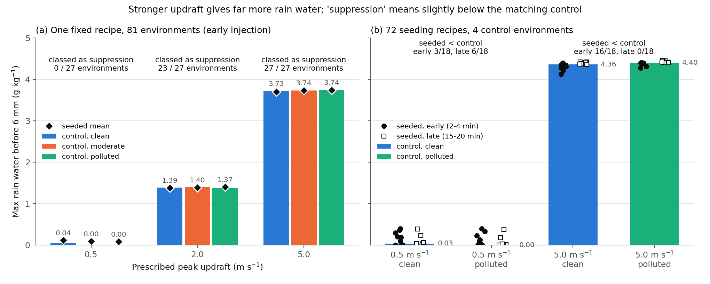
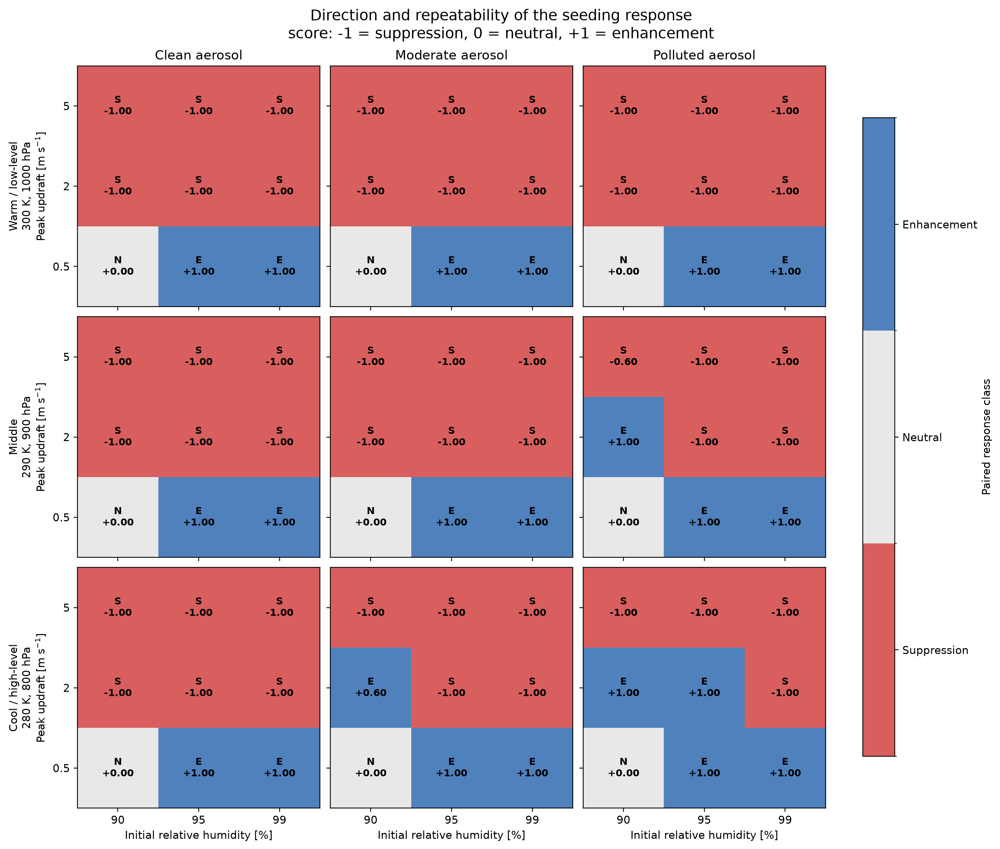
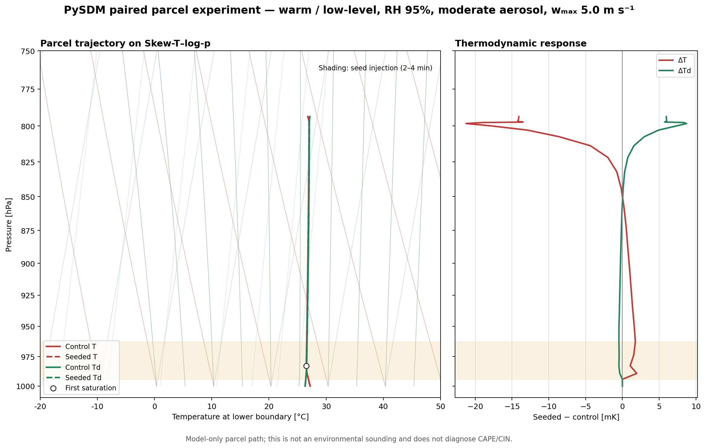

::: {.callout-note title="Provenance"}
This experiment was performed **outside PySDM-Seeding-Lab**. Separate PySDM parcel scripts written in Visual Studio Code were run in parallel with 20 workers on the laboratory server. These are not Seeding Lab results.
:::

## Question: why does the same seeding reduce rain in some clouds?

[Experiment 4](../2026-07-08-efficiency-response-surface/index.qmd) found a monotonic picture for one background and one updraft: larger κ, larger dry radius, and later injection gave a stronger response. It ended with three open items: a fair dose definition, background aerosol, and an injection coordinate tied to cloud state instead of absolute time. This experiment takes them up together with **updraft strength**.

1. What sets the **sign** of the seeding effect (enhancement or suppression): seed size, updraft, or injection timing?
2. Does "suppression" under a strong updraft mean little rain?
3. If the seed recipe is fixed and only the environment changes, what does the sign map look like?

## Design: one experiment varies the recipe, the other varies the environment

| | Recipe experiment | Environment experiment |
|---|---|---|
| Varied | background × updraft × injection timing × seed dry radius × dose | initial RH × updraft × background × thermodynamic state |
| Levels | clean 50 / polluted 1,000 mg⁻¹; peak 0.5 / 5 m s⁻¹; 2–4 / 15–20 min; 0.1 / 1 / 5 µm; low / medium / high | 90 / 95 / 99%; 0.5 / 2 / 5 m s⁻¹; 50 / 200 / 1,000 mg⁻¹; 300 K·1000 hPa / 290 K·900 hPa / 280 K·800 hPa |
| Fixed | 300 K, 1000 hPa, water vapour 22.2 g kg⁻¹ | seed dry radius 1 µm, κ 0.8, medium dose, injection at 2–4 min |
| Scenarios | 72 seeded + 4 controls | 81 environments × (seeded + control) |
| Repetitions × scenarios | 10 × 76 = **760 runs** | 5 × 162 = **810 runs** |

Common settings: a PySDM 0-D adiabatic parcel [@Bartman2022PySDM], condensation + coalescence (geometric kernel; every collision coalesces), Rogers–Yau terminal velocity, Δt 10 s, 40-min integration, 4,096 background + 2,048 seed super-droplets. The background aerosol is lognormal with mode dry radius 75 nm, σg 1.6, κ 0.5; seeds use σg 1.2, κ 0.8. **There is no sedimentation and no breakup.** Each seeded run is paired with a control through the same random seed.

### Dose was matched by dry volume

$$
N_{seed}(r_d)=N_{ref}\left(\frac{1\ \mu\text{m}}{r_d}\right)^{3},\qquad N_{ref}=1,\ 10,\ 100\ \text{mg}^{-1}
$$

$N_{seed}$ is the number of seed particles per mg of dry air, $r_d$ the seed median dry radius, and $N_{ref}$ the number at the 1 µm reference (low/medium/high). One particle's volume scales with $r_d^3$, so reducing the number as $r_d^{-3}$ keeps **the total dry volume (the amount of material) the same for every size**. Fine seeds (0.1 µm) are therefore 1,000 times more numerous than coarse seeds (1 µm), and giant seeds (5 µm) are 1/125 as numerous. This avoids the fixed-number confusion where size and dose change together.

### The updraft is a 12.5-minute pulse

$$
w(t)=w_{min}+\left(w_{peak}-w_{min}\right)\sin^{2}\!\left(\frac{\pi t}{T}\right)\quad(0\le t\le T=12.5\ \text{min}),\qquad w=w_{min}\ \ (t>T)
$$

$w_{peak}$ is the peak updraft and $w_{min}=0.025$ m s⁻¹ the very weak ascent left after the pulse. The $\sin^2$ term makes the updraft start from the minimum, peak at 6.25 min, and return to the minimum at 12.5 min. Over 40 min the parcel rises about 0.24 km at 0.5 m s⁻¹ and about 1.9 km at 5 m s⁻¹. **Early active** (2–4 min) injects while the updraft is growing; **late quiescent** (15–20 min) injects into an almost stationary parcel after the pulse.

### Metric: maximum rain water before 6 mm

Rain means drops with wet radius ≥ 40 µm. The main metric is the **difference in maximum rain-water mixing ratio before 6 mm**, $\Delta RWC_{max}$, between seeded and control runs. Without sedimentation or breakup, a large drop never leaves the parcel and keeps collecting others. All 380 strong-updraft runs of the recipe experiment saw their largest drop exceed 6 mm radius between 16 and 27 min, and by 40 min it had grown to about 3 cm radius. No weak-updraft run crossed 6 mm. Where the 6 mm number comes from is the subject of [Experiment 6](../2026-08-25-terminal-velocity-sensitivity/index.qmd). Using the whole-run maximum instead of the 6 mm cut kept the sign in 71 of 72 recipes.

The two experiments classify sign slightly differently. The recipe experiment uses the sign of the 10-member mean $\Delta RWC_{max}$; "neutral" only means neither seeded nor control produced rain. The environment experiment scores each pair +1 (enhancement), −1 (suppression), or 0 (no rain in either), and calls the 5-member mean enhancement above +0.2 and suppression below −0.2.

## Result 1. Updraft sets the amount of rain

{fig-alt="Bar chart of control maximum rain water before 6 mm by updraft and background, with seeded values as markers, for the fixed-recipe and recipe experiments"}

In the environment experiment, the clean-background control's maximum rain water before 6 mm grew from 0.04 → 1.39 → 3.73 g kg⁻¹ as the updraft went from 0.5 → 2 → 5 m s⁻¹. A parcel that rises higher simply condenses more water. "Suppression" under a strong updraft therefore does not mean a dry cloud. It means the seeded run is **slightly** below a control that already makes more than 4 g kg⁻¹ of rain water. In the recipe experiment, strong-updraft seeded − control differences ranged from −5.5% to +1.4% of the control.

## Result 2. Updraft × injection timing decided the sign

| Updraft | Injection | Mean $\Delta RWC_{max}$ (g kg⁻¹) | Enhance / neutral / suppress | ≥ 9 of 10 runs share the sign |
|---|---|---:|:---:|:---:|
| weak 0.5 m s⁻¹ | early 2–4 min | +0.136 | 12 / 3 / 3 | 15 / 15 |
| weak 0.5 m s⁻¹ | late 15–20 min | +0.059 | 9 / 3 / 6 | 10 / 15 |
| strong 5 m s⁻¹ | early 2–4 min | −0.044 | 2 / 0 / 16 | 15 / 18 |
| strong 5 m s⁻¹ | late 15–20 min | +0.024 | 18 / 0 / 0 | 14 / 18 |

The last column counts, among scenarios with a non-zero mean, those in which at least 9 of 10 repetitions had the same sign as the mean.

{fig-alt="Four panels of seeded minus control pre-6-mm rain water versus dose for weak and strong updraft and early and late injection, coloured by seed size"}

- **Strong + early:** 16 of 18 were suppression. The only exceptions were the two low-dose fine-seed cases (clean +0.035, polluted +0.003 g kg⁻¹). Fine seeds delayed rain onset by 0.7–7.8 min (Δonset > 0 = later), while giant seeds advanced onset by 1.7–5.7 min yet still ended slightly below the control maximum.
- **Strong + late:** all 18 were enhancement, but no larger than 1.4% of the control. Read the warning below.
- **Weak + early:** all 12 coarse and giant cases were enhancement. The polluted control produced no rain at all, but coarse and giant seeds did. Fine seeds removed even the weak rain of the clean control (3 suppression) and left the polluted case rainless on both sides (3 neutral).
- **Weak + late:** all 6 giant cases were enhancement; coarse and fine were small suppression or neutral.

::: {.callout-warning title="Reading the strong + late “all enhancement”"}
- **The analysis window is short.** The pre-6-mm window of the controls ends at about 18 min (clean) and 21 min (polluted), so seeds injected from 15 min have only a few minutes to affect the metric.
- **Runs already differed before injection.** Despite the shared random seed, seeded runs were not identical to the control before injection (rain-water difference at 14.5 min: clean +0.0035, polluted −0.0006 g kg⁻¹; cause not identified). The clean giant-seed low and medium doses (+0.0035, +0.0046 g kg⁻¹) are about that size, so their sign is not trustworthy.
:::

## Result 3. With the recipe fixed, the updraft almost alone set the sign

{fig-alt="Grid of effect-direction maps for 81 environments: suppression in red, neutral in grey, enhancement in blue, by relative humidity and updraft"}

| Initial RH | 0.5 m s⁻¹ | 2 m s⁻¹ | 5 m s⁻¹ |
|---|---|---|---|
| 90% | neutral 9 | enhance 3 / suppress 6 | suppress 9 |
| 95% | enhance 9 | enhance 1 / suppress 8 | suppress 9 |
| 99% | enhance 9 | suppress 9 | suppress 9 |

Of 81 environments, 22 were enhancement, 50 suppression, and 9 neutral. The 9 neutral cases are not cancelling effects: at RH 90% and 0.5 m s⁻¹ neither seeded nor control runs produced rain. The four enhancement cases at 2 m s⁻¹ all occurred at RH 90–95% with moderate or polluted backgrounds and thermodynamic states of 290 K or cooler. Changing only the background, at fixed RH and thermodynamic state, never flipped the sign at 0.5 or 5 m s⁻¹. Background aerosol adjusted the size of the effect rather than its sign.

This experiment used **early injection (2–4 min) only**. "Strong updraft = suppression" is therefore the same statement as strong + early in the recipe experiment, not a claim about late injection.

## Clean clouds start rain earlier

| Environment-experiment controls | clean 50 mg⁻¹ | moderate 200 mg⁻¹ | polluted 1,000 mg⁻¹ |
|---|---:|---:|---:|
| 0.5 m s⁻¹: environments with any rain | 3 / 9 | 2 / 9 (some runs) | 0 / 9 |
| 2 m s⁻¹: mean rain onset | 11.3 min | 16.2 min | 23.5 min |
| 5 m s⁻¹: mean rain onset | 7.4 min | 9.4 min | 12.1 min |
| 5 m s⁻¹: mean maximum rain water | 3.73 g kg⁻¹ | 3.74 g kg⁻¹ | 3.75 g kg⁻¹ |

Fewer background particles → fewer cloud droplets (recipe-experiment control maximum at 5 m s⁻¹: about 56 vs 990 cm⁻³) → the same water is shared by fewer drops, which grow faster → collision–coalescence starts earlier. At 0.5 m s⁻¹, rain formed only at RH 99%. At 5 m s⁻¹, however, the maximum rain water was nearly identical. In this parcel, a clean background made rain **sooner**, not **more**. Rain onset here is the first time rain water exceeds 10⁻⁵ g kg⁻¹, not the start of surface rainfall.

## One pair on a Skew-T: seeding barely touched the thermodynamics

{fig-alt="Skew-T log-p diagram of one paired parcel trajectory and the seeded minus control temperature and dew-point differences in millikelvin"}

The parcel rose from 1000 hPa to about 794 hPa (about 1.93 km), mostly during the updraft pulse. The seeded − control temperature difference stayed between −21 and +2 mK, only thousandths of a degree. The seeding response lives in the **drop size distribution**, not in parcel thermodynamics. Because the updraft is prescribed, even this tiny difference cannot feed back into buoyancy or ascent. In this pair the seeded run started rain one minute earlier (8.0 vs 9.0 min) but reached a 0.15% lower maximum rain water, so it sits in a "suppression" cell of the sign map. Onset time and maximum answer different questions. The diagram shows a parcel path, not an environmental sounding, so it cannot diagnose CAPE or CIN.

## What can and cannot be said

| Category | Content |
|---|---|
| Supported (sign, consistent across repetitions) | Updraft × timing sets the sign (strong + early suppression 16/18, weak + early enhancement 12/18) · with a fixed early recipe, 50 of 54 environments at 2–5 m s⁻¹ were suppression · absolute rain water is controlled by the updraft · clean backgrounds start rain earlier |
| Descriptive (magnitude) | $\Delta RWC_{max}$ values, relative changes, rankings of "strongest" conditions — convergence in super-droplet number and timestep was not checked |
| Not shown | Surface rainfall (no sedimentation) · cloud invigoration (prescribed updraft, so no latent heat → buoyancy → updraft feedback) · drops beyond 6 mm · results with collision efficiency or breakup · the suppression mechanism (vapour competition and similar ideas are hypotheses) |

::: {.review-verdict}
**Conclusion.** The sign of the seeding response was set first by the combination of updraft and injection timing, before seed size. Early injection into a strong updraft gave suppression in 16 of 18 recipes, late injection gave enhancement in all 18 (but at most 1.4% of the control), and coarse or giant seeds injected early into a weak updraft always enhanced. "Suppression" here does not mean little rain; it means slightly below a control that already rains a lot.
:::

## Next question

Every conclusion above stands on the "before 6 mm" cut. That 6 mm comes from the upper limit of a terminal-velocity lookup table, and terminal velocity enters the collision kernel directly. Does the sign pattern survive if the terminal-velocity formula changes?

[Continue to Experiment 6](../2026-08-25-terminal-velocity-sensitivity/index.qmd)

## Related material

- [All experiments](../../../experiments.qmd)

## References {.unnumbered}

::: {#refs}
:::
