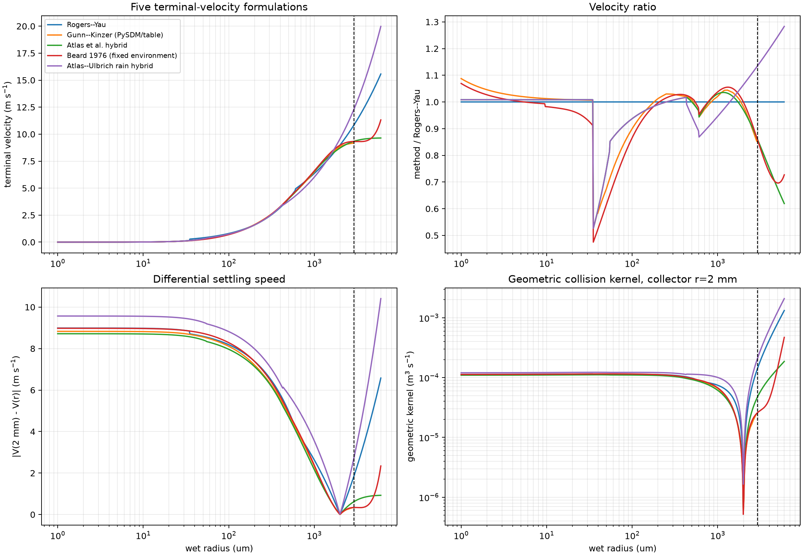
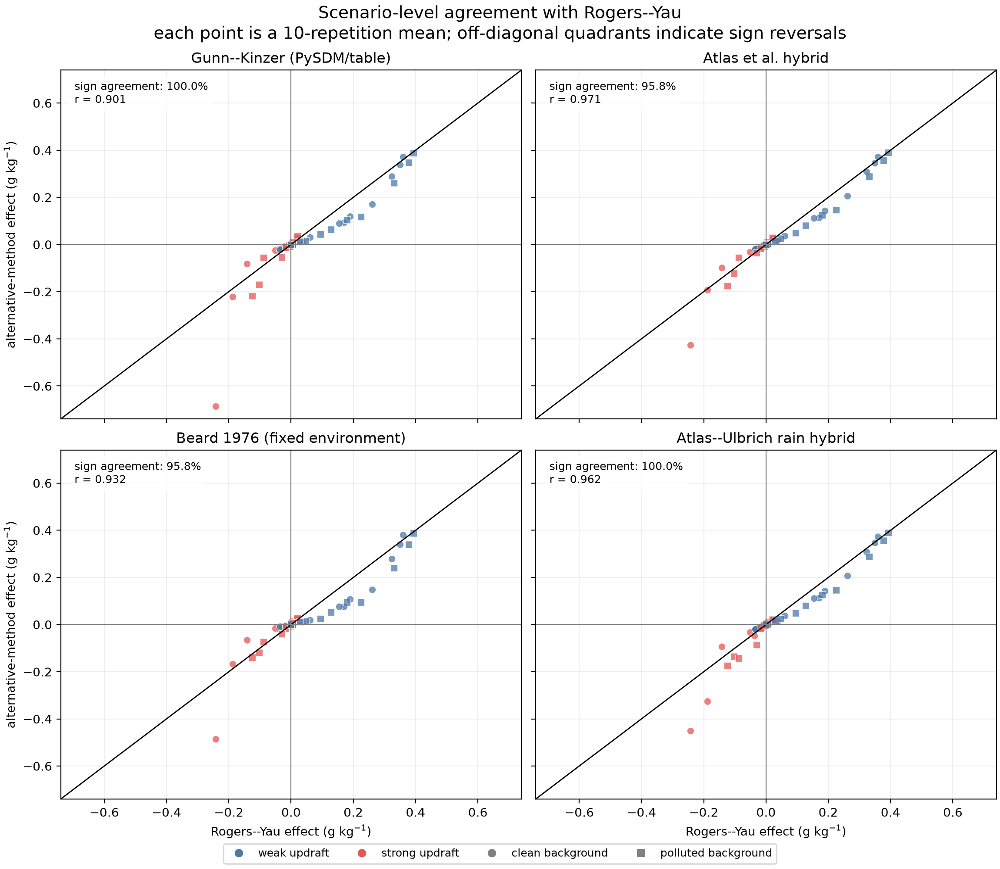
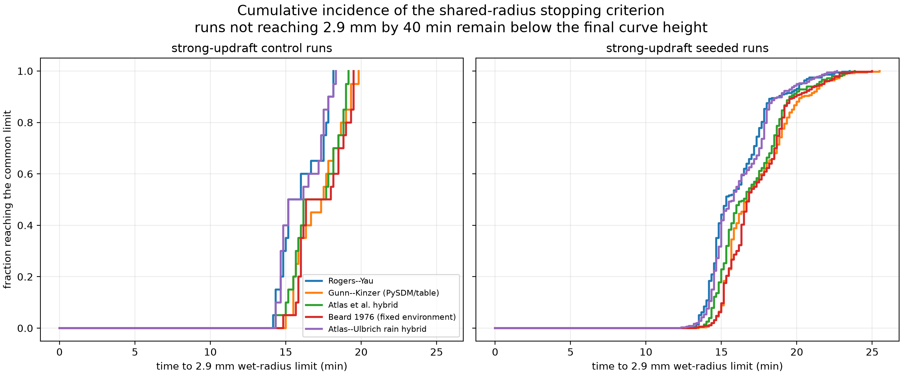

::: {.callout-note title="Provenance"}
This experiment was also performed **outside PySDM-Seeding-Lab**. Separate scripts that reuse the Experiment 5 parcel code with only the terminal-velocity formula swapped were run on the laboratory server. These are not Seeding Lab results.
:::

## Question: where does 6 mm come from, and does the conclusion lean on the formula?

Every metric in [Experiment 5](../2026-08-06-updraft-timing-regimes/index.qmd) was the maximum rain water "before the largest drop exceeds 6 mm". This experiment asks two things.

1. Is 6 mm a physical limit or a code limit?
2. If the terminal-velocity formula changes, does the sign pattern of Experiment 5 (updraft × injection timing) survive, and how much does the effect size change?

The goal is not to pick "the most accurate formula" but to see how robust the existing conclusion is to that choice.

## 6 mm was an implementation limit, not physics

Gunn and Kinzer measured the fall speed of more than 1,500 water droplets in stagnant air (760 mmHg, 20 °C, RH 50%) [@GunnKinzer1949]. The largest drop in their table has a **diameter of 5.8 mm** and falls at 9.17 m s⁻¹. A 5.8 mm diameter is a **2.9 mm radius**.

PySDM's `GunnKinzer1949` converts this table to radius, fits an RBF interpolant, evaluates it on a lookup grid for **radius 0–6 mm**, and raises a `ValueError` when an input radius exceeds 6 mm (below 40 µm radius it overrides the table with a small-drop approximation). The 2.9–6 mm radius range is therefore extrapolation, not measurement, and 6 mm is the upper bound of the code that builds the lookup table. Earlier runs used this formula, so they stopped with an error the moment a drop passed 6 mm. Experiment 5 switched to Rogers–Yau, which has no upper bound, and interpreted only pre-6-mm values.

The real problem is not the formula, though. With no sedimentation and no breakup in the parcel, a large drop keeps growing. In the strong-updraft controls of Experiment 5 the largest drop reached about 3 cm radius. Changing the terminal-velocity formula does not supply the missing physics.

::: {.callout-warning title="Radius and diameter"}
PySDM and the experiments on this blog use **radius**; the Gunn–Kinzer table uses **diameter**. "6 mm" means a 6 mm radius (12 mm diameter), and "2.9 mm" a 2.9 mm radius (5.8 mm diameter).
:::

## How terminal velocity changes collisions

$$
K_{ij}=\pi\,(r_i+r_j)^{2}\,\left|V(r_i)-V(r_j)\right|\,E_{ij}
$$

$K_{ij}$ is the collision kernel of drops $i$ and $j$: the volume the pair "sweeps out" per unit time. $\pi(r_i+r_j)^2$ is the collision cross-section, a circle whose radius is the sum of both radii; $|V(r_i)-V(r_j)|$ is the difference in fall speed (differential settling); and $E_{ij}$ is the collision efficiency, set to 1 here. A different $V(r)$ changes the speed difference between a large collector drop and small droplets, and therefore directly changes the rate of collision–coalescence.

The baseline Rogers–Yau formula uses a different power law in each radius range.

$$
V_{RY}(r)=\begin{cases}k_1 r^{2} & r<35\ \mu\text{m}\\ k_2\, r & 35\ \mu\text{m}\le r<0.6\ \text{mm}\\ k_3\, r^{1/2} & r\ge 0.6\ \text{mm}\end{cases}
\qquad k_1=1.19\times10^{8}\ \text{m}^{-1}\text{s}^{-1},\ k_2=8\times10^{3}\ \text{s}^{-1},\ k_3=201\ \text{m}^{1/2}\text{s}^{-1}
$$

Small drops are in the Stokes regime, so speed scales with $r^2$; medium drops scale with $r$; large drops with $\sqrt{r}$. The last branch has no upper bound and reaches 15.6 m s⁻¹ at 6 mm radius. In the Gunn–Kinzer measurements, by contrast, fall speed barely increases beyond 9.1–9.2 m s⁻¹ once the diameter exceeds 5 mm.

## Five formulas and the design

| Formula | Form | Implementation here | $V$ at $r$ = 2.9 mm |
|---|---|---|---:|
| Rogers–Yau | Piecewise power law (above) | PySDM default, Experiment 5 baseline | 10.82 m s⁻¹ |
| Gunn–Kinzer (1949) | Observation table | PySDM's RBF lookup table | 9.17 m s⁻¹ |
| Atlas et al. (1973) hybrid | $V=9.65-10.3\,e^{-0.6D_{mm}}$ (diameter ≥ 0.86 mm) | Spliced to small-drop branches for this study | 9.33 m s⁻¹ |
| Beard (1976) fixed | Physical formula with three flow regimes | Air properties fixed at the initial 300 K·1000 hPa | 9.32 m s⁻¹ |
| Atlas–Ulbrich (1977) hybrid | $V=3.78\,D_{mm}^{0.67}$ (diameter ≥ 0.86 mm) | Spliced to small-drop branches for this study | 12.27 m s⁻¹ |

$D_{mm}$ is the diameter in mm. The two Atlas variants are not the original formulas applied over the full size range; they are comparison splices built for this study. The Beard formula is not coupled to the parcel's changing temperature and pressure.

{fig-alt="Four panels comparing five terminal-velocity formulations: velocity, ratio to Rogers-Yau, differential settling speed against a 2 mm collector, and geometric collision kernel versus wet radius"}

The experiment reuses the Experiment 5 recipe design (76 scenarios × 10 repetitions) and changes only the formula: 5 × 760 = **3,800 runs**, with zero errors. To compare all five formulas inside the observed range, each run stopped when its largest drop reached a radius of **2.9 mm**. The main metric is $\Delta RWC_{max}$ (seeded − control difference in maximum rain water) before that common limit.

## Result 1. The sign barely changed

| Formula | Mean $\Delta RWC_{max}$ (g kg⁻¹) | Median | Share positive | Sign agreement with Rogers–Yau | RY mean / this mean |
|---|---:|---:|---:|:---:|---:|
| Rogers–Yau | +0.0352 | +0.0006 | 56.9% | — | 1.0 |
| Gunn–Kinzer | +0.0183 | +0.0016 | 56.9% | 72 / 72 | 1.9 |
| Atlas hybrid | +0.0266 | +0.0001 | 52.8% | 69 / 72 | 1.3 |
| Beard fixed | +0.0224 | +0.0008 | 55.6% | 69 / 72 | 1.6 |
| Atlas–Ulbrich hybrid | +0.0222 | +0.0024 | 56.9% | 72 / 72 | 1.6 |

{fig-alt="Four scatter plots of scenario-mean seeding effects from alternative terminal-velocity formulas against Rogers-Yau, with sign agreement of 95.8 to 100 percent"}

Sign agreement was 95.8–100%. Yet the median is close to zero for every formula and only about half of the scenarios are positive. The mean is positive because a few weak-updraft coarse and giant cases pull it up; it does not mean that rain increased in most conditions.

Recounting the Experiment 5 regime table for each formula (enhance / neutral / suppress):

| Regime | Rogers–Yau | Gunn–Kinzer | Atlas hybrid | Beard fixed | Atlas–Ulbrich |
|---|:---:|:---:|:---:|:---:|:---:|
| weak + early | 12 / 3 / 3 | 12 / 3 / 3 | 12 / 3 / 3 | 12 / 3 / 3 | 12 / 3 / 3 |
| weak + late | 9 / 3 / 6 | 9 / 3 / 6 | 9 / 3 / 6 | 10 / 3 / 5 | 9 / 3 / 6 |
| strong + early | 2 / 0 / 16 | 2 / 0 / 16 | 2 / 0 / 16 | 2 / 0 / 16 | 2 / 0 / 16 |
| strong + late | 18 / 0 / 0 | 18 / 0 / 0 | 15 / 0 / 3 | 16 / 0 / 2 | 18 / 0 / 0 |

Rogers–Yau with the 2.9 mm stop matched the sign of Experiment 5 (6 mm cut) in all 72 scenarios. The six sign disagreements (Atlas 3, Beard 3) all involved **late injection** and were no larger than 0.007 g kg⁻¹.

## But strong + late was hardly tested

{fig-alt="Cumulative distribution of the time at which strong-updraft runs reached the 2.9 mm wet-radius limit, for five terminal-velocity formulas"}

Weak-updraft runs never reached 2.9 mm with any formula and ran the full 40 min. All 380 strong-updraft runs of every formula, however, stopped at 2.9 mm between about 12 and 26 min. Late injection starts at 15 min, so the strong + late analysis window ended at a median of 15.5–16.8 min depending on the formula. With Rogers–Yau, 40% of strong + late runs stopped **before injection even began**, and three clean-background cases (coarse low, giant low, giant medium) gave exactly the same value, +0.0006 g kg⁻¹, despite different seed sizes and doses. The run ended before the seeds could reach the metric. The strong + late row above therefore cannot test the "strong + late enhancement" of Experiment 5. What this experiment actually checks is the two weak rows and strong + early.

## Result 2. Magnitudes differed by formula

- The overall mean from Rogers–Yau was **1.3–1.9 times** that of the other formulas. Rogers–Yau produced the largest enhancement under weak updraft and the weakest suppression for strong + early.
- The most formula-sensitive condition was clean · strong · early · fine · medium. All five formulas gave suppression, but its size ranged from −0.24 (Rogers–Yau) to −0.69 g kg⁻¹ (Gunn–Kinzer), about a 2.8-fold spread.
- The most robust condition was polluted · weak · early · giant · high, at +0.387 to +0.393 g kg⁻¹ for all five formulas.

The terminal-velocity formula affected the **size** more than the sign. This is one more reason to read the magnitudes of Experiment 5 as descriptive only.

## Which formula should be the baseline?

| Role | Formula | Reason |
|---|---|---|
| Main baseline | Gunn–Kinzer | Observation-based, 72/72 sign agreement with Rogers–Yau, most conservative mean effect |
| Reproducing earlier results | Rogers–Yau | Same formula as Experiments 4–5 |
| Physical sensitivity | Beard fixed | Physical formula with separate flow regimes |
| Range diagnostics | Atlas hybrids | Spread of large-drop speed assumptions |

This is an operational choice, not an accuracy test. Nothing was compared against observations, so a smaller mean does not make Gunn–Kinzer more accurate. Choosing Gunn–Kinzer also keeps the 6 mm radius ceiling (2.9 mm within the observed range). Actually removing the ceiling needs sedimentation/removal and breakup.

## What can and cannot be said

| Category | Content |
|---|---|
| Supported | 6 mm is the ceiling of PySDM's lookup table (the observations end at 2.9 mm radius) · all five formulas give strong + early suppression 16/18 and weak + early enhancement 12/18 · scenario sign agreement of 95.8–100% |
| Descriptive | The 1.3–1.9-fold spread in mean effect and the ~2.8-fold spread in the sensitive condition — unconverged, and the mean is pulled by a few conditions |
| Not shown | Robustness of strong + late (mostly cut off by the common stop) · which formula best matches observations · growth beyond 2.9 mm · results with sedimentation or breakup |

::: {.review-verdict}
**Conclusion.** Across five terminal-velocity formulas, strong + early suppression (16/18) and weak + early enhancement (12/18) stayed the same, and scenario signs agreed with Rogers–Yau in 95.8–100% of cases. The mean effect size, however, differed by a factor of 1.3–1.9, and strong + late was effectively untested because of the 2.9 mm common stop. The terminal-velocity formula is an uncertainty axis for magnitude more than for sign.
:::

## Next question

So far I have checked robustness inside designs I chose myself. Next, the same 0-D parcel is held against a published study. Ren et al. (2025) showed in a 2-D bin model that rainfall switches from suppression to enhancement as the size of equal-mass seeds grows [@Ren2025ParticleSize]. The paper reports seed size as **diameter**, so units must be matched carefully against my radius-based experiments.

[Continue to Experiment 7](../2026-09-07-ren2025-parcel-replication/index.qmd)

## Related material

- [All experiments](../../../experiments.qmd)

## References {.unnumbered}

::: {#refs}
:::
