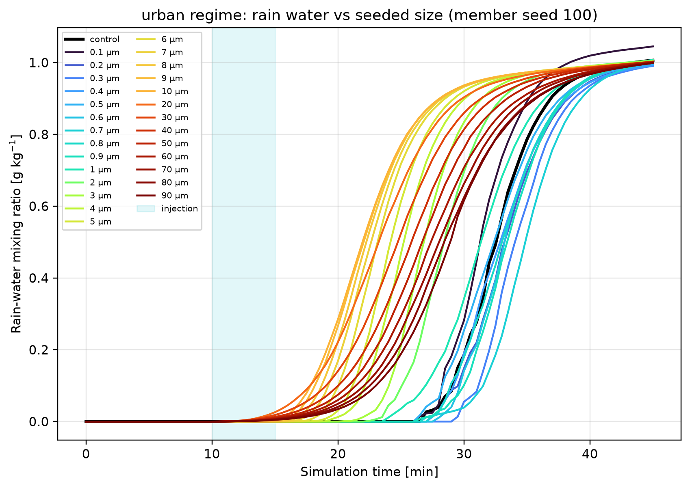
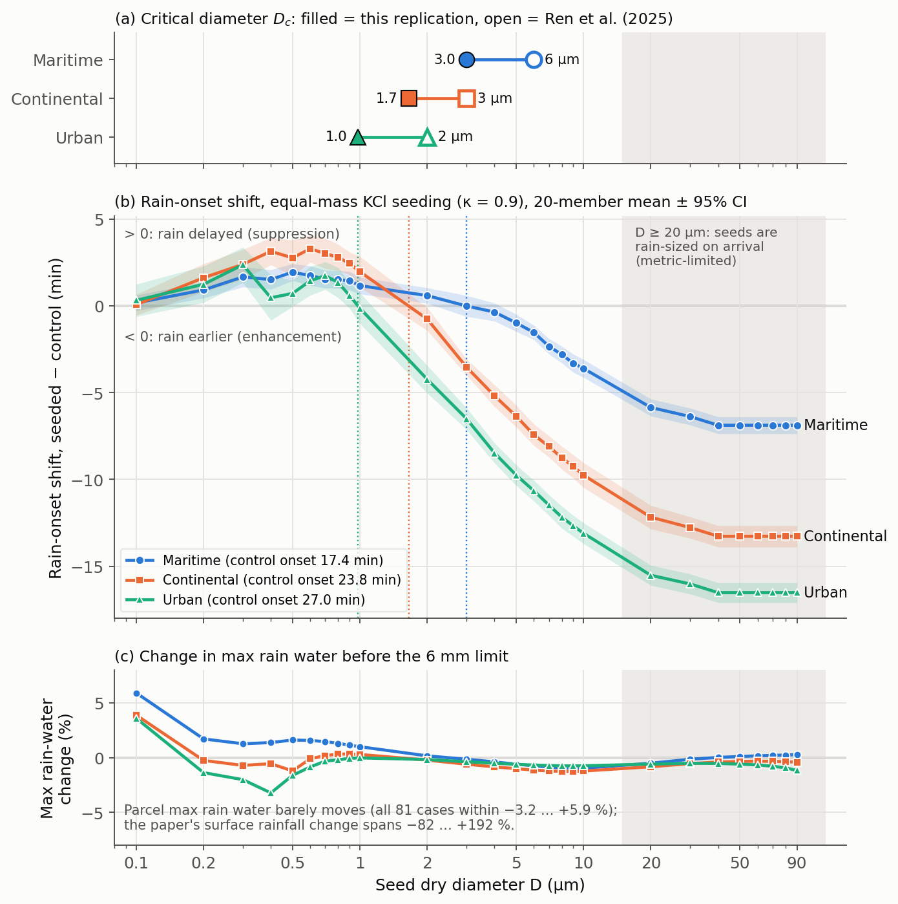

::: {.callout-note title="Provenance"}
This experiment was performed **outside PySDM-Seeding-Lab**. It is a paper replication run with separate PySDM parcel scripts on the laboratory server, and the results were presented as supplementary material at a lab meeting. It is not reported as a Seeding Lab result.
:::

## Question: does the paper's size effect survive a change of model?

Ren et al. (2025) simulated a warm convective cloud with a 2-D slab-symmetric bin-microphysics model and, **holding the total seeding mass fixed**, varied only the diameter of KCl particles across 27 values between 0.1 and 90 µm [@Ren2025ParticleSize]. Their conclusion has three steps. Submicron seeds (0.1–0.9 µm) suppress precipitation, the response turns from suppression to enhancement within 1–9 µm, and seeds of 10 µm and larger enhance rainfall. The **critical diameter $D_c$** at which the sign changes **shrinks as the background becomes more polluted** (about 6 µm maritime, 3 µm continental, 2 µm urban). The paper itself is summarized in the [Ren et al. (2025) review](../../article-review/2026-09-10-ren2025-particle-size/index.qmd).

This experiment asks one question: **if 2-D dynamics and sedimentation are removed and the bin scheme is replaced by the super-droplet method in a 0-D parcel, do the suppression-to-enhancement transition and the ordering of $D_c$ still appear?** If they do, the mechanism is robust to model class; if not, 2-D dynamics or sedimentation are needed to set the sign. Either outcome is a result. Matching the paper's surface-rainfall numbers was never the goal.

## What was matched and what was approximated

| Item | Ren et al. (2025) | This replication (v1) |
|---|---|---|
| Seed size | 27 monodisperse **diameters**, 0.1–90 µm | Same 27 diameters |
| Seed number | Equal-mass constraint | Same equal-mass law (checked against the paper's Table 2 in code) |
| Seed material | KCl | κ = 0.9 |
| Background CCN | (NH₄)₂SO₄, Jaenicke 3-mode | κ = 0.61, single lognormal |
| Injection | 10 min, cloud base, 5 pulses 60 s apart | Spread evenly over a 10–15 min window |
| Dynamics | 2-D, thermal bubble, 40 min | 0-D adiabatic parcel, prescribed updraft, 45 min |
| Thermodynamics | Sanya radiosonde | 300 K, 1000 hPa, 22.2 g/kg vapour (RH about 97.5%) |
| Collisions | Bin collision–coalescence + breakup | SDM `Geometric` kernel, efficiency 1, no breakup |
| Precipitation metric | Accumulated surface rainfall change (%) | **Shift in rain-onset time** |
| Repetition | One deterministic run | 20-member paired ensemble |

The equal-mass constraint reduces to one equation.

$$
N(D) = 5.4508\times10^{5}\left(\frac{0.1}{D}\right)^{3}\ \text{cm}^{-3}
$$

Read aloud: "seed number concentration is inversely proportional to the cube of the diameter." $N$ is the seed number concentration, $D$ the dry diameter in µm, and 0.1 and $5.4508\times10^5$ anchor the law to the paper's smallest case (0.1 µm). Because the mass of one particle scales with $D^3$, keeping $N D^3$ constant keeps the total mass constant. A tenfold larger diameter means a thousandfold fewer particles: $5.5\times10^5$ cm⁻³ at 0.1 µm, but $7.5\times10^{-4}$ cm⁻³ at 90 µm.

::: {.callout-warning title="Radius versus diameter"}
Every size axis in this post is the **dry diameter $D$**. The code is designed in diameter and converts to dry radius $= D/2$ only when passing particles to PySDM. Earlier Experiments used a dry-radius axis, so their numbers cannot be compared directly.
:::

The updraft was prescribed as $w(t)=w_{min}+(w_{peak}-w_{min})\sin^2(\pi t/15\,\text{min})$. It rises to a 1 m/s maximum and falls back during the first 15 minutes, then stays at 0.025 m/s. The background number was calibrated so that the unseeded control reaches the maximum cloud-droplet number ($N_{d,max}$) given in Section 4.5 of the paper. The KCl κ = 0.9 is a design choice; the background (NH₄)₂SO₄ κ = 0.61 is the CCN-derived value of Petters & Kreidenweis (2007) [@Petters2007Kappa]. What κ means is summarized in the [κ-Köhler review](../../article-review/2026-07-15-kappa-kohler/index.qmd). The terminal-velocity formulation was Rogers–Yau ([previous experiment](../2026-08-25-terminal-velocity-sensitivity/index.qmd)).

| Regime | Background mode radius | σ_g | Target $N_{d,max}$ | Control $N_{d,max}$ | Control rain onset |
|---|---:|---:|---:|---:|---:|
| Maritime | 90 nm | 1.8 | 120 cm⁻³ | 123.7 cm⁻³ | 17.4 min |
| Continental | 70 nm | 1.9 | 450 cm⁻³ | 448.7 cm⁻³ | 23.8 min |
| Urban | 55 nm | 2.0 | 1,400 cm⁻³ | 1,423.5 cm⁻³ | 27.0 min |

The run set was 3 regimes × (1 control + 27 seeded) × 20 members = **1,680 runs**, all of which completed. Super-droplet numbers were 4,096 for the background and 2,048 for seeds, and every seeded run was paired with its control through the same random seed (100–119). PySDM and the SDM follow [@Bartman2022PySDM; @Shima2009SDM].

## Why rain-onset time instead of rain amount?

A 0-D parcel has no sedimentation, no precipitation removal, no entrainment, and no finite cloud lifetime. Given enough time, nearly all condensate ends up as rain water, and large drops keep growing because there is no breakup. The analysis was therefore limited to the period before any drop exceeds a 6 mm radius (the upper limit of PySDM's Gunn–Kinzer table). The weak 1 m/s updraft peak was chosen for the same reason: in design-stage calibration, stronger updrafts let the control convert almost all condensate into rain, leaving seeding no room to act. This choice compensates for missing loss processes; it does not reproduce the paper's dynamics.

{fig-alt="Urban-regime rain-water mixing ratio time series for control and 27 seed diameters; all curves saturate near 1 g/kg while their rise times differ by up to about 16 minutes"}

As the figure shows, the control maximum rain water saturated at 0.99–1.01 g/kg in all three regimes. Across the 81 seeded cases, the maximum rain-water change was only −3.2 to +5.9%, which is not an axis that can be compared with the paper's surface-rainfall change (−82 to +192%). The paper's percentages are meaningful because the 2-D model removes falling drops to the ground.

By contrast, **when rain begins** clearly depended on seed size. The primary metric was therefore defined as follows.

- Rain onset $t_{onset}$: first time the rain-water mixing ratio of drops with wet radius ≥ 40 µm exceeds $10^{-8}$ kg/kg (30 s output interval)
- $\Delta t_{onset} = t_{onset}^{seeded} - t_{onset}^{control}$, computed between runs that share a random seed
- **Sign convention: $\Delta t_{onset} > 0$ is a delay = suppression direction; $\Delta t_{onset} < 0$ is earlier rain = enhancement direction**
- Critical diameter $D_c$: the diameter where the mean $\Delta t_{onset}$ turns from positive to negative, interpolated linearly in $\log D$

Earlier onset does not mean more rain. The metric is a proxy that asks whether the response points in the same **direction** as the paper's sign.

## Result 1. The sign transition and the ordering of $D_c$ reproduced

{fig-alt="Three-panel figure: critical diameters of the replication versus the paper for three regimes; rain-onset shift versus seed diameter crossing zero near 3.0, 1.7 and 1.0 micrometres; and nearly flat max rain-water change"}

| Regime | Replication $D_c$ | Paper $D_c$ | Ratio | Largest submicron delay | At 10 µm |
|---|---:|---:|---:|---:|---:|
| Maritime | ≈ 3.0 µm | ≈ 6 µm | 0.50 | +2.0 min | −3.6 min |
| Continental | ≈ 1.7 µm | ≈ 3 µm | 0.55 | +3.3 min | −9.8 min |
| Urban | ≈ 1.0 µm | ≈ 2 µm | 0.49 | +2.4 min | −13.1 min |

In all three regimes, small seeds delayed rain slightly and large seeds brought it forward substantially. Each curve crossed zero once, and $D_c$ decreased in the order maritime > continental > urban. **The ordering and direction match the paper; the values are consistently about 0.5 times smaller.** The causes of the factor 0.5 (single-mode background, no sedimentation, idealized thermodynamics, unit collision efficiency) are hypotheses that were not tested separately. Because the diameter grid has 1 µm spacing between 1 and 10 µm, $D_c$ is uncertain by roughly one grid cell. Continental is interpolated between 1 and 2 µm, urban between 0.9 and 1.0 µm, and the maritime mean was exactly zero at 3 µm. A separate urban-only run with 50 members also gave $D_c$ of about 1.0 µm.

The flattening above 20 µm is a limit of the metric, not physics. From 40 µm upward, onset occurred at 10.5 min in all three regimes, which is the first output just after injection begins. The seeds were counted as rain the moment they arrived. Physical interpretation is therefore restricted to $D \lesssim 10$ µm, and the paper's 60 µm optimum cannot be judged by this experiment.

## Result 2. Sign agreement 78/81, strict criterion 71/81

The sign of the mean $\Delta t_{onset}$ was compared with the sign of the precipitation change in the paper's Table 2. A negative (suppression) paper value counts as agreement when $\Delta t_{onset}>0$, and a positive (enhancement) value when $\Delta t_{onset}<0$. The "strict" criterion additionally requires the 95% confidence interval to exclude zero.

| Regime | Sign agreement | Strict criterion |
|---|---:|---:|
| Maritime | 25/27 | 23/27 |
| Continental | 27/27 | 26/27 |
| Urban | 26/27 | 22/27 |
| **Total** | **78/81** | **71/81** |

All three mismatches sit near the transition. Maritime 2 µm gave a +0.6 min delay (confidence interval ±0.45 min) where Table 2 reports +0.72%. Maritime 3 µm had a mean of exactly zero and was not counted as agreement. Urban 1 µm gave −0.1 min (±0.9 min), effectively zero, where Table 2 reports −4.78%. The 7 further cases dropped by the strict criterion were 0.1 µm in all three regimes, urban 0.4, 0.5, and 0.9 µm, and maritime 4 µm, where the mean shift was smaller than its confidence interval.

::: {.callout-warning title="Why the count was redone"}
The count in the lab-meeting supplementary material treated the maritime 3 µm tie as agreement and mixed in urban results from the separate 50-member run. The 78/81 and 71/81 in this post were recounted on a single 20-member set, without the tie.

Table 2 also reports the paper's main experiment set (one background). For maritime and continental, the reference sign is therefore borrowed from that set; the regime-specific comparison is the one through $D_c$. For example, the maritime 2 µm delay disagrees with Table 2 but lies below the paper's maritime $D_c$ (about 6 µm), so it points the same way as the paper's maritime result.
:::

::: {.callout-note title="Points that stood out when reading the paper"}
The paper calls the background of the Table 2 set urban in Section 3.1 but continental (C series) in Section 4.5. Its transition (1→2 µm) matches the urban $D_c$ (about 2 µm), so this replication reads it as urban. The target $N_{d,max}$ also differs between Section 2.2 (140/400/1400 cm⁻³) and Section 4.5 (120/450/1400 cm⁻³); the Section 4.5 values were used here. Parts of Section 4.5 say "critical radius", but the Figure 11 caption and the conclusions use diameter, so it is read as a diameter.
:::

## What did not reproduce

- **Rain amount.** Maximum rain water is structurally flat; the parcel has no counterpart to the paper's −82 to +192%.
- **Size dependence within the submicron range.** The paper's strongest suppression is at 0.1 µm, but in the parcel 0.1 µm gave the smallest delay (+0.1 to +0.3 min), with confidence intervals including zero in all three regimes.
- **The ultragiant optimum.** It cannot be judged because of the metric saturation described above.

## v2: switching on realistic collisions removed the transition curve

The v1 `Geometric` kernel sets collision and coalescence efficiencies to 1, which makes collisions easier than in reality. A v2 closer to the paper's bin model was therefore built. The collision kernel was either `Hydrodynamic` (collision efficiency < 1) or `Geometric`, and both variants switched on `Berry1967` coalescence efficiency and collisional breakup (`Straub2010Nf` fragmentation) [@deJong2023PySDM]. It was tested only as a preview: urban, 8 diameters, 4 members.

The outcome was a dichotomy. At every updraft tested (3 m/s for the `Hydrodynamic` variant, 1.0/1.5/2.0 m/s for the `Geometric` variant), **the control produced no rain at all.** Rain appeared only when the seeds themselves were already large (≥ 30 µm for the `Geometric` variant, ≥ 10 µm for the `Hydrodynamic` variant), and with no control onset to compare against, no transition curve could be defined. This was interpreted as the parcel lacking what lets real clouds pass the autoconversion bottleneck (long residence time, cloud depth, mixing), but that interpretation was not tested either. v2 was stopped here. In other words, **the smooth transition curve of v1 has been shown only under the unit-efficiency assumption.**

## Next step: a 1-D column

The next step is a PySDM `Kinematic1D` column with sedimentation and accumulated surface precipitation. That would, for the first time, produce a quantity of the same kind as the paper's "Precipitation Variation (%)", and show whether the control can rain with realistic collision efficiency. Coding has started, but the control column does not yet sustain cloud and rain, so there are no results. The main effort has since moved to WRF, and this work is currently paused.

::: {.review-verdict}
**Conclusion.** Even in a 0-D PySDM parcel, the diameter of equal-mass KCl seeds decided whether rain onset was delayed or advanced, and the critical diameter followed the paper's ordering, maritime ≈ 3.0 > continental ≈ 1.7 > urban ≈ 1.0 µm (paper: 6/3/2 µm). Sign agreement was 78/81 (strict 71/81). The transition, however, was shown only under unit collision efficiency, and rain amount cannot be reproduced by the parcel's structure.
:::

| Category | Content |
|---|---|
| Supported (direction) | Submicron delay / giant advance; $D_c$ shrinking with pollution |
| Descriptive (magnitude) | Size of $\Delta t_{onset}$, $D_c$ values and the factor 0.5. Convergence in super-droplet number was not checked, and the diameter grid is coarse |
| Not shown | Surface-rainfall change, the 60 µm optimum, the transition under realistic collision efficiency |

## Related material

- [Ren et al. (2025) paper review](../../article-review/2026-09-10-ren2025-particle-size/index.qmd)
- [Previous experiment: terminal-velocity sensitivity](../2026-08-25-terminal-velocity-sensitivity/index.qmd)
- [κ-Köhler theory review](../../article-review/2026-07-15-kappa-kohler/index.qmd)
- [All experiments](../../../experiments.qmd)

## References {.unnumbered}

::: {#refs}
:::
