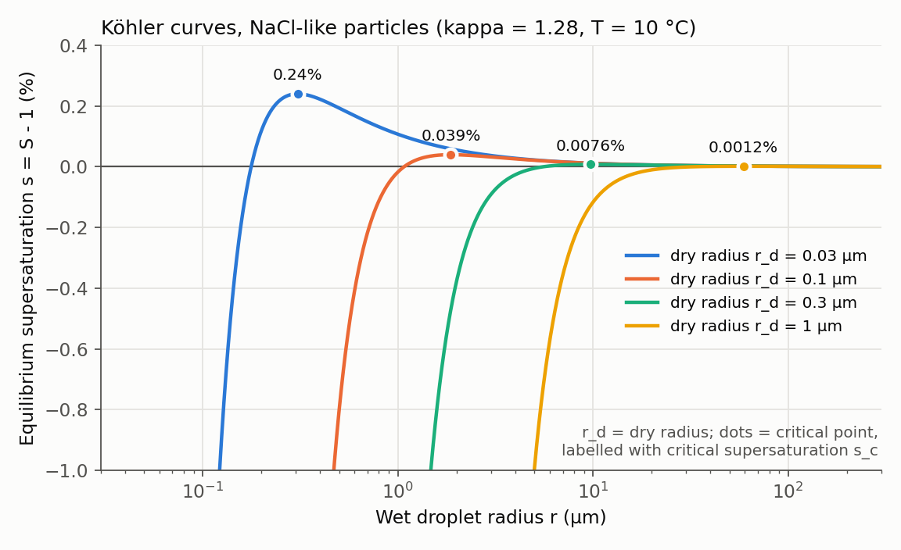
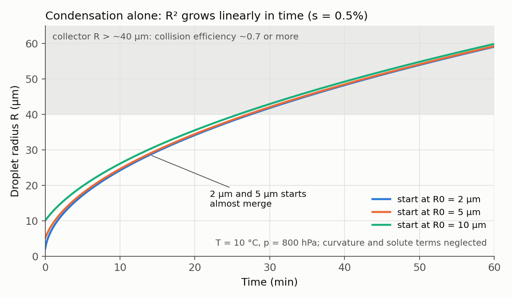

At the April lab meeting I reported, as part of my progress update, the notes I had taken on the warm-cloud part (Section 3.1) of chapter 3 (Cloud Microphysics) of Houze's *Cloud Dynamics*. This post rewrites those notes after checking them against the textbook. Equation numbers follow the second edition (2014) [@Houze2014CloudMicrophysics]. The question: **how does an aerosol particle of about 0.1 µm become a cloud droplet, how does a cloud droplet become a raindrop, and where in between does hygroscopic seeding intervene?**

::: {.review-verdict}
**Key takeaway.** Pure water droplets cannot form on their own in the atmosphere, so cloud droplets start on CCN. Condensation grows small droplets quickly but slows down as they grow ($R^2 \propto t$), while collision–coalescence only starts once a collector larger than its neighbours exists. The size gap between the two processes is the bottleneck of warm rain, and hygroscopic seeding tries either to supply large drops that jump the gap or to change the competition for vapour among droplets.
:::

## Notation and sizes first

| Symbol | Meaning | Note |
|---|---|---|
| $S = e/e_s$ | saturation ratio; $e$ is vapour pressure, $e_s$ the saturation vapour pressure over a flat surface of pure water | $S=1$ is saturation (RH 100%) |
| $s = S-1$ | supersaturation | $s=0.01$ is 1%; this is $\tilde S$ in the textbook's Eq. (3.15) |
| $R$ | droplet radius | diameter $D=2R$ |
| $r_d$ | dry radius | aerosol size before it takes up water |

| Particle | Typical size | Note |
|---|---|---|
| CCN (dry) | radius about 0.01–1 µm | the textbook says "tenths of a micron"; dry radii above 1 µm are often called giant CCN |
| Cloud droplet | 1–100 µm diameter | falls slower than 1 m s⁻¹ |
| Drizzle | 50 µm to a few hundred µm diameter | smallest liquid precipitation |
| Raindrop | a few hundred to thousands of µm diameter | fall speed levels off near 3 mm radius |

: Notation and particle sizes. The textbook's size classes are diameters; its equations use radius {.review-data}

## 1. Pure droplets cannot form on their own: the Kelvin effect

The net energy needed for vapour molecules to come together by chance into a pure-water embryo of radius $R$ is

$$
\begin{aligned}
\Delta E &= 4\pi R^2\sigma_{vl} - \tfrac{4}{3}\pi R^3 n_l\,(\mu_v-\mu_l) \\
\mu_v-\mu_l &= k_B T \ln S
\end{aligned} \tag{3.1–3.2}
$$

In words: "net cost of the embryo = cost of creating new surface − gain from molecules entering the liquid." $\sigma_{vl}$ is the work needed to create a unit area of vapour–liquid interface (surface tension), $n_l$ is the number of molecules per unit volume of the drop, and $\mu_v-\mu_l$ is the Gibbs free-energy difference for one molecule moving from vapour to liquid. If $S<1$ both terms are costs and the embryo always evaporates. If $S>1$, the surface term ($R^2$) wins at small $R$ and the volume term ($R^3$) at large $R$, creating an energy barrier. Locating its top with $\partial(\Delta E)/\partial R=0$ gives Kelvin's formula:

$$
R_c = \frac{2\sigma_{vl}}{n_l k_B T \ln S}
\tag{3.3}
$$

Embryos smaller than $R_c$ evaporate; only those that happen to exceed $R_c$ keep growing. At saturation ($S=1$), $\ln S=0$ and $R_c\to\infty$, so supersaturation is essential. Computing it at 10 °C makes the point:

| $S$ | $s$ | $R_c$ | molecules that must meet by chance |
|---:|---:|---:|---:|
| 1.01 | 1% | 0.11 µm | about $2\times10^{8}$ |
| 2 | 100% | 1.6 nm | about 560 |
| 4.5 | 350% | 0.73 nm | about 55 |

: Critical radius from Kelvin's formula (3.3) (T = 10 °C, σ = 0.072 J m⁻²) {.review-data}

According to the textbook, the homogeneous nucleation rate shoots up only when $S$ reaches about 4–5, that is, at supersaturations of 300–400%, whereas atmospheric supersaturation seldom exceeds 1%. **Homogeneous nucleation therefore plays no role in natural clouds.**

::: {.callout-warning title="Keep S and s apart"}
"1% supersaturation" means $S=1.01$ and $\ln S\approx0.01$; $\ln 1=0$ only at $S=1$ (saturation). The requirement for homogeneous nucleation should likewise be written with all three notations kept distinct: $S\approx4$–5, i.e. RH 400–500%, i.e. $s\approx$ 300–400%.
:::

## 2. Aerosol changes the starting point: the Raoult effect and the Köhler curve

Real cloud droplets form by heterogeneous nucleation, as water collects on aerosol particles. On a wettable particle, the same number of molecules gives a larger radius of curvature, so the Kelvin barrier is easier to cross. If the particle dissolves, the equilibrium vapour pressure over the solution drops below that over pure water (the Raoult effect), which helps further. The textbook therefore concludes that **the first droplets form on the largest and most soluble CCN**. Combining both effects, the equilibrium vapour density at the drop surface is

$$
\begin{aligned}
\rho_v(R) &= \rho_{vs}[T(R)]\left(1+\frac{\hat a}{R}-\frac{\hat b}{R^3}\right) \\
\hat a &= \frac{2\sigma_{vl}}{\rho_L R_v T}, \qquad \hat b = \frac{3 i_{vH} m_s M_w}{4\pi\rho_L M_s}
\end{aligned} \tag{3.18–3.20}
$$

In words: "vapour in equilibrium at the drop surface = saturation value over flat pure water × (1 + curvature correction − solute correction)." $\hat a/R$ is the Kelvin term, larger for smaller drops; $\hat b/R^3$ is the Raoult term, larger for more dissolved salt mass $m_s$, more ions per molecule (van't Hoff factor $i_{vH}$) and lighter salt molecules (molecular weight $M_s$). As the drop grows the solution dilutes and the term falls off as $R^3$.

Plotting the equilibrium saturation ratio $S_{eq}(R)\approx 1+\hat a/R-\hat b/R^3$ gives the Köhler curve. At small $R$ the solute term wins and the drop exists as a haze droplet with $S_{eq}<1$; at large $R$ the curvature term remains and $S_{eq}$ is slightly above 1. Setting $dS_{eq}/dR=0$ gives the maximum at $R_c=\sqrt{3\hat b/\hat a}$, $s_c=\sqrt{4\hat a^3/(27\hat b)}$. If the ambient supersaturation exceeds this critical supersaturation $s_c$, the drop passes $R_c$ and keeps growing: this is **activation**. In κ-Köhler theory a dilute solution has $\hat b\approx\kappa r_d^3$, so $s_c \propto r_d^{-3/2}\kappa^{-1/2}$. The full form is in my [κ-Köhler review](../../article-review/2026-07-15-kappa-kohler/index.qmd) [@Petters2007Kappa].

{fig-alt="Köhler curves for dry radii 0.03, 0.1, 0.3 and 1 micrometre with kappa 1.28; critical supersaturation falls from 0.24 percent to 0.0012 percent as dry radius increases"}

| Dry radius $r_d$ | $s_c$ (κ = 0.61, ammonium sulfate) | $s_c$ (κ = 1.28, NaCl) | $R_c$ (NaCl) |
|---:|---:|---:|---:|
| 0.03 µm | 0.35% | 0.24% | 0.31 µm |
| 0.1 µm | 0.057% | 0.039% | 1.9 µm |
| 0.3 µm | 0.011% | 0.0076% | 9.7 µm |
| 1 µm | 0.0018% | 0.0012% | 59 µm |

: Maxima of the κ-Köhler curve found numerically (T = 10 °C, σ = 0.072 J m⁻²). κ values are the CCN-derived values of Petters & Kreidenweis (2007) {.review-data}

A tenfold larger dry radius lowers $s_c$ about thirtyfold, while doubling κ only multiplies $s_c$ by about 0.7. Within this range **size controls activation more strongly than chemistry**. A giant CCN of 1 µm radius has $s_c$ of order 0.001% and activates in practically any cloud, but its $R_c$ is tens of micrometres, so it is more useful to ask "how quickly does it reach collector size" than "does it activate".

## 3. Condensational growth: small drops grow fast, large drops slowly

Activated drops grow by vapour diffusion (Fick's law). Combining steady, spherically symmetric diffusion with a heat balance gives, for a near-saturated environment, the mass growth rate

$$
\begin{aligned}
\dot m &= \frac{4\pi R\, s}{F_\kappa + F_D} \\
F_\kappa &= \frac{L^2}{\kappa_a R_v T^2}, \qquad F_D = \frac{R_v T}{D_v e_s}
\end{aligned} \tag{3.14–3.17}
$$

In words: "mass growth rate = $4\pi R$ × supersaturation ÷ (heat-conduction resistance + vapour-diffusion resistance)." $s$ is the driving force. $F_\kappa$ expresses that the latent heat ($L$) released by condensation warms the drop and raises its surface saturation vapour pressure, so the heat must be conducted away through the air ($\kappa_a$); $F_D$ expresses that vapour has to diffuse through the air ($D_v$) to reach the drop. Switching from mass to radius ($m=\tfrac43\pi R^3\rho_L$),

$$
R\frac{dR}{dt}=\frac{s}{\rho_L(F_\kappa+F_D)}\equiv G\,s \quad\Longrightarrow\quad R^2 = R_0^2 + 2Gs\,t .
$$

Some textbooks fold $\rho_L$ into the $F$ terms and write $R\,dR/dt=(S-1)/(F_k+F_d)$. The key is $dR/dt = Gs/R$: **the larger the drop, the slower its radius grows**. Small drops catch up with large ones, so condensation narrows the size distribution. For very small drops the curvature and solute terms must be kept (Eq. 3.21), and for falling drops a ventilation factor multiplies the rate (Eqs. 3.22–3.23).

{fig-alt="Droplet radius versus time for condensation growth from initial radii 2, 5 and 10 micrometres at 0.5 percent supersaturation; the curves converge and reach 40 micrometres only after roughly 26 to 28 minutes"}

| Radius growth step | s = 0.2% | s = 0.5% | s = 1% |
|---|---:|---:|---:|
| 5 → 10 µm | 3 min | 1.3 min | 0.6 min |
| 10 → 20 µm | 13 min | 5 min | 2.6 min |
| 10 → 50 µm | 1.7 h | 41 min | 21 min |
| 10 → 100 µm | 7.1 h | 2.8 h | 1.4 h |

: My calculation of condensational growth times (T = 10 °C, p = 800 hPa, $G\approx9.7\times10^{-11}$ m² s⁻¹, constant s assumed) {.review-data}

Given that a typical cumulus lives for about 30 minutes [@Bruintjes1999Review], condensation alone can hardly make drizzle or raindrops a few hundred micrometres in diameter. In a real cloud $s$ is not constant, so the table only shows orders of magnitude.

## 4. Fall speed and collision–coalescence

Cloud droplets (under 100 µm in diameter) fall slower than 1 m s⁻¹. Fall speed grows almost linearly with radius up to 500 µm, then more slowly, and levels off near 3 mm radius as the drop flattens into a horizontal disc. Drops of different sizes fall at different speeds and overtake one another. For one large drop falling through cloud droplets, the continuous collection equation is

$$
\begin{aligned}
\dot m_{col} &= A_m\,\lvert V(m)-V(m')\rvert\,\rho q_{m'}\,\Sigma_c(m,m') \\
A_m &= \pi(R+R')^2
\end{aligned} \tag{3.24–3.25}
$$

In words: "collection growth rate = volume swept per second (cross-section × relative fall speed) × cloud-water mass in that volume × fraction that actually sticks." $A_m$ is the effective cross-section based on the sum of the radii, the absolute value reflects that only relative motion matters, and $\rho q_{m'}$ is the cloud liquid water content (g m⁻³). The collection efficiency $\Sigma_c$ is **collision efficiency × coalescence efficiency**. Collision efficiency is below 1 when the airflow around the large drop carries small droplets aside, and can exceed 1 when droplets are pulled into its wake. Coalescence efficiency is the fraction of colliding pairs that actually merge; models often set it to 1, but in heavy rain colliding drops may stay together only briefly.

For $R\gg R'$, $A_m\approx\pi R^2$ and $m=\tfrac43\pi R^3\rho_L$, so $dR/dt\approx\Sigma_c\lvert\Delta V\rvert\rho q_c/(4\rho_L)$. Unlike condensation, **growth speeds up as the drop gets larger**, because fall speed and collision efficiency both increase. The problem is getting started. Reading the textbook's Fig. 3.5 (collision efficiencies from Wallace & Hobbs) by eye, a 10 µm-radius collector reaches a collision efficiency of at most about 0.05, a 20 µm collector about 0.2, and only collectors of 40 µm or more approach 0.7–1. Real collection is not continuous but probabilistic, so drops starting at the same size diverge as some happen to collide first (stochastic collection, Eqs. 3.27–3.33). In the example calculation the textbook shows, after about 30 minutes cloud droplets near 10 µm radius still dominate by number, but a large part of the water mass has moved into raindrops near 1 mm radius.

## 5. The gap between the two processes, and where seeding enters

| | Condensation | Collision–coalescence |
|---|---|---|
| Radius growth rate | $dR/dt = Gs/R$ | $dR/dt \approx \Sigma_c\lvert\Delta V\rvert\rho q_c/(4\rho_L)$ |
| As the drop grows | slows down | speeds up |
| Effect on size distribution | narrows | broadens |
| Efficient range | radius of a few µm or less | collector radius of tens of µm or more |

: Comparison of the two warm-rain growth processes {.review-data}

Between about 10 µm and a few tens of µm in radius, condensation has already slowed and collision efficiency is still small. How quickly drops cross this gap sets the onset of warm rain. The two hygroscopic seeding approaches summarized by Bruintjes (1999) target exactly this gap.

- **Embryo approach:** salt particles larger than 10 µm in diameter supply collector candidates from the start, jumping the gap.
- **Flare approach:** salt particles of about 0.5 µm diameter are released below cloud base. The large artificial CCN activate first and take up vapour, fewer natural CCN activate, and fewer droplets grow larger. This changes the competition for vapour.

The $R^2\propto t$ figure suggests one more point. Drops starting at 2 µm and 5 µm are almost the same size after 20 minutes. A slightly larger starting size is therefore quickly forgotten; my reading of the equation is that inserting drops near collector size, or reducing the number of competitors, is what makes the difference. Conversely, if small hygroscopic particles add droplets instead of replacing natural CCN, rain could be delayed. Ren et al. (2025), which I read later, reported for one convective case in a two-dimensional bin model that, at a fixed seeding mass, particles of 0.1–0.9 µm diameter suppressed precipitation and the response turned to enhancement above about 2 µm diameter [@Ren2025ParticleSize]. This question continues in my [0-D reproduction of Ren (2025)](../../experiments/2026-09-07-ren2025-parcel-replication/index.qmd).

## References {.unnumbered}

::: {#refs}
:::
