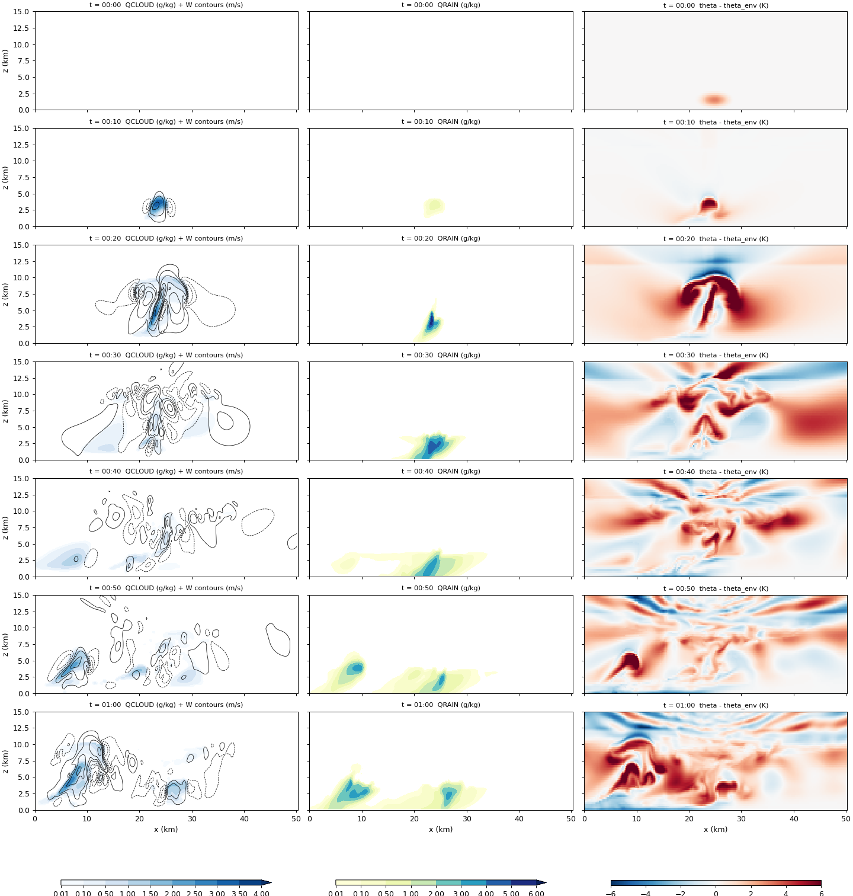
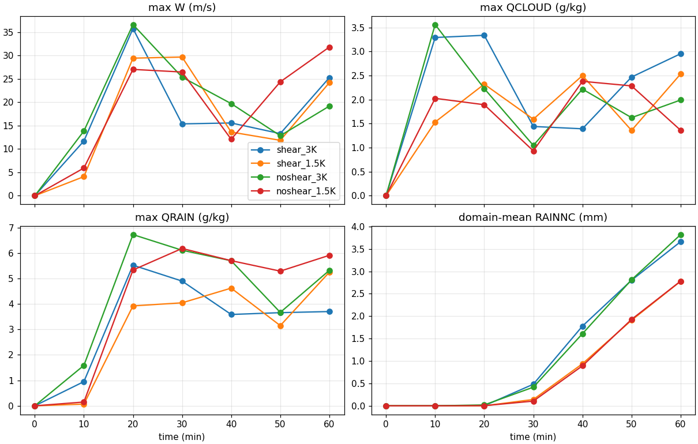
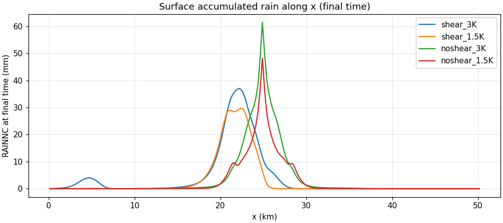
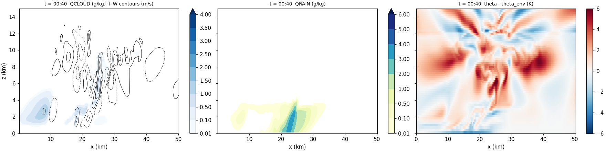
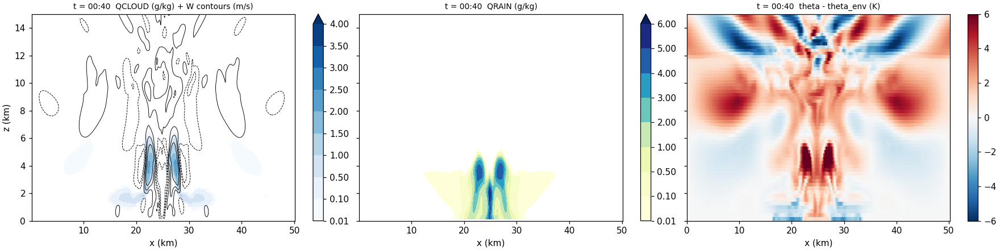
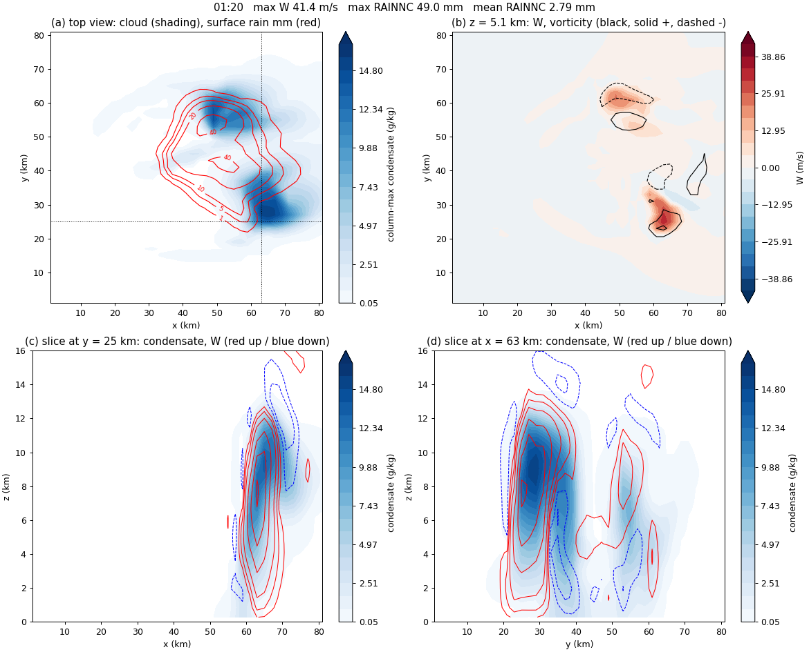
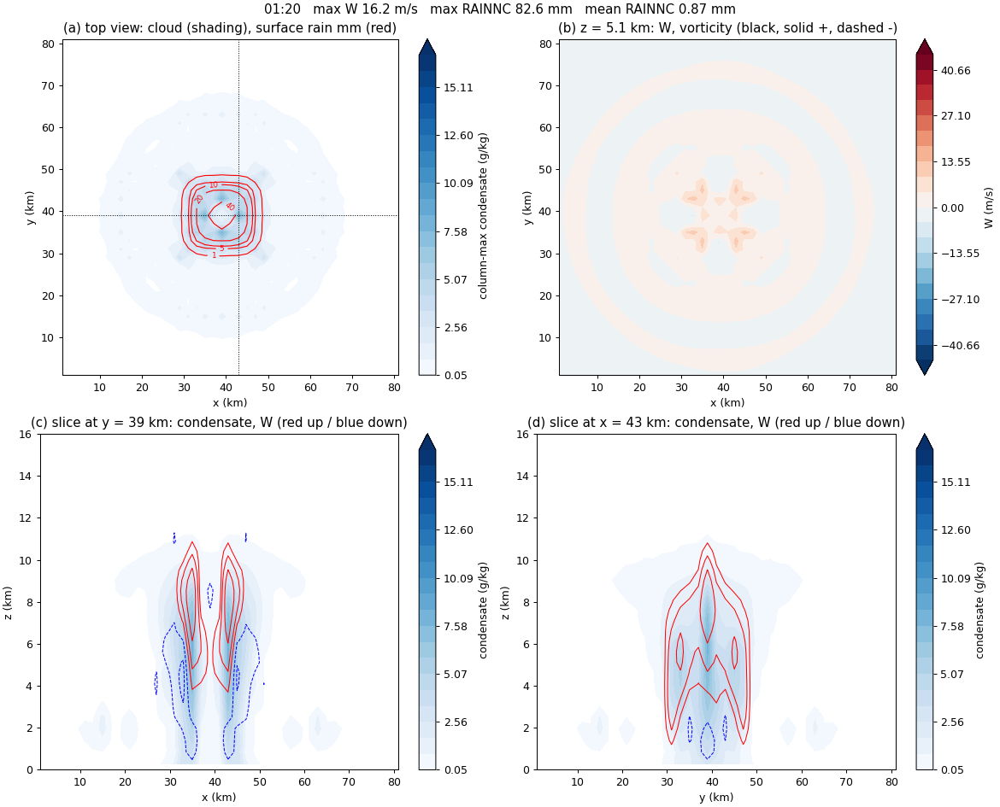

My goal is to redo the 2-D hygroscopic seeding experiment of [Ren et al. (2025)](../../article-review/2026-09-10-ren2025-particle-size/index.qmd) in WRF. That paper also builds its cloud from one sounding plus a warm bubble, an **idealized** setup, so I skipped real-case preprocessing (WPS) and started from WRF's built-in 2-D squall-line case `em_squall2d_x`. This post covers L1 (the default case on the lab server), L2 (changing wind shear and bubble strength), and a side trip to the 3-D supercell case.

## The idealized WRF workflow

```
Real case:   reanalysis → WPS → real.exe → wrfinput + wrfbdy → wrf.exe → wrfout
Idealized:   input_sounding + namelist.input → ideal.exe → wrfinput → wrf.exe → wrfout
```

| File | Role |
|---|---|
| `input_sounding` | One vertical profile (potential temperature, mixing ratio, u, v by height). `ideal.exe` copies it to every grid column |
| `namelist.input` | Grid, time, and physics options. Read by both `ideal.exe` and `wrf.exe` |
| `ideal.exe` | Adds a warm bubble to the sounding and writes the initial state `wrfinput_d01` |
| `wrf.exe` | Integrates in time and writes `wrfout_d01_*` (NetCDF) |
| `rsl.out.*`, `rsl.error.*` | One log per MPI process |
| `namelist.output` | Every setting WRF **actually applied**, including defaults I never wrote |

```bash
mpirun -np 4 ./ideal.exe
mkdir -p log_ideal; mv rsl.* log_ideal/        # move ideal.exe logs before wrf.exe overwrites them
grep -q "SUCCESS COMPLETE IDEAL INIT" log_ideal/rsl.error.0000 || echo "ideal.exe failed"
mpirun -np 4 ./wrf.exe
tail -1 rsl.out.0000                           # SUCCESS COMPLETE WRF means success
for f in rsl.error.*; do echo "== $f"; tail -3 $f; done   # do not check only rank 0
grep -iE "mp_physics|time_step|e_sn" namelist.output       # values actually used
```

An error can appear only in another rank's log while `rsl.error.0000` looks clean (fast SBM did exactly that in the next post). And "what is the default for this option?" is answered faster by grepping `namelist.output` than by searching the docs.

## Where the 2-D case stopped as shipped

| Where | Example value → my value | Why |
|---|---|---|
| `&domains e_sn` | 3 → **10** | In an MPI (dmpar) build each process patch must be at least 10 cells in each direction, so `ideal.exe` refuses the original |
| end of `&domains` | add `nproc_x = 4`, `nproc_y = 1` | Otherwise WRF tries a 2 × 2 split and y drops below 10 cells again |
| end of `&physics` | add `ghg_input = 0` | The WRF 4.6 default (1) requires a greenhouse-gas input used with radiation; this run has radiation off |
| Compile | `./compile em_quarter_ss` instead of `./compile em_squall2d_x` | Cases with `2d` in the name are rejected for dmpar builds, after the old executables have already been deleted. `ideal.exe` picks the squall2d_x initial state at run time from `&ideal ideal_case = 4` |

Because y is periodic and the bubble is uniform in y, raising `e_sn` to 10 keeps the run 2-D; the Lin runs showed zero rain difference between y rows. Everything else is the example default: dx = 250 m with 201 columns (50 km), 80 levels (top at 20 km), dt = 3 s, 60 min, output every 10 min. Only microphysics (Lin, `mp_physics = 2`) is on; radiation, surface, boundary-layer, and cumulus schemes are off. Turbulence is 1.5-order TKE, x boundaries are open, and the top 5 km is a Rayleigh damping layer. The run took about 75 s on 4 cores.

## Initial state: Weisman–Klemp sounding and warm bubble

The temperature and humidity in the example sounding follow the Weisman–Klemp analytic sounding, a standard for convection modeling [@Weisman1982Shear]. The first line holds surface pressure 1000 hPa, potential temperature 300.5 K, and mixing ratio 14 g/kg, followed by 80 lines at 250 m spacing.

$$\theta(z) = \theta_0 + (\theta_{tr} - \theta_0)\left(\frac{z}{z_{tr}}\right)^{5/4}, \qquad \mathrm{RH}(z) = 1 - \frac{3}{4}\left(\frac{z}{z_{tr}}\right)^{5/4} \quad (z \le z_{tr})$$

Potential temperature rises slowly with the 5/4 power of height $z$, from the reference value $\theta_0 = 300$ K to the tropopause value $\theta_{tr} = 343$ K. $z_{tr} = 12$ km is the tropopause height; above it is a 213 K isothermal layer, so θ increases sharply (very stable). The lowest ~350 m is a mixed layer at a constant 300.5 K. Relative humidity falls from nearly 100 % near the surface to 25 % at the tropopause. The low-level mixing ratio is capped at 14 g/kg and stays constant up to a little above 1 km. In short: **moist low levels, a conditionally unstable troposphere, and a lid at 12 km**. Checking against the file: at 375 m, $300 + 43 \times (375/12000)^{5/4} = 300.565$ K, which matches.

Wind has linear shear only in 0–2.5 km: $u(z) = -12 + 12\,z/2500$ m/s (zero above 2.5 km). The first level (125 m) has u = −11.4 m/s. What matters physically is not the absolute value but the **12 m/s difference with height**.

The warm bubble is hard-coded in `dyn_em/module_initialize_ideal.F`, not set in the namelist.

| Item | Value |
|---|---|
| Strength (central θ perturbation) | +3 K (`delt = 3.`) |
| Center | middle of the domain, 1.5 km height |
| Radius | 4 km horizontal, 1.5 km vertical (falls to zero at the edge) |

Changing the bubble strength therefore means editing the source and rebuilding `ideal.exe`. To revert, copying the old file back does not work, because its old modification time makes `make` skip recompiling; I reverted the value with `sed` instead.

## Experiment design

All runs use Lin, dt = 3 s, 60 min, and change one thing at a time.

| Run | Sounding wind | Bubble | What it was meant to check |
|---|---|---|---|
| L1 | as shipped (shear) | +3 K | Does the example reproduce on the server? |
| L2A | u = v = 0 (no shear) | +3 K | Does shear change how much rain falls, or where? |
| L2B | shear | +1.5 K | If the trigger is halved, does rain drop too? |
| L2B-noshear | u = v = 0 | +1.5 K | What happens when both change (completes the 2 × 2)? |

## L1: one hour of the default squall line

| Time | Max W (m/s) | Max cloud water (g/kg) | Max rain water (g/kg) | Point-max accumulated rain (mm) |
|---|---:|---:|---:|---:|
| 10 min | 11.7 | 3.29 | 0.95 | 0.00 |
| 20 min | 35.8 | 3.34 | 5.53 | 0.04 |
| 30 min | 15.4 | 1.44 | 4.90 | 8.94 |
| 60 min | 25.3 | 2.95 | 3.70 | 37.02 |

{fig-alt="L1 em_squall2d_x with Lin microphysics: x-z sections of cloud water with vertical velocity contours, rain water, and potential temperature perturbation every 10 minutes from 0 to 60 minutes"}

At 0 min there is only the warm bubble near 1.5 km. By 10 min a cloud forms at 2.5–5 km; at 20 min the updraft peaks at 35.8 m/s and reaches the 12 km tropopause. Surface rain starts between 20 and 30 min (the 10-min output interval only allows "between"). After rain reaches the ground, cold air (negative θ perturbation) spreads near the surface, and after 40 min a new cloud grows on the west side (x ≈ 5–10 km). The numbers matched the example's reference values, so I trusted the server setup and moved on.

## L2: switching off shear, weakening the bubble

| 60 min, domain mean / point max | Bubble +3 K | Bubble +1.5 K |
|---|---|---|
| With shear | 3.66 / 37.0 mm | 2.78 / 29.7 mm |
| No shear | 3.82 / 61.5 mm | 2.78 / 48.3 mm |

The table and figures come from re-aggregating all four runs with the same comparison script in late October. That re-aggregation corrected some of my first interpretations (for example, of rain onset time).

{fig-alt="Time series of maximum vertical velocity, maximum cloud water, maximum rain water, and domain-mean accumulated rain for four runs: shear or no shear, with 3 K or 1.5 K warm bubble"}

{fig-alt="Surface accumulated rain along x at 60 minutes for the four L2 runs; no-shear runs peak sharply near x = 25 km while shear runs peak near x = 22 km"}

**Shear changed location and concentration more than amount.** The domain mean changed by only −4 % (3 K) and 0 % (1.5 K) between shear and no shear. Without shear, the cloud stayed upright over the bubble center, so the same amount of rain fell in one place (x ≈ 25 km) and the point maximum was about 1.6 times larger. With shear, the cloud tilted and the rain shifted toward x ≈ 22 km. "Shear spreads rain wider" held only at 3 K (width with ≥1 mm: 14.8 vs 11.0 km at 3 K, 9.0 vs 10.5 km at 1.5 K).

{fig-alt="L1 with wind shear at 40 minutes: tilted updraft and rain shaft, new cloud forming on the west side"}

{fig-alt="L2A without wind shear at 40 minutes: cloud, rain, and temperature perturbation are left-right symmetric about the domain center"}

**Bubble strength changed the total.** Going from +3 K to +1.5 K reduced the domain mean by 24 % (shear) and 27 % (no shear), and the point maximum by about 20 %. The 10-min updraft started more slowly (4–6 m/s instead of 12–14 m/s), and the 30-min domain mean was only a third to a quarter as large (0.48 → 0.14 and 0.42 → 0.10 mm). Surface rain onset, however, could not be separated within the 10-min output interval.

::: {.callout-warning title="The first 1.5 K run had no wind"}
When I first ran the 1.5 K case, I thought I had used the sheared sounding, but the cloud came out left–right symmetric. Opening `input_sounding` showed u = 0 everywhere. The WRF example file itself had been changed to u = 0, so "copying again from the original" still gave a windless sounding. I restored the original sounding (second line u = −11.4 m/s) and re-ran; that is the "with shear + 1.5 K" entry above. When re-aggregating, I confirmed the bubble strength and wind of all four final runs from the wrfout initial fields. Since then I check **content**, not file names: `sed -n 2p input_sounding`, and `diff namelist.input` against the reference run.
:::

## Side trip: what shear does in a 3-D supercell

To learn how to look at 3-D output and what differs from 2-D, I ran the 3-D example `em_quarter_ss` (Kessler, dx = 2 km, a roughly 80 km square domain, 120 min) with its example namelist and sounding, and compared it with a run in which only the sounding's u and v were set to zero. The executables were already built as `em_quarter_ss`, so no recompilation was needed.

| 120 min | With shear (example) | No wind (u = v = 0) |
|---|---|---|
| Max W | ~41–43 m/s sustained over 40–100 min | 45 m/s peak at 20 min → 21 m/s at 40 min |
| Max vorticity at 5 km | ~0.01 s⁻¹ from 20 min | ≤ ~0.002 s⁻¹ |
| Storm shape | splits north–south, moves east | stationary, no split |
| Surface rain | V-shaped two-branch swath, point max ~80 mm | central circle + outer ring, point max ~100 mm |
| Domain-mean rain | ~9.7 mm | ~2.2 mm |

{fig-alt="3-D quarter-circle shear supercell at 80 minutes: split storms with a V-shaped rain swath, updrafts overlapping positive and negative vertical vorticity at 5.1 km"}

{fig-alt="3-D no-wind run at 80 minutes: stationary storm with circular rain pattern at the domain center and a ring of weak cells, no significant vorticity"}

During the first 20 min the windless run was actually stronger: with shear the updraft tilts and mixes with the crosswind, so it starts more slowly. Without wind, however, rain fell straight onto the updraft and shut it down within 40 min, a single-cell life cycle. Shear did not make the storm "strong early" but **"long-lived and wide"**, and the domain-mean rain was about four times larger. The octagonal ring in the windless run is an imprint of the square grid. A 2-D cloud is an infinitely long band in y, so its vertical vorticity is zero by construction, and "domain mean" means different things in 2-D and 3-D, so I do not compare them directly.

::: {.review-verdict}
**Conclusion.** In this 2-D squall line (Lin, 60 min, single runs), wind shear changed **where and how concentrated** the rain was, while bubble strength changed the **total** rain. In 3-D, shear made the storm rotate and persist, changing the total as well.
:::

## Open questions

- I did not check why total 2-D rain is almost the same with and without shear. Each setting was run once, with Lin only and 10-min output, so onset times are coarse.
- Lin is single-moment and has no droplet number or CCN. Seeding needs a different microphysics scheme → [next post: microphysics comparison and fast SBM](../2026-09-29-microphysics-fsbm/index.qmd)

## References {.unnumbered}

::: {#refs}
:::
