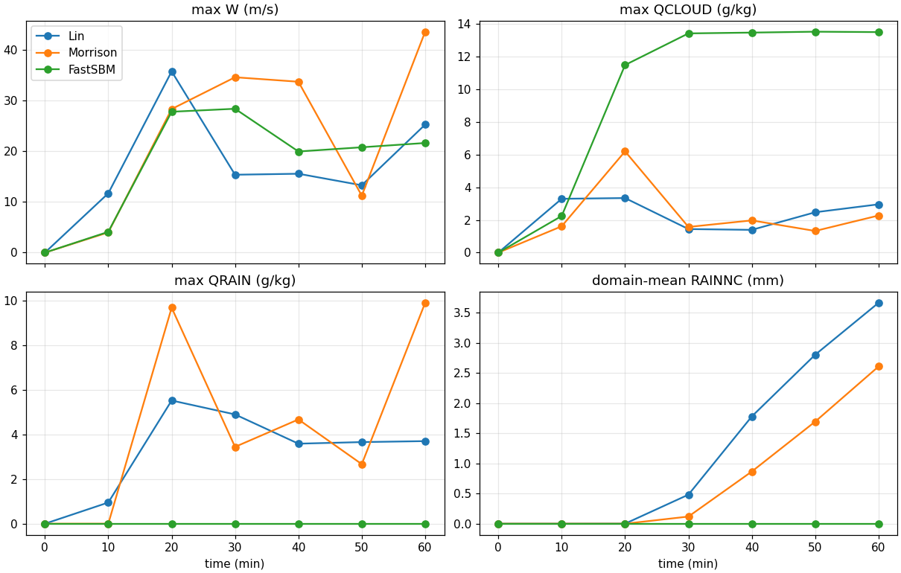
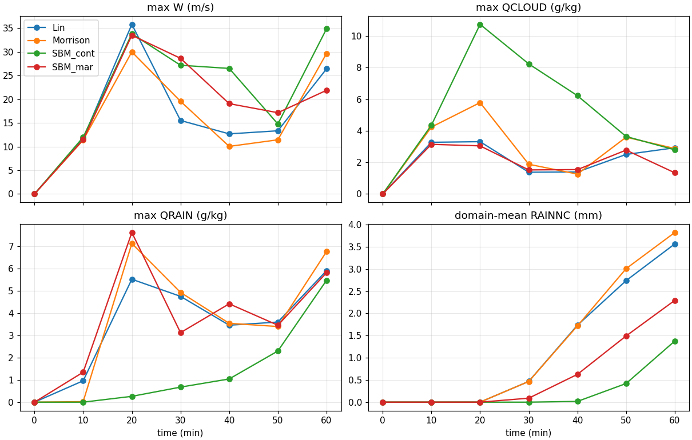
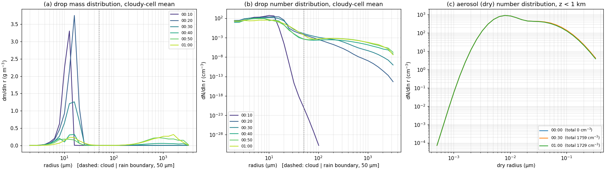
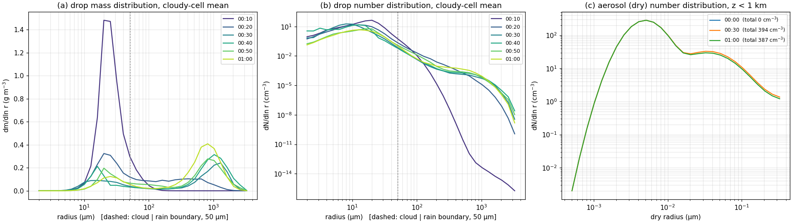

Lin, used in the [previous post](../2026-09-27-idealized-squall-line/index.qmd), is a single-moment scheme with no droplet number and no CCN, so it cannot represent an experiment that "changes the aerosol size distribution", such as hygroscopic seeding. Seeding needs bin microphysics with aerosol bins, so I chose WRF's fast SBM (`mp_physics = 30`). First, I ran the same squall line with Lin → Morrison → fast SBM to see how the schemes differ, and finally changed only the fast SBM background aerosol to maritime. Along the way I hit a bug that appears only when fast SBM is used in 2-D.

## How the three schemes differ

| | Lin (2) | Morrison (10) | fast SBM (30) |
|---|---|---|---|
| Predicts | mass per hydrometeor (single-moment) | mass + number (double-moment) | size distribution in bins |
| Droplet number | none | fixed at the default 250 cm⁻³ | computed from aerosol activation |
| Aerosol | none | none (default setup) | 43 bins; continental over land, maritime over sea |
| Wall time for 60 min (4 cores) | ~75 s (dt 3 s) | — | ~25 min (dt 2 s) |

The original papers for the Lin and Morrison schemes are Lin et al. (1983) and Morrison et al. (2009) [@Lin1983BulkSnow; @Morrison2009SquallLine]. Fast SBM represents liquid drops with 33 bins (radius ~2 µm – 3.25 mm); bins 1–14 are cloud and bin 15 (radius ~50 µm) and above are rain. Full SBM (`mp_physics = 32`) was not available in my build, so I used fast SBM only.

## Getting fast SBM to run

| Item | Setting | Without it |
|---|---|---|
| Lookup tables | link `SBM_input_33/` and `scattering_tables_2layer_high_quad_1dT_1%fw_110/` into the run directory | stops right at startup |
| Advection | `moist_adv_opt = 2`, `scalar_adv_opt = 2` | — |
| Time step | **2 s** | stops around 15 min at 3 s (below) |
| Bin output | add `ff1i01–33`, `ff8i01–43` with `iofields_filename` | they are auxiliary-stream (`h3`) variables in the Registry, so not in the default wrfout |

```bash
{ printf '+:h:0:'; for k in $(seq -w 1 33); do printf 'ff1i%s,' $k; done
  for k in $(seq -w 1 43); do printf 'ff8i%s,' $k; done; } | sed 's/,$/\n/' > sbm_iofields.txt
# add to &time_control:  iofields_filename = "sbm_iofields.txt",  ignore_iofields_warning = .true.,
```

`ff1i` is the drop mass mixing ratio per bin (kg/kg) and `ff8i` is the aerosol $dN/d\ln r$ per bin (#/kg). `ff8i` is exactly where seeding particles will go.

## Problem 1: stopping at 15 min with dt 3 s

`rsl.error.0000` simply stopped at model time 00:15:33; the error was only in rank 1's log `rsl.error.0001` (the region where the cloud was growing): `fatal error in ONECOND1-in (ABS(DAL1*DELMASSL1) > 3.0)`. The check in the source means:

$$\Delta T = \frac{L}{c_p}\,\Delta q_l, \qquad |\Delta T| > 3\ \mathrm{K} \;\Rightarrow\; \text{stop}$$

Multiplying the change in liquid mixing ratio from one condensation step, $\Delta q_l$, by latent heat $L$ divided by the specific heat at constant pressure $c_p$ gives the warming $\Delta T$ of the air from that condensation. If it exceeds 3 K in one step, the scheme treats the calculation as untrustworthy and stops itself. In a strong updraft a long time step lumps too much condensation into one step, so I reduced dt to 2 s and the run finished. I did not re-test 3 s after the patch below, so I do not know whether this error was related to the reset bug.

## Problem 2: it finished, but no rain — the 2-D aerosol reset bug

With dt 2 s the run reached the end, but the result was strange, and there was not a single error.

| Symptom (before patch) | Value |
|---|---|
| Surface rain, rain water | zero for 60 min |
| Max cloud water | flat at 13.5 g/kg |
| Droplet number | ~30,000 cm⁻³ (normally a few hundred) |
| Drop size | all at 2–6 µm radius |
| Aerosol at 0–1 km (30 → 60 min) | 1774 → 1775 cm⁻³, not consumed |

{fig-alt="Before the patch: time series where the fast SBM line shows maximum cloud water stuck near 13.5 g/kg and zero rain water and zero surface rain for 60 minutes, compared with Lin and Morrison lines from older 3-second time-step runs"}

Once rain forms, aerosol below cloud should decrease through activation and scavenging, but it stayed constant. Something was refilling the aerosol every step. I found the cause in `phys/module_mp_fast_sbm.F` (WRF 4.6.0, around line ~4320).

```fortran
! when itimestep > 1 and domain_id == 1 (in my source, a block compiled only for MPI builds)
if (i <= 5 .or. i >= IDE-5 .OR. &
    & j <= 5 .or. j >= JDE-5)THEN
   ! reset the aerosol bins (ff8i) to the initial distribution
```

This is a lateral boundary condition that keeps supplying aerosol to the outer 5 cells of a 3-D real-case domain. In the 2-D setup, however, `e_sn = 10`, so $JDE = 10$ and $JDE - 5 = 5$. Every y row j = 1–9 satisfies "j ≤ 5 or j ≥ 5", so the aerosol of the **whole domain** is reset to its initial value every step. Working through the condition, any setup with `e_sn` of 11 or less is affected. With aerosol refilled without limit, new droplets kept forming; water shared among tens of thousands of droplets could not grow by collision–coalescence into rain. For seeding it is even worse: seeding particles placed in `ff8i` are overwritten at the next step.

The patch turns off only the y condition and keeps the aerosol supply at the open x boundaries.

```bash
cp phys/module_mp_fast_sbm.F phys/module_mp_fast_sbm.F.orig
sed -i 's/& j <= 5 .or. j >= JDE-5)THEN/\& .false.)THEN   ! 2D patch: y-edge aerosol reset off (e_sn=10)/' phys/module_mp_fast_sbm.F
./compile em_quarter_ss > compile_fsbm_patch.log 2>&1
```

| | Before patch | After patch |
|---|---|---|
| Droplet number | ~30,000 cm⁻³ | 438 / 341 / 292 cm⁻³ (10 / 20 / 30 min) |
| Aerosol at 0–1 km (30 → 60 min) | 1774 → 1775 cm⁻³ | 1759 → 1729 cm⁻³ (consumed) |
| 60-min point-max rain | 0 mm | 10.6 mm |
| Drop distribution | only at 2–6 µm radius | a raindrop mode near 1 mm radius |

::: {.callout-warning title="For other 2-D fast SBM users"}
This patch is a local change applied only to **my working copy** of WRF 4.6.0, not to the lab's original WRF installation, and I checked it only in this 2-D setup with `e_sn = 10`. It is not an official fix, and I have not looked at the source of other versions. If you see the same symptoms (no errors, zero rain, tens of thousands of droplets per cm³, aerosol that never decreases), this condition is a good first place to look.
:::

## Four runs at the same dt 2 s

Morrison is also sensitive to dt (below), so all comparisons use dt 2 s. The numbers come from re-aggregating all runs with the same script in late October, and domain means average over all y rows.

| 60 min, squall2d, dt 2 s | Lin | Morrison | SBM continental | SBM maritime |
|---|---:|---:|---:|---:|
| Domain-mean rain | 3.57 mm | 3.82 mm | **1.38 mm** | **2.29 mm** |
| Point-max rain (range over y rows) | 34.2 mm | 36.1 mm | 10.6 (9.9–10.6) mm | 24.1 (22.2–24.1) mm |
| Width with ≥ 1 mm | 15.2 km | 14.0 km | 10.5 km | 11.2 km |
| Surface rain onset (10-min output) | 20–30 min | 20–30 min | 30–40 min | 20–30 min |
| Max cloud water at 20 min | 3.3 g/kg | 5.8 g/kg | 10.7 g/kg | 3.1 g/kg |

{fig-alt="Time series for Lin, Morrison, fast SBM continental, and fast SBM maritime at dt 2 s: fast SBM continental keeps high cloud water and produces the least domain-mean rain, maritime is intermediate"}

**Morrison was sensitive to the time step.** From the first dt 3 s results I had concluded that "Morrison rains less than Lin and has a weaker early updraft", and I withdrew that.

| | Max W at 10 min | Max W | 60-min point max | Domain mean |
|---|---:|---:|---:|---:|
| Lin dt 3 → 2 s | 11.7 → 11.7 | 35.8 → 35.8 | 37.0 → 34.2 mm | 3.66 → 3.57 mm (−2 %) |
| Morrison dt 3 → 2 s | **4.0 → 11.4** | 43.6 → 30.0 | 29.0 → 36.1 mm | 2.61 → 3.82 mm (**+46 %**) |

The difference is already large at 10 min, when convection is just starting, so I treat it as numerical rather than chaotic noise (which process is responsible is still unknown). Two lessons: compare experiments at the same dt, and check convergence once by reducing dt when using a new setup. And a seeding effect is meaningful only if it is clearly larger than numerical sensitivity like this.

**Morrison makes rain aloft later.** Max rain water at 10 min is about 1 g/kg for Lin and almost zero for Morrison (surface onset falls in the same 10-min window). I think the explanation lies in the autoconversion formula; WRF's Morrison scheme uses the Khairoutdinov–Kogan form [@Khairoutdinov2000Autoconversion].

$$P_{aut} = 1350\, q_c^{2.47}\, N_c^{-1.79}$$

The rate $P_{aut}$ at which cloud droplets first merge into raindrops grows with the 2.47 power of the cloud water mixing ratio $q_c$ (kg/kg) and falls with the −1.79 power of droplet number concentration $N_c$ (cm⁻³). When the same cloud water is shared by more droplets, each droplet is smaller and converts to rain less easily. The fixed $N_c$ = 250 cm⁻³ appears to delay the first rain, but I did not break it down process by process.

**Fast SBM rains less and later.** Its default background aerosol is continental (~1760 cm⁻³ at 0–1 km), so droplets are many and small. Cloud water piles up to 10.7 g/kg at 20 min, and rain reaches the ground only at 30–40 min. If this interpretation is right, reducing only the aerosol should make rain earlier and heavier.

## L3.5: changing only the background aerosol to maritime

Fast SBM chooses its aerosol distribution from the grid's surface type (`XLAND`: 1 = land → continental, 2 = sea → maritime). At first I changed `XLAND` in `wrfinput_d01` to 2 after `ideal.exe`, but the result table and figure files were **byte-for-byte** identical to the continental run. The reason: `wrf.exe` overwrites `XLAND` at startup with the namelist value `ideal_xland` (default 1). I added `ideal_xland = 2` to `&physics` and confirmed it with `grep -i ideal_xland namelist.output`. When two experiments are completely identical, suspect "the setting never got in" before "no effect", because convection amplifies even tiny differences.

| Continental → maritime | Value |
|---|---|
| Aerosol at 0–1 km (30 min) | 1759 → 394 cm⁻³ |
| Droplet number (10 / 20 / 30 min) | 438 / 341 / 292 → 47 / 28 / 39 cm⁻³ |
| Drop mass mode at 10 min (radius) | ~13 µm → ~20 µm |
| Max rain water at 10 min | 0 → 1.3 g/kg |
| 60-min domain-mean rain | 1.38 → 2.29 mm (+66 %) |

{fig-alt="Fast SBM continental run after the patch: drop mass and number distributions every 10 minutes with a cloud mode near 13 micrometers radius at 10 minutes and a rain mode near 1 millimeter later, and the near-surface aerosol distribution with totals 1759 and 1729 per cubic centimeter"}

{fig-alt="Fast SBM maritime run: the 10-minute cloud mode sits near 20 micrometers radius, rain-size drops grow earlier, and the near-surface aerosol total is about 390 per cubic centimeter"}

```
aerosol ↓ → droplet number ↓ (~1/10) → each droplet larger (13 → 20 µm)
  → collision–coalescence starts earlier → rain aloft from 10 min → surface rain earlier and heavier
```

The 0 cm⁻³ aerosol at 00:00 in the size-distribution figures appears to be because the bins are not yet filled in the initial output, so I used only the 30- and 60-min values. Even the maritime run produces less surface rain than Lin. Why it has plenty of rain aloft but less at the ground (evaporation below cloud, or ice processes?) is still unresolved.

::: {.callout-note title="Addendum (checked in late October): y rows differ slightly"}
Although the runs are 2-D, fast SBM rain differed slightly between y rows (60-min domain mean: continental 1.34–1.42 mm, maritime 2.21–2.40 mm). Lin and Morrison show zero difference between rows. Reading the source, the likely cause is a part of the ice-process block that treats the last y row as the "domain edge" and computes the wind average differently there — the same kind of "3-D real-case assumption" as the reset bug. I have only proposed a patch; no confirmation run yet. So all comparisons above use the average over all y rows, and point maxima are given with their row range. The row-to-row spread (about ±3–4 %) is far smaller than the continental → maritime difference (+66 %).
:::

::: {.review-verdict}
**Conclusion.** On the same squall line, fast SBM (continental) produced about 60 % less rain than Lin and Morrison, and later; switching only the background aerosol to maritime increased rain about 1.7-fold and made it earlier. The model responds to aerosol changes — but only after turning off the condition that reset aerosol every step in 2-D, and scheme comparisons were meaningful only at the same dt.
:::

## Next steps

Next, I plan to move one setting at a time toward [Ren et al. (2025)](../../article-review/2026-09-10-ren2025-particle-size/index.qmd) [@Ren2025ParticleSize]. The paper used the Tel Aviv University 2-D slab-symmetric bin model, so fast SBM is an approximation.

| Step | What to change (paper setting) |
|---|---|
| Sounding | radiosonde from Sanya station, Hainan (WMO 59948), 2024-05-11 12:00 (BT) |
| Grid and run length | dx = dz = 300 m, 30 km wide × 12 km top, 40 min |
| Warm bubble | +3 °C, centered at 900 m (edit source → rebuild `ideal.exe`) |
| Seeding | inject KCl particles into the aerosol bins (`ff8i`) of the patched fast SBM at cloud base (900 m) at 10 min |

Before reading any seeding signal, I first need to measure the size of numerical noise from dt and from small initial perturbations.

## References {.unnumbered}

::: {#refs}
:::
