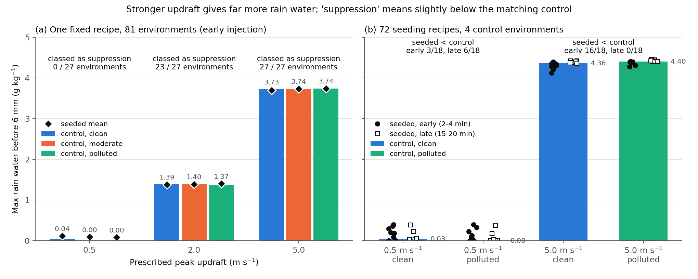
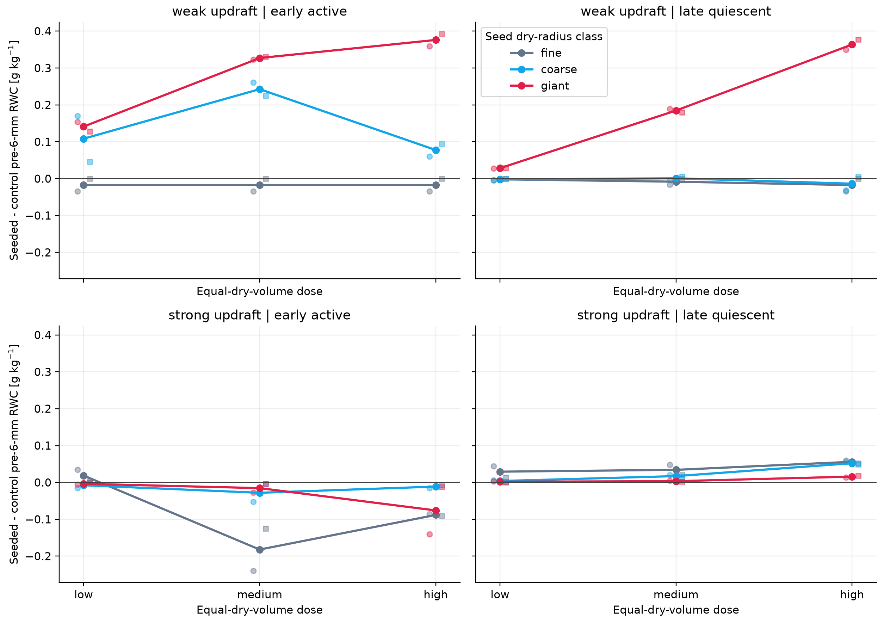
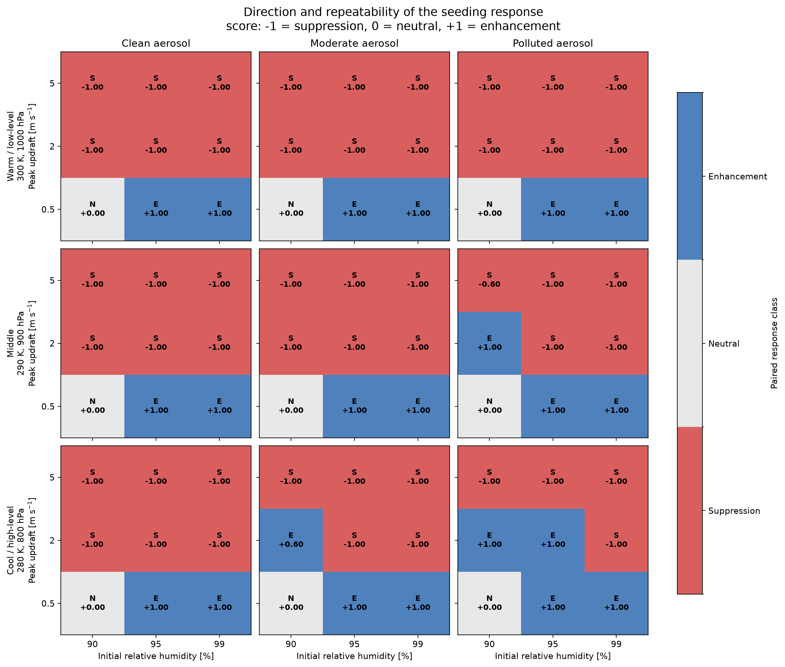
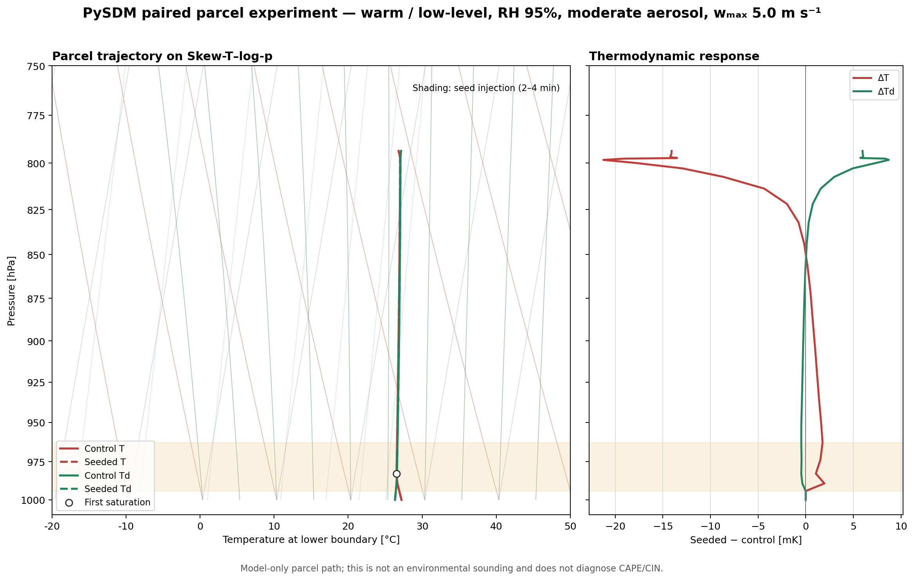

::: {.callout-note title="실험 출처"}
이 실험은 **PySDM-Seeding-Lab 외부**에서 수행했다. Visual Studio Code로 작성한 별도 PySDM parcel 스크립트를 연구실 서버에서 20개 worker로 병렬 실행했으며, Seeding Lab 결과로 표기하지 않는다.
:::

## 질문: 같은 시딩이 왜 어떤 구름에서는 비를 줄이나

[Experiment 4](../2026-07-08-efficiency-response-surface/index.qmd)는 하나의 배경과 하나의 상승류에서 "큰 κ, 큰 dry radius, 늦은 주입일수록 강하다"는 단조로운 그림을 얻었다. 그 글 끝에 남긴 숙제는 공정한 dose 기준, 배경 에어로졸, 그리고 절대 시간 대신 구름 상태를 반영하는 주입 시점이었다. 이번에는 이 숙제를 **상승류 세기**와 묶어서 묻는다.

1. 시딩 효과의 **부호**(강화/억제)는 무엇이 정하는가 — seed 크기, 상승류, 주입 시점?
2. 강한 상승류에서 나온 "억제"는 비가 적다는 뜻인가?
3. Seed recipe를 하나로 고정하고 환경만 바꾸면 부호 지도는 어떻게 생기는가?

## 설계: recipe를 바꾸는 실험과 환경을 바꾸는 실험

| | Recipe 실험 | 환경 실험 |
|---|---|---|
| 바꾼 것 | 배경 × 상승류 × 주입 시점 × seed dry radius × dose | 초기 RH × 상승류 × 배경 × 열역학 조건 |
| 수준 | clean 50 / polluted 1,000 mg⁻¹; peak 0.5 / 5 m s⁻¹; 2–4 / 15–20분; 0.1 / 1 / 5 µm; low / medium / high | 90 / 95 / 99%; 0.5 / 2 / 5 m s⁻¹; 50 / 200 / 1,000 mg⁻¹; 300 K·1000 hPa / 290 K·900 hPa / 280 K·800 hPa |
| 고정 | 300 K, 1000 hPa, 수증기 22.2 g kg⁻¹ | seed dry radius 1 µm, κ 0.8, medium dose, 2–4분 주입 |
| 시나리오 | 72 seeded + 4 control | 81개 환경 × (seeded + control) |
| 반복 × 시나리오 | 10 × 76 = **760 run** | 5 × 162 = **810 run** |

공통 설정은 PySDM 0-D adiabatic parcel [@Bartman2022PySDM], condensation + coalescence(geometric kernel, 충돌하면 모두 합체), Rogers–Yau 종단속도, Δt 10 s, 40분 적분, super-droplet 4,096개(배경) + 2,048개(seed)다. 배경 에어로졸은 mode dry radius 75 nm, σg 1.6, κ 0.5의 lognormal, seed는 σg 1.2, κ 0.8이다. **침강(sedimentation)과 breakup은 없다.** Seeded run과 control은 같은 random seed로 짝지었다.

### Dose는 같은 건조부피로 맞췄다

$$
N_{seed}(r_d)=N_{ref}\left(\frac{1\ \mu\text{m}}{r_d}\right)^{3},\qquad N_{ref}=1,\ 10,\ 100\ \text{mg}^{-1}
$$

$N_{seed}$는 건조공기 1 mg당 넣는 seed 입자 수, $r_d$는 seed의 median dry radius, $N_{ref}$는 1 µm 기준 입자 수(low/medium/high)다. 입자 하나의 부피가 $r_d^3$에 비례하므로 입자 수를 $r_d^{-3}$로 줄이면 **총 건조부피(투입 물질량)가 크기와 상관없이 같아진다.** 그래서 fine(0.1 µm)은 coarse(1 µm)보다 입자가 1,000배 많고, giant(5 µm)는 1/125이다. 크기와 투입량이 함께 바뀌는 fixed-number 설계의 혼동을 피하려는 선택이다.

### 상승류는 12.5분짜리 펄스다

$$
w(t)=\begin{cases}
w_{min}+\left(w_{peak}-w_{min}\right)\sin^{2}\!\left(\dfrac{\pi t}{T}\right) & 0\le t\le T=12.5\ \text{min} \\[4pt]
w_{min} & t>T
\end{cases}
$$

$w_{peak}$는 최대 상승속도, $w_{min}=0.025$ m s⁻¹는 펄스 뒤에 남는 아주 약한 상승이다. $\sin^2$ 항 때문에 상승류는 최소값에서 출발해 6.25분에 최대가 되고 12.5분에 최소로 돌아온다. 40분 동안 parcel이 올라가는 높이는 0.5 m s⁻¹에서 약 0.24 km, 5 m s⁻¹에서 약 1.9 km다. **Early active**(2–4분)는 상승류가 커지는 중에, **late quiescent**(15–20분)는 펄스가 끝나 거의 멈춘 parcel에 seed를 넣는다.

### 지표: 6 mm 이전의 최대 rain water

Rain은 wet radius 40 µm 이상 물방울이고, 주 지표는 seeded와 control의 **6 mm 이전 최대 rain-water mixing ratio 차이** $\Delta RWC_{max}$다. Parcel에는 침강과 breakup이 없어서, 한 번 커진 물방울이 빠져나가지 않고 계속 다른 방울을 먹는다. Recipe 실험의 강한 상승류 run 380개는 모두 16–27분 사이에 가장 큰 방울의 반지름이 6 mm를 넘었고, 40분 끝에는 반지름이 약 3 cm까지 자랐다. 약한 상승류 run은 하나도 넘지 않았다. 6 mm라는 숫자의 출처는 [Experiment 6](../2026-08-25-terminal-velocity-sensitivity/index.qmd)에서 따로 다룬다. 6 mm 컷 대신 run 전체의 최대값을 써도 72개 recipe 중 71개는 부호가 같았다.

부호 분류는 두 실험이 조금 다르다. Recipe 실험은 10회 평균 $\Delta RWC_{max}$의 부호로 강화/억제를 나눴고, seeded와 control 모두 비가 없을 때만 "중립"이다. 환경 실험은 짝지은 run마다 +1(강화)/−1(억제)/0(둘 다 비 없음)을 매기고 5회 평균이 +0.2보다 크면 강화, −0.2보다 작으면 억제로 분류했다.

## 결과 1. 비의 양은 상승류가 정한다

{fig-alt="Bar chart of control maximum rain water before 6 mm by updraft and background, with seeded values as markers, for the fixed-recipe and recipe experiments"}

환경 실험 clean 배경 control의 6 mm 이전 최대 rain water는 상승류 0.5 → 2 → 5 m s⁻¹에서 0.04 → 1.39 → 3.73 g kg⁻¹로 커졌다. Parcel이 높이 올라갈수록 응결되는 물 자체가 많기 때문이다. 따라서 강한 상승류의 "억제"는 비가 적은 구름이라는 뜻이 아니다. 이미 rain water가 4 g kg⁻¹ 넘게 생기는 control보다 seeded가 **조금** 작다는 상대적 의미다. Recipe 실험에서 강한 상승류의 seeded − control 차이는 control 대비 −5.5%에서 +1.4% 사이였다.

## 결과 2. 부호는 상승류 × 주입 시점의 조합이 갈랐다

| 상승류 | 주입 시점 | 평균 $\Delta RWC_{max}$ (g kg⁻¹) | 강화 / 중립 / 억제 | 10회 중 9회 이상 같은 부호 |
|---|---|---:|:---:|:---:|
| weak 0.5 m s⁻¹ | early 2–4분 | +0.136 | 12 / 3 / 3 | 15 / 15 |
| weak 0.5 m s⁻¹ | late 15–20분 | +0.059 | 9 / 3 / 6 | 10 / 15 |
| strong 5 m s⁻¹ | early 2–4분 | −0.044 | 2 / 0 / 16 | 15 / 18 |
| strong 5 m s⁻¹ | late 15–20분 | +0.024 | 18 / 0 / 0 | 14 / 18 |

마지막 열은 평균이 0이 아닌 시나리오 가운데, 10회 반복 중 9회 이상이 평균과 같은 부호였던 개수다.

{fig-alt="Four panels of seeded minus control pre-6-mm rain water versus dose for weak and strong updraft and early and late injection, coloured by seed size"}

- **Strong + early:** 18개 중 16개가 억제였다. 예외는 fine seed의 low dose 두 개(clean +0.035, polluted +0.003 g kg⁻¹)뿐이다. Fine seed는 강수 개시를 0.7–7.8분 늦췄고(Δonset > 0 = 지연), giant seed는 개시를 1.7–5.7분 앞당겼는데도 최대값은 control보다 약간 낮았다.
- **Strong + late:** 18개 모두 강화였지만 크기는 control 대비 1.4% 이하다. 아래 주의를 함께 읽어야 한다.
- **Weak + early:** coarse·giant 12개가 모두 강화였다. Polluted 배경의 control은 비를 전혀 만들지 못했는데, coarse·giant seed는 비를 만들어냈다. Fine seed는 clean 배경에서 control의 약한 비마저 없앴고(억제 3), polluted에서는 양쪽 모두 비가 없었다(중립 3).
- **Weak + late:** giant 6개는 모두 강화, coarse·fine은 작은 억제 또는 중립이었다.

::: {.callout-warning title="strong + late의 '모두 강화'를 읽을 때"}
- **분석 구간이 짧다.** 6 mm 이전 구간이 control 기준 약 18분(clean)·21분(polluted)에 끝나므로, 15분에 들어간 seed가 지표에 기여할 시간은 몇 분뿐이다.
- **주입 전에도 차이가 있었다.** 같은 random seed를 썼지만 seeded run은 주입 전에도 control과 완전히 같지 않았다(14.5분 rain water 차이: clean +0.0035, polluted −0.0006 g kg⁻¹, 원인 미확인). Clean giant seed의 low·medium dose 값(+0.0035, +0.0046 g kg⁻¹)은 이 차이와 크기가 비슷해 부호를 믿기 어렵다.
:::

## 결과 3. Recipe를 고정하면 상승류가 부호를 거의 혼자 정했다

{fig-alt="Grid of effect-direction maps for 81 environments: suppression in red, neutral in grey, enhancement in blue, by relative humidity and updraft"}

| 초기 RH | 0.5 m s⁻¹ | 2 m s⁻¹ | 5 m s⁻¹ |
|---|---|---|---|
| 90% | 중립 9 | 강화 3 / 억제 6 | 억제 9 |
| 95% | 강화 9 | 강화 1 / 억제 8 | 억제 9 |
| 99% | 강화 9 | 억제 9 | 억제 9 |

81개 환경 중 강화 22, 억제 50, 중립 9였다. 중립 9개는 효과가 상쇄된 것이 아니라 RH 90% + 0.5 m s⁻¹에서 seeded와 control 모두 비가 생기지 않은 경우다. 2 m s⁻¹의 강화 4개는 모두 RH 90–95%, moderate·polluted 배경, 290 K 이하의 열역학 조건에서 나왔다. 같은 RH·열역학 조건에서 배경만 바꾸면 0.5와 5 m s⁻¹에서는 부호가 바뀌지 않았다. 배경 에어로졸은 부호보다 크기를 조절했다.

이 실험은 **2–4분 early 주입만** 썼다. 그래서 "강한 상승류 = 억제"는 recipe 실험의 strong + early와 같은 이야기이고, 늦은 주입에도 그렇다는 뜻이 아니다.

## 깨끗한 구름은 비를 더 일찍 만든다

| 환경 실험 control | clean 50 mg⁻¹ | moderate 200 mg⁻¹ | polluted 1,000 mg⁻¹ |
|---|---:|---:|---:|
| 0.5 m s⁻¹: 비가 생긴 환경 | 3 / 9 | 2 / 9 (일부 run) | 0 / 9 |
| 2 m s⁻¹: 평균 강수 개시 | 11.3분 | 16.2분 | 23.5분 |
| 5 m s⁻¹: 평균 강수 개시 | 7.4분 | 9.4분 | 12.1분 |
| 5 m s⁻¹: 평균 최대 rain water | 3.73 g kg⁻¹ | 3.74 g kg⁻¹ | 3.75 g kg⁻¹ |

배경 입자가 적음 → 구름방울 수가 적음(recipe 실험 5 m s⁻¹ control 최대 약 56 vs 990 cm⁻³) → 같은 물을 적은 방울이 나눠 가져 방울이 빨리 커짐 → 충돌·병합이 일찍 시작된다. 0.5 m s⁻¹에서는 RH 99%일 때만 비가 생겼다. 하지만 5 m s⁻¹에서는 최대 rain water가 거의 같았다. 이 parcel에서 깨끗한 배경은 비를 **빨리** 만들 뿐, **많이** 만들지는 않았다. 여기서 강수 개시는 rain water가 10⁻⁵ g kg⁻¹을 처음 넘는 시각이며, 지상 강수 시작이 아니다.

## Skew-T 위의 한 쌍: 시딩은 열역학을 거의 바꾸지 않았다

{fig-alt="Skew-T log-p diagram of one paired parcel trajectory and the seeded minus control temperature and dew-point differences in millikelvin"}

Parcel은 1000 hPa에서 약 794 hPa(약 1.93 km)까지 올라갔고 대부분은 상승류 펄스 동안 올라갔다. Seeded − control 온도 차이는 −21에서 +2 mK, 즉 1000분의 몇 도에 불과했다. 시딩 반응은 parcel 열역학이 아니라 **방울 크기 분포**에서 일어난다. 게다가 상승류를 처방했으므로 이 작은 차이조차 부력·상승류로 되먹임되지 않는다. 이 쌍에서 seeded는 비가 1분 일찍 시작했지만(8.0 vs 9.0분) 최대 rain water는 0.15% 작아 환경 지도에서는 "억제" 칸에 속한다. 개시 시각과 최대값은 서로 다른 질문에 답한다. 이 그림은 parcel 경로일 뿐 환경 sounding이 아니므로 CAPE/CIN을 진단할 수 없다.

## 말할 수 있는 것과 없는 것

| 구분 | 내용 |
|---|---|
| 지지됨 (부호, 반복 간 일관) | 상승류 × 주입 시점이 부호를 가름 (strong + early 억제 16/18, weak + early 강화 12/18) · early 주입 고정 recipe에서 2–5 m s⁻¹ 환경 54개 중 50개 억제 · 절대 rain water는 상승류가 지배 · clean 배경에서 강수 개시가 빠름 |
| 서술적 (크기) | $\Delta RWC_{max}$ 값, 상대 변화율, "가장 강한 조건" 순위 — super-droplet 수·timestep 수렴을 확인하지 않았다 |
| 보여주지 않음 | 지상 강수량(침강 없음) · cloud invigoration(상승류 처방이라 잠열 → 부력 → 상승류 되먹임 없음) · 6 mm 이후의 방울 · 충돌 효율·breakup을 넣었을 때의 결과 · 억제 메커니즘(수증기 경쟁 등은 추정) |

::: {.review-verdict}
**결론.** 시딩 반응의 부호는 seed 크기보다 먼저 상승류와 주입 시점의 조합에서 갈렸다. 강한 상승류에 일찍 넣으면 18개 중 16개가 억제, 늦게 넣으면 18개 모두 강화(단, control 대비 1.4% 이하)였고, 약한 상승류에 일찍 넣은 coarse·giant seed는 모두 강화였다. 여기서 "억제"는 비가 적다는 뜻이 아니라 이미 비가 많은 control보다 조금 작다는 상대적 의미다.
:::

## 다음 질문

모든 결론은 "6 mm 이전"이라는 컷 위에 서 있다. 이 6 mm는 종단속도 조회표의 상한에서 온 숫자이고, 종단속도는 충돌 kernel에 직접 들어간다. 그렇다면 종단속도식을 바꿔도 위의 부호 패턴이 유지될까?

[Experiment 6로 이어서 읽기](../2026-08-25-terminal-velocity-sensitivity/index.qmd)

## 연결 자료

- [Experiments 목록](../../../experiments.qmd)

## 참고문헌 {.unnumbered}

::: {#refs}
:::
