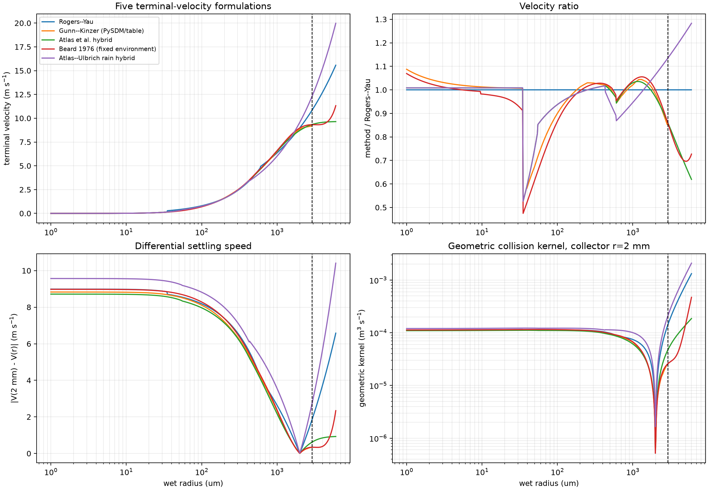
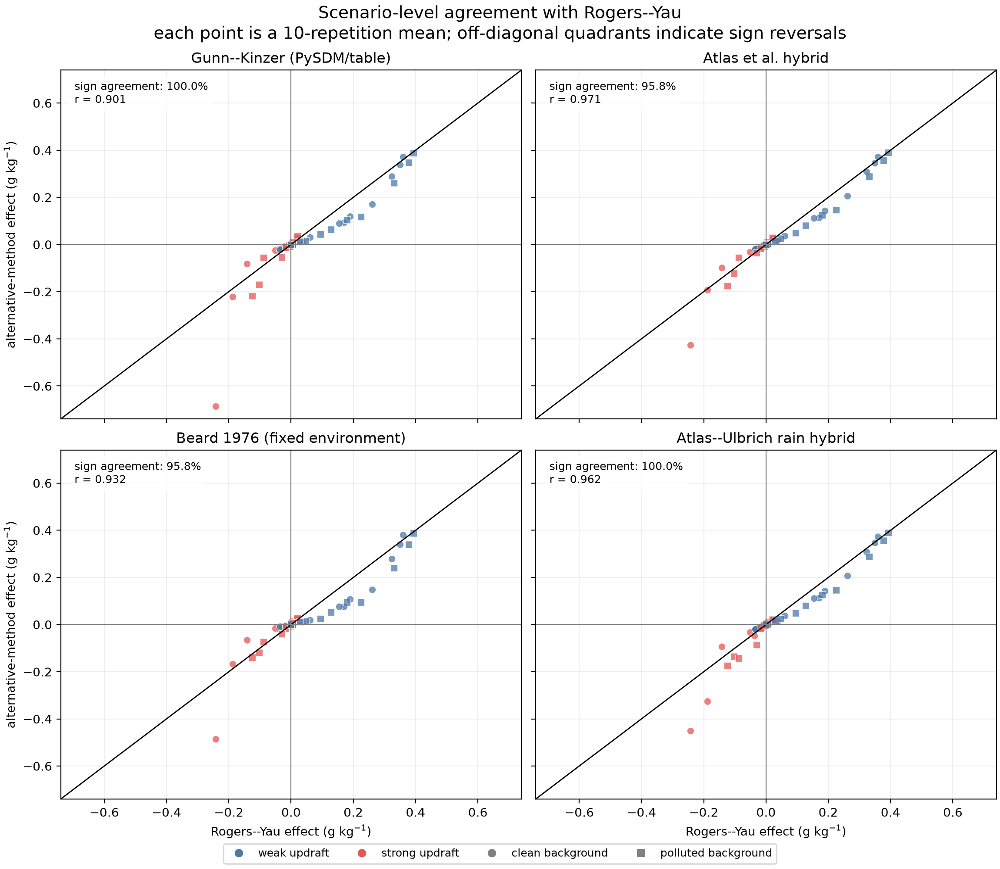
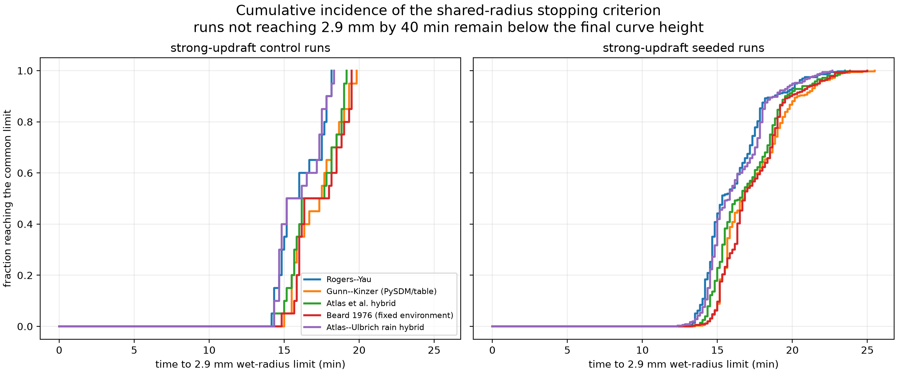

::: {.callout-note title="실험 출처"}
이 실험도 **PySDM-Seeding-Lab 외부**에서 수행했다. Experiment 5와 같은 parcel 코드에 종단속도식만 바꿔 끼운 별도 스크립트를 연구실 서버에서 실행했으며, Seeding Lab 결과로 표기하지 않는다.
:::

## 질문: 6 mm는 어디서 왔고, 결론은 종단속도식에 기대고 있나

[Experiment 5](../2026-08-06-updraft-timing-regimes/index.qmd)의 모든 지표는 "가장 큰 방울이 6 mm를 넘기 전"의 최대 rain water였다. 이 실험은 두 가지를 묻는다.

1. 6 mm라는 숫자는 물리적 한계인가, 코드의 한계인가?
2. 종단속도식을 바꾸면 Experiment 5의 부호 패턴(상승류 × 주입 시점)이 유지되는가, 그리고 효과 크기는 얼마나 달라지는가?

목표는 "가장 정확한 식"을 고르는 것이 아니라, 기존 결론이 식 선택에 얼마나 강건한지 보는 것이다.

## 6 mm는 물리가 아니라 구현의 상한이었다

Gunn과 Kinzer는 정지한 공기(760 mmHg, 20 °C, RH 50%)에서 1,500개가 넘는 물방울의 낙하속도를 측정했다 [@GunnKinzer1949]. 표에 실린 가장 큰 방울은 **지름 5.8 mm**, 낙하속도 9.17 m s⁻¹이다. 지름 5.8 mm는 **반지름 2.9 mm**다.

PySDM의 `GunnKinzer1949`는 이 표를 반지름으로 바꾼 뒤 RBF로 보간해 **반지름 0–6 mm** 격자의 조회표를 만들고, 입력 반지름이 6 mm를 넘으면 `ValueError`를 낸다(반지름 40 µm 미만은 작은 방울용 근사식으로 덮어쓴다). 즉 반지름 2.9–6 mm 구간은 측정이 아니라 외삽이고, 6 mm는 조회표를 만든 코드의 상한이다. 이전 실험에서는 이 식을 썼기 때문에 방울이 6 mm를 넘는 순간 run이 오류로 멈췄다. Experiment 5는 상한이 없는 Rogers–Yau로 바꾸고 6 mm 이전 값만 해석했다.

하지만 진짜 문제는 식이 아니다. Parcel에 침강과 breakup이 없어서 한 번 커진 방울이 계속 자란다. Experiment 5의 강한 상승류 control에서 가장 큰 방울은 반지름 약 3 cm까지 자랐다. 종단속도식을 바꿔도 이 빠진 물리는 채워지지 않는다.

::: {.callout-warning title="반지름과 지름"}
PySDM 코드와 이 블로그의 실험은 **반지름**을 쓰고, Gunn–Kinzer 표는 **지름**을 쓴다. "6 mm"는 반지름 6 mm(지름 12 mm), "2.9 mm"는 반지름 2.9 mm(지름 5.8 mm)다.
:::

## 종단속도가 충돌을 바꾸는 경로

$$
K_{ij}=\pi\,(r_i+r_j)^{2}\,\left|V(r_i)-V(r_j)\right|\,E_{ij}
$$

$K_{ij}$는 두 방울 $i$, $j$의 collision kernel, 즉 단위 시간에 두 방울이 함께 "쓸고 지나가는" 부피다. $\pi(r_i+r_j)^2$는 두 반지름의 합을 반지름으로 하는 충돌 단면적, $|V(r_i)-V(r_j)|$는 두 방울의 낙하속도 차이(차등 침강), $E_{ij}$는 충돌 효율로 이 실험에서는 1이다. 종단속도식 $V(r)$이 바뀌면 큰 collector drop과 작은 방울 사이의 속도 차가 바뀌고, 그만큼 충돌·병합 속도가 직접 바뀐다.

기준인 Rogers–Yau 식은 반지름 구간마다 다른 거듭제곱을 쓴다.

$$
\begin{gathered}
V_{RY}(r)=\begin{cases}k_1 r^{2} & r<35\ \mu\text{m}\\ k_2\, r & 35\ \mu\text{m}\le r<0.6\ \text{mm}\\ k_3\, r^{1/2} & r\ge 0.6\ \text{mm}\end{cases} \\[6pt]
k_1=1.19\times10^{8}\ \text{m}^{-1}\text{s}^{-1},\quad k_2=8\times10^{3}\ \text{s}^{-1},\quad k_3=201\ \text{m}^{1/2}\text{s}^{-1}
\end{gathered}
$$

작은 방울은 Stokes 영역이라 속도가 $r^2$에, 중간 방울은 $r$에, 큰 방울은 $\sqrt{r}$에 비례한다. 마지막 구간에는 상한이 없어서 반지름 6 mm에서 15.6 m s⁻¹까지 커진다. 반면 Gunn–Kinzer 측정에서는 지름 5 mm를 넘으면 낙하속도가 9.1–9.2 m s⁻¹에서 거의 늘지 않는다.

## 다섯 가지 식과 실험 설계

| 식 | 형태 | 이 실험의 구현 | 반지름 2.9 mm에서의 $V$ |
|---|---|---|---:|
| Rogers–Yau | 반지름 구간별 거듭제곱식(위) | PySDM 기본, Experiment 5 기준 | 10.82 m s⁻¹ |
| Gunn–Kinzer (1949) | 관측표 | PySDM의 RBF 조회표 | 9.17 m s⁻¹ |
| Atlas et al. (1973) hybrid | $V=9.65-10.3\,e^{-0.6D_{mm}}$ (지름 0.86 mm 이상) | 작은 방울 식과 이어 붙인 실험용 조합 | 9.33 m s⁻¹ |
| Beard (1976) fixed | 세 유동 영역의 물리식 | 공기 물성을 초기 300 K·1000 hPa로 고정 | 9.32 m s⁻¹ |
| Atlas–Ulbrich (1977) hybrid | $V=3.78\,D_{mm}^{0.67}$ (지름 0.86 mm 이상) | 작은 방울 식과 이어 붙인 실험용 조합 | 12.27 m s⁻¹ |

$D_{mm}$은 mm 단위 지름이다. 두 Atlas 계열은 원 논문의 식을 전 크기 범위에 쓴 것이 아니라 이 실험에서 작은 방울 branch와 연결한 비교용 조합이고, Beard 식은 parcel의 온도·압력 변화와 결합하지 않았다.

{fig-alt="Four panels comparing five terminal-velocity formulations: velocity, ratio to Rogers-Yau, differential settling speed against a 2 mm collector, and geometric collision kernel versus wet radius"}

실험 조건은 Experiment 5의 recipe 실험(76개 시나리오 × 10회)을 그대로 쓰고 식만 바꿨다. 5 × 760 = **3,800 run**, 오류 0건이다. 다섯 식을 모두 관측 범위 안에서 비교하기 위해, 가장 큰 방울의 반지름이 **2.9 mm**에 닿으면 run을 끝냈다. 주 지표는 이 공통 한계 이전의 $\Delta RWC_{max}$(seeded − control 최대 rain water 차이)다.

## 결과 1. 부호는 거의 그대로였다

| 식 | 평균 $\Delta RWC_{max}$ (g kg⁻¹) | 중앙값 | 강화 비율 | Rogers–Yau와 부호 일치 | RY 평균 / 이 식 평균 |
|---|---:|---:|---:|:---:|---:|
| Rogers–Yau | +0.0352 | +0.0006 | 56.9% | — | 1.0 |
| Gunn–Kinzer | +0.0183 | +0.0016 | 56.9% | 72 / 72 | 1.9 |
| Atlas hybrid | +0.0266 | +0.0001 | 52.8% | 69 / 72 | 1.3 |
| Beard fixed | +0.0224 | +0.0008 | 55.6% | 69 / 72 | 1.6 |
| Atlas–Ulbrich hybrid | +0.0222 | +0.0024 | 56.9% | 72 / 72 | 1.6 |

{fig-alt="Four scatter plots of scenario-mean seeding effects from alternative terminal-velocity formulas against Rogers-Yau, with sign agreement of 95.8 to 100 percent"}

부호 일치는 95.8–100%였다. 그러나 중앙값은 모든 식에서 거의 0이고 강화 비율도 절반 남짓이다. 평균이 양수인 이유는 약한 상승류의 coarse·giant 조건 몇 개가 크게 끌어올렸기 때문이며, "대부분의 조건에서 비가 늘었다"는 뜻이 아니다.

Experiment 5의 regime 표를 식별로 다시 세면 다음과 같다(강화 / 중립 / 억제).

| Regime | Rogers–Yau | Gunn–Kinzer | Atlas hybrid | Beard fixed | Atlas–Ulbrich |
|---|:---:|:---:|:---:|:---:|:---:|
| weak + early | 12 / 3 / 3 | 12 / 3 / 3 | 12 / 3 / 3 | 12 / 3 / 3 | 12 / 3 / 3 |
| weak + late | 9 / 3 / 6 | 9 / 3 / 6 | 9 / 3 / 6 | 10 / 3 / 5 | 9 / 3 / 6 |
| strong + early | 2 / 0 / 16 | 2 / 0 / 16 | 2 / 0 / 16 | 2 / 0 / 16 | 2 / 0 / 16 |
| strong + late | 18 / 0 / 0 | 18 / 0 / 0 | 15 / 0 / 3 | 16 / 0 / 2 | 18 / 0 / 0 |

2.9 mm 종료를 쓴 Rogers–Yau 결과는 6 mm 컷을 쓴 Experiment 5와 72개 시나리오 모두 부호가 같았다. 부호가 갈린 여섯 경우(Atlas 3, Beard 3)는 모두 **늦은 주입**이었고 크기가 0.007 g kg⁻¹ 이하였다.

## 그런데 strong + late는 거의 검사되지 않았다

{fig-alt="Cumulative distribution of the time at which strong-updraft runs reached the 2.9 mm wet-radius limit, for five terminal-velocity formulas"}

약한 상승류 run은 어느 식에서도 2.9 mm에 닿지 않고 40분을 다 돌았다. 반대로 강한 상승류 run은 다섯 식 모두 380개 전부가 약 12–26분 사이에 2.9 mm에서 끝났다. Late 주입은 15분에 시작하므로, strong + late의 분석 구간은 식에 따라 중앙값 15.5–16.8분에 끝났다. Rogers–Yau에서는 strong + late run의 40%가 **주입이 시작되기도 전에** 종료됐고, clean 배경의 세 조건(coarse low, giant low, giant medium)은 seed 크기·dose가 달라도 값이 +0.0006 g kg⁻¹로 똑같았다. Seed가 지표에 닿기 전에 run이 끝났다는 뜻이다. 따라서 위 표의 strong + late 칸은 Experiment 5의 "strong + late 강화"를 검증하지 못한다. 이 실험이 실제로 확인한 것은 weak 두 칸과 strong + early다.

## 결과 2. 크기는 식마다 달랐다

- 전체 평균은 Rogers–Yau가 다른 식보다 **1.3–1.9배** 컸다. Rogers–Yau는 약한 상승류에서 가장 큰 강화를, strong + early에서 가장 약한 억제를 계산했다.
- 식에 가장 민감한 조건은 clean · strong · early · fine · medium이었다. 다섯 식 모두 억제였지만 크기는 −0.24(Rogers–Yau)에서 −0.69 g kg⁻¹(Gunn–Kinzer)까지 약 2.8배 차이 났다.
- 가장 강건한 조건은 polluted · weak · early · giant · high로, 다섯 식 모두 +0.387–+0.393 g kg⁻¹였다.

종단속도식은 부호보다 **크기**에 영향을 줬다. Experiment 5의 크기 값을 서술적으로만 읽어야 하는 이유가 하나 더 생긴 셈이다.

## 어떤 식을 기준으로 쓸까

| 역할 | 식 | 이유 |
|---|---|---|
| 주 기준선 | Gunn–Kinzer | 관측표 기반, Rogers–Yau와 부호 72/72 일치, 평균 효과가 가장 보수적 |
| 기존 결과 재현 | Rogers–Yau | Experiment 4–5와 같은 식으로 비교 |
| 물리 민감도 | Beard fixed | 유동 영역을 나눈 물리식 |
| 범위 진단 | Atlas 계열 hybrid | 큰 방울 속도 가정의 폭 확인 |

이것은 운영상의 선택이지 정확도 검증이 아니다. 관측과 직접 비교하지 않았으므로 평균이 작다는 이유만으로 Gunn–Kinzer가 더 정확하다고 말할 수 없다. 또 Gunn–Kinzer를 기준으로 쓰면 반지름 6 mm 상한(관측 범위로는 2.9 mm)이 그대로 남는다. 상한 문제를 실제로 풀려면 침강·제거와 breakup이 필요하다.

## 말할 수 있는 것과 없는 것

| 구분 | 내용 |
|---|---|
| 지지됨 | 6 mm는 PySDM 조회표의 상한(관측표는 반지름 2.9 mm까지) · 다섯 식 모두 strong + early 억제 16/18, weak + early 강화 12/18 · 시나리오 부호 일치 95.8–100% |
| 서술적 | 평균 효과의 1.3–1.9배 차이, 민감 조건의 약 2.8배 차이 — 수렴 미검증이며 평균은 소수 조건에 끌려감 |
| 보여주지 않음 | strong + late의 강건성(공통 종료로 대부분 잘림) · 어느 식이 관측에 가장 맞는지 · 2.9 mm 이후 성장 · 침강·breakup을 넣었을 때의 결과 |

::: {.review-verdict}
**결론.** 종단속도식을 다섯 가지로 바꿔도 strong + early 억제(16/18)와 weak + early 강화(12/18)는 그대로였고, 시나리오 부호는 Rogers–Yau와 95.8–100% 일치했다. 그러나 평균 효과 크기는 식에 따라 1.3–1.9배 달랐고, strong + late는 2.9 mm 공통 종료 때문에 사실상 검사되지 못했다. 종단속도식은 부호보다 크기의 불확실성 축이다.
:::

## 다음 질문

지금까지는 내가 정한 설계 안에서 결론의 강건성을 봤다. 다음에는 같은 0-D parcel을 출판된 연구와 맞대 본다. Ren et al. (2025)은 2-D bin 모델에서 등질량 seed의 크기에 따라 강수가 억제에서 증대로 바뀌는 전환을 보였다 [@Ren2025ParticleSize]. 이 논문은 seed 크기를 **지름**으로 표기하므로, 반지름을 쓰던 지금까지의 실험과 단위를 주의해서 맞춰야 한다.

[Experiment 7로 이어서 읽기](../2026-09-07-ren2025-parcel-replication/index.qmd)

## 연결 자료

- [Experiments 목록](../../../experiments.qmd)

## 참고문헌 {.unnumbered}

::: {#refs}
:::
