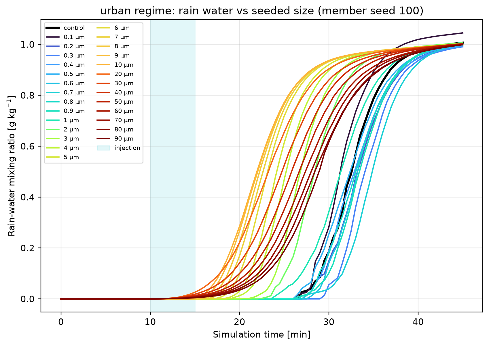
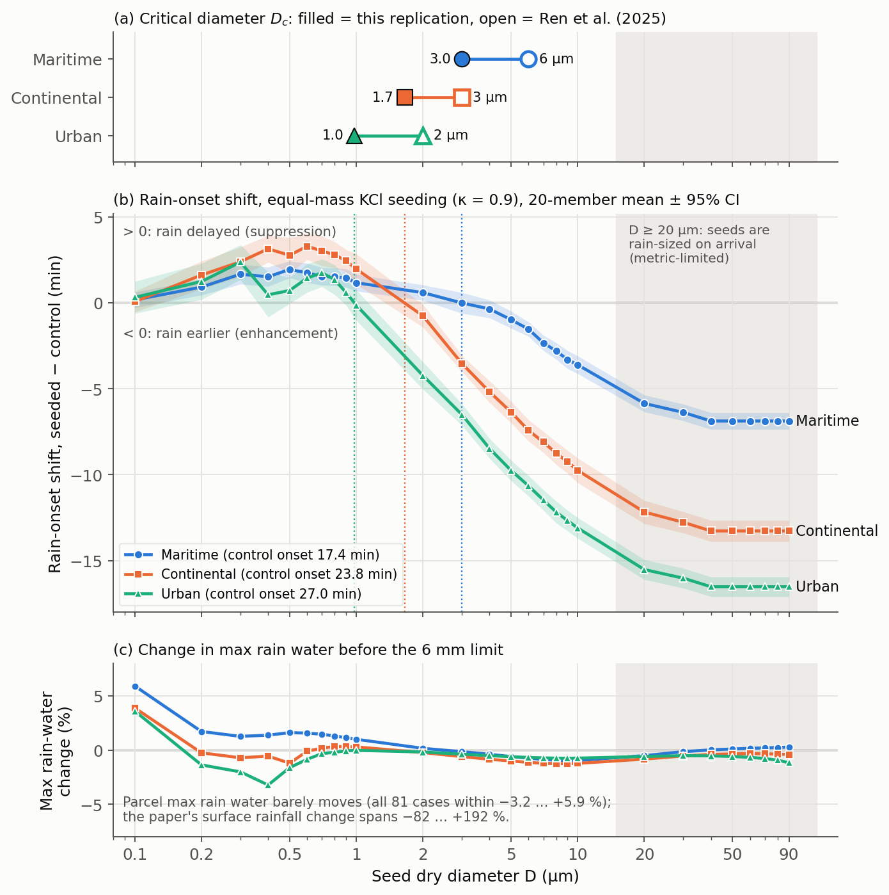

::: {.callout-note title="실험 출처"}
이 실험은 **PySDM-Seeding-Lab 외부**에서 수행했다. 연구실 서버에서 별도 PySDM parcel 스크립트로 실행한 논문 재현 실험이며, 결과는 랩미팅 추가자료로 발표했다. Seeding Lab 결과로 표기하지 않는다.
:::

## 질문: 논문의 크기 효과는 모델이 바뀌어도 살아남는가

Ren et al. (2025)은 2-D slab-symmetric bin 미세물리 모델로 온난 대류운을 모의하고, **총 시딩 질량을 고정한 채** KCl 입자의 직경만 0.1–90 µm 사이 27개 값으로 바꿨다 [@Ren2025ParticleSize]. 결론은 세 단계다. Submicron(0.1–0.9 µm)은 강수를 억제하고, 1–9 µm에서 억제가 증대로 바뀌며, 10 µm 이상은 강수를 늘린다. 그리고 부호가 바뀌는 **임계직경 $D_c$는 배경이 오염될수록 작아진다**(maritime 약 6, continental 약 3, urban 약 2 µm). 논문 내용은 [Ren et al. (2025) 리뷰](../../article-review/2026-09-10-ren2025-particle-size/index.qmd)에 따로 정리했다.

이번 실험의 질문은 하나다. **2-D 동역학과 침강을 빼고, bin 대신 super-droplet method를 쓰는 0-D parcel에서도 억제→증대 전환과 $D_c$의 순서가 나오는가?** 나오면 기작이 모델 종류에 강건하다는 근거가 되고, 안 나오면 부호를 정하는 데 2-D 동역학이나 침강이 필요하다는 뜻이다. 둘 다 결과다. 논문의 지표 강수량 수치를 맞추는 것은 처음부터 목표가 아니었다.

## 무엇을 맞추고 무엇을 근사했나

| 항목 | Ren et al. (2025) | 이번 재현 (v1) |
|---|---|---|
| Seed 크기 | 단분산 27개 **직경** 0.1–90 µm | 같은 27개 직경 |
| Seed 수농도 | 등질량 제약 | 같은 등질량 법칙 (논문 Table 2와 코드에서 대조) |
| Seed 물질 | KCl | κ = 0.9 |
| 배경 CCN | (NH₄)₂SO₄, Jaenicke 3-mode | κ = 0.61, 단일 lognormal |
| 주입 | 10분, 운저, 60초마다 5회 | 10–15분 창에 균등 분산 |
| 동역학 | 2-D, thermal bubble, 40분 | 0-D 단열 parcel, 처방 상승류, 45분 |
| 열역학 | Sanya 라디오존데 | 300 K, 1000 hPa, 수증기 22.2 g/kg (RH 약 97.5%) |
| 충돌 | bin collision–coalescence + breakup | SDM `Geometric` kernel, 효율 1, breakup 없음 |
| 강수 지표 | 지표 누적 강수 변화 (%) | **강수 개시 시각 이동** |
| 반복 | 결정론적 1 run | 20-member paired ensemble |

등질량 제약은 다음 식 하나로 요약된다.

$$
N(D) = 5.4508\times10^{5}\left(\frac{0.1}{D}\right)^{3}\ \text{cm}^{-3}
$$

말로 읽으면 "seed 수농도는 직경의 세제곱에 반비례한다"이다. $N$은 seed 수농도, $D$는 µm 단위 건조 직경, 0.1과 $5.4508\times10^5$은 논문의 가장 작은 경우(0.1 µm)를 기준점으로 잡은 값이다. 입자 하나의 질량이 $D^3$에 비례하므로 $N D^3$이 일정하면 총 질량이 같다. 직경이 10배 커지면 개수는 1,000배 줄어, 0.1 µm는 $5.5\times10^5$ cm⁻³, 90 µm는 $7.5\times10^{-4}$ cm⁻³이 된다.

::: {.callout-warning title="반지름과 직경"}
이 글의 크기 축은 모두 **건조 직경 $D$**다. 코드도 직경으로 설계하고 PySDM에 넣을 때만 dry radius $= D/2$로 바꾼다. 이전 Experiment들은 dry radius 축이었으므로 숫자를 그대로 비교하면 안 된다.
:::

상승류는 $w(t)=w_{min}+(w_{peak}-w_{min})\sin^2(\pi t/15\,\text{min})$로 처방했다. 처음 15분 동안 최대 1 m/s까지 올랐다가 내려오고, 이후에는 0.025 m/s로 유지된다. 배경 수농도는 seed 없는 control의 최대 구름방울 수농도($N_{d,max}$)가 논문 4.5절 값에 맞도록 보정했다. KCl seed의 κ = 0.9는 설계 선택이고, 배경 (NH₄)₂SO₄의 κ = 0.61은 Petters & Kreidenweis (2007)의 CCN 기반 값이다 [@Petters2007Kappa]. κ의 의미는 [κ-Köhler 리뷰](../../article-review/2026-07-15-kappa-kohler/index.qmd)에 정리했다. 종단속도식은 Rogers–Yau를 썼다([이전 실험](../2026-08-25-terminal-velocity-sensitivity/index.qmd)).

| Regime | 배경 mode radius | σ_g | 목표 $N_{d,max}$ | Control $N_{d,max}$ | Control 강수 개시 |
|---|---:|---:|---:|---:|---:|
| Maritime | 90 nm | 1.8 | 120 cm⁻³ | 123.7 cm⁻³ | 17.4분 |
| Continental | 70 nm | 1.9 | 450 cm⁻³ | 448.7 cm⁻³ | 23.8분 |
| Urban | 55 nm | 2.0 | 1,400 cm⁻³ | 1,423.5 cm⁻³ | 27.0분 |

실행 규모는 3 regime × (control 1 + seeded 27) × 20 member = **1,680 run**이고 모두 끝까지 돌았다. Super-droplet 수는 배경 4,096, seed 2,048이며, seeded run과 control은 같은 random seed(100–119)로 짝지었다. PySDM과 SDM 자체는 [@Bartman2022PySDM; @Shima2009SDM]을 따른다.

## 왜 강수량이 아니라 강수 개시 시각인가

0-D parcel에는 침강, 강수 제거, entrainment, 유한한 구름 수명이 없다. 시간이 충분하면 응결수는 결국 거의 다 rain water가 되고, 큰 방울은 breakup 없이 계속 자란다. 그래서 분석은 어떤 방울이든 반지름 6 mm(PySDM Gunn–Kinzer 표의 상한)를 넘기 전까지로 제한했다. 상승류 최대값을 1 m/s로 약하게 둔 것도 같은 이유다. 설계 단계의 보정에서 더 강한 상승류는 control이 응결수를 거의 다 비로 바꿔 시딩이 움직일 여지가 없었다. 이는 빠진 손실 과정을 보정하려는 선택이지 논문 동역학의 재현이 아니다.

{fig-alt="Urban-regime rain-water mixing ratio time series for control and 27 seed diameters; all curves saturate near 1 g/kg while their rise times differ by up to about 16 minutes"}

그림처럼 control의 최대 rain water는 세 regime 모두 0.99–1.01 g/kg에서 포화했다. 81개 seeded 경우의 최대 rain-water 변화는 −3.2…+5.9%뿐이었고, 논문의 지표 강수 변화(−82…+192%)와 비교할 수 있는 축이 아니었다. 논문의 퍼센트는 2-D 모델이 떨어지는 방울을 지면으로 빼내기 때문에 의미가 생기는 값이다.

반면 **비가 언제 시작되는지**는 seed 크기에 따라 분명히 달랐다. 그래서 주지표를 다음처럼 정했다.

- 강수 개시 $t_{onset}$: 습윤 반지름 40 µm 이상 방울의 rain-water mixing ratio가 처음 $10^{-8}$ kg/kg를 넘는 시각(출력 간격 30초)
- $\Delta t_{onset} = t_{onset}^{seeded} - t_{onset}^{control}$, 같은 random seed끼리 짝지어 계산
- **부호 규약: $\Delta t_{onset} > 0$은 지연 = 억제 방향, $\Delta t_{onset} < 0$은 앞당김 = 증대 방향**
- 임계직경 $D_c$: 평균 $\Delta t_{onset}$이 양에서 음으로 바뀌는 직경, $\log D$에서 선형 보간

개시가 빨라졌다고 강수량이 늘었다는 뜻은 아니다. 이 지표는 논문 부호와 같은 **방향**을 가리키는지 보는 대리 지표다.

## 결과 1. 부호 전환과 $D_c$ 순서는 재현됐다

{fig-alt="Three-panel figure: critical diameters of the replication versus the paper for three regimes; rain-onset shift versus seed diameter crossing zero near 3.0, 1.7 and 1.0 micrometres; and nearly flat max rain-water change"}

| Regime | 재현 $D_c$ | 논문 $D_c$ | 비 | Submicron 최대 지연 | 10 µm에서 |
|---|---:|---:|---:|---:|---:|
| Maritime | ≈ 3.0 µm | ≈ 6 µm | 0.50 | +2.0분 | −3.6분 |
| Continental | ≈ 1.7 µm | ≈ 3 µm | 0.55 | +3.3분 | −9.8분 |
| Urban | ≈ 1.0 µm | ≈ 2 µm | 0.49 | +2.4분 | −13.1분 |

세 regime 모두 작은 seed는 비를 조금 늦추고, 큰 seed는 비를 크게 앞당겼다. 곡선은 0을 한 번 가로질렀고, $D_c$는 maritime > continental > urban 순서로 작아졌다. **순서와 방향은 논문과 같고, 값은 일관되게 약 0.5배**다. 0.5배의 원인(단일모드 배경, 침강 없음, 이상화된 열역학, 효율 1 충돌)은 가설일 뿐 따로 검증하지 않았다. 1–10 µm 구간의 격자 간격이 1 µm라서 $D_c$는 한 칸 정도 불확실하다. Continental은 1과 2 µm 사이, urban은 0.9와 1.0 µm 사이를 보간한 값이고, maritime은 3 µm에서 평균이 정확히 0이었다. Urban만 따로 50 member로 돌린 run에서도 $D_c$는 약 1.0 µm였다.

20 µm 이상에서 곡선이 평평해지는 것은 물리가 아니라 지표의 한계다. 40 µm 이상에서는 세 regime 모두 개시가 10.5분, 즉 주입 시작 직후 첫 출력 시각이었다. Seed 자체가 들어오자마자 rain 크기로 계산된 것이다. 따라서 물리적 해석은 $D \lesssim 10$ µm로 제한하고, 논문의 60 µm 최적점은 이 실험으로 판단할 수 없다.

## 결과 2. 부호 일치는 78/81, 엄밀 기준 71/81

평균 $\Delta t_{onset}$의 부호를 논문 Table 2의 강수 변화 부호와 비교했다. 논문이 음(억제)이면 $\Delta t_{onset}>0$, 양(증대)이면 $\Delta t_{onset}<0$일 때 일치로 센다. "엄밀" 기준은 여기에 95% 신뢰구간이 0을 포함하지 않는다는 조건을 더한 것이다.

| Regime | 부호 일치 | 엄밀 기준 |
|---|---:|---:|
| Maritime | 25/27 | 23/27 |
| Continental | 27/27 | 26/27 |
| Urban | 26/27 | 22/27 |
| **합계** | **78/81** | **71/81** |

어긋난 세 경우는 모두 전환점 근처다. Maritime 2 µm은 +0.6분 지연(신뢰구간 ±0.45분)인데 Table 2는 +0.72%다. Maritime 3 µm은 평균이 정확히 0이라 일치로 세지 않았다. Urban 1 µm은 −0.1분(±0.9분)으로 사실상 0인데 Table 2는 −4.78%다. 엄밀 기준에서 추가로 빠진 7개는 세 regime의 0.1 µm, urban 0.4·0.5·0.9 µm, maritime 4 µm로, 평균 이동이 신뢰구간보다 작은 경우였다.

::: {.callout-warning title="집계를 다시 한 이유"}
랩미팅 추가자료의 집계는 maritime 3 µm의 tie를 일치로 셌고, urban은 별도 50-member run 결과를 섞었다. 이 글의 78/81과 71/81은 같은 20-member 세트 하나로 tie를 빼고 다시 센 값이다.

또 Table 2는 논문의 주 실험 세트(배경 하나)의 결과다. 따라서 maritime과 continental의 비교 기준은 그 세트에서 빌려 온 부호다. Regime별 비교는 $D_c$로 하는 것이 맞다. 예를 들어 maritime 2 µm의 지연은 Table 2와는 어긋나지만, 논문의 maritime $D_c$(약 6 µm)보다 작은 직경이므로 논문 maritime 결과와는 같은 방향이다.
:::

::: {.callout-note title="논문을 읽으며 걸린 점"}
논문은 Table 2 세트의 배경을 3.1절에서는 urban, 4.5절에서는 continental(C series)로 부른다. Table 2의 전환(1→2 µm)이 urban $D_c$(약 2 µm)와 맞아서 이 재현에서는 urban으로 읽었다. 목표 $N_{d,max}$도 2.2절(140/400/1400 cm⁻³)과 4.5절(120/450/1400 cm⁻³)이 다르며, 여기서는 4.5절 값을 썼다. 4.5절 일부는 "critical radius"라고 쓰지만 Figure 11 설명과 결론은 직경이므로 직경으로 해석했다.
:::

## 재현되지 않은 것

- **강수량 크기.** 최대 rain water는 구조적으로 평평하다. 논문의 −82…+192%에 대응하는 값은 parcel에 없다.
- **Submicron 안의 크기 의존성.** 논문은 0.1 µm에서 억제가 가장 강하지만, parcel에서 0.1 µm는 지연이 +0.1~+0.3분으로 가장 작았고 세 regime 모두 신뢰구간이 0을 포함했다.
- **Ultragiant 최적점.** 위에서 설명한 지표 포화 때문에 판단할 수 없다.

## v2: 현실적인 충돌을 켜자 전환 곡선이 사라졌다

v1의 `Geometric` kernel은 충돌효율과 병합효율을 1로 둔다. 실제보다 충돌이 쉬운 설정이다. 그래서 논문의 bin 모델에 더 가깝게 v2를 만들었다. 충돌 kernel을 `Hydrodynamic`(충돌효율 < 1) 또는 `Geometric`으로 두고, 두 경우 모두 `Berry1967` 병합효율과 collisional breakup(`Straub2010Nf` fragmentation)을 켰다 [@deJong2023PySDM]. Urban, 8개 직경, 4 member의 preview로만 시험했다.

결과는 이분법이었다. 시험한 모든 상승류(`Hydrodynamic` 조합 3 m/s, `Geometric` 조합 1.0/1.5/2.0 m/s)에서 **control이 비를 전혀 만들지 못했다.** 비는 seed 자체가 이미 큰 경우(`Geometric` 조합은 30 µm 이상, `Hydrodynamic` 조합은 10 µm 이상)에만 생겼고, 개시 시각을 비교할 control이 없으니 전환 곡선도 정의되지 않았다. 실제 구름이 autoconversion 병목을 넘는 수단(긴 체류 시간, 구름 두께, 혼합)이 parcel에는 없기 때문이라고 해석했지만, 이것도 검증한 것은 아니다. v2는 여기서 멈췄다. 즉 **v1의 매끄러운 전환 곡선은 효율 1 가정 위에서만 확인된 결과**다.

## 다음 단계: 1-D column

다음은 PySDM `Kinematic1D` column으로 침강과 지면 강수 누적을 넣는 것이다. 그러면 처음으로 논문의 "Precipitation Variation (%)"과 같은 종류의 값을 만들 수 있고, 현실적인 충돌효율로도 control이 비를 만들 수 있는지 볼 수 있다. 코드 작업은 시작했지만 control column이 아직 구름과 비를 유지하지 못해 결과는 없다. 이후 주력 작업이 WRF로 옮겨가 지금은 멈춰 있다.

::: {.review-verdict}
**결론.** 0-D PySDM parcel에서도 등질량 KCl seed의 직경이 강수 개시를 늦추느냐 당기느냐를 갈랐고, 임계직경은 maritime ≈ 3.0 > continental ≈ 1.7 > urban ≈ 1.0 µm로 논문(6/3/2 µm)과 같은 순서를 보였다. 부호 일치는 78/81(엄밀 71/81)이다. 다만 이 전환은 충돌효율 1 가정 위에서만 확인됐고, 강수량 크기는 parcel 구조상 재현할 수 없었다.
:::

| 구분 | 내용 |
|---|---|
| 지지됨 (방향) | Submicron 지연 / giant 앞당김, $D_c$가 오염될수록 작아지는 순서 |
| 서술적 (크기) | $\Delta t_{onset}$ 크기, $D_c$ 값과 0.5배 비율. Super-droplet 수에 대한 수렴을 확인하지 않았고 직경 격자도 거칠다 |
| 보이지 않음 | 지표 강수량 변화, 60 µm 최적점, 현실적 충돌효율에서의 전환 |

## 연결 자료

- [Ren et al. (2025) 논문 리뷰](../../article-review/2026-09-10-ren2025-particle-size/index.qmd)
- [이전 실험: 종단속도식 민감도](../2026-08-25-terminal-velocity-sensitivity/index.qmd)
- [κ-Köhler 이론 리뷰](../../article-review/2026-07-15-kappa-kohler/index.qmd)
- [Experiments 목록](../../../experiments.qmd)

## 참고문헌 {.unnumbered}

::: {#refs}
:::
