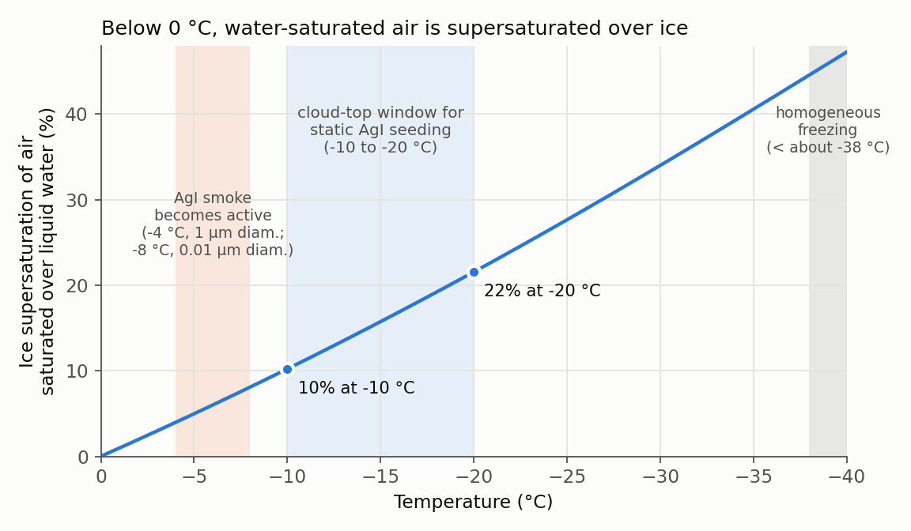

2026년 3월 첫 랩미팅에서 "What is Cloud Seeding?"이라는 제목으로 인공강우의 큰 그림을 발표했다. 이 글은 그 발표 자료와 질의응답 준비 노트를 원 논문·교재와 다시 대조해, 근거를 확인한 내용만 남긴 정리다. 질문은 하나다. **구름에 무엇을 넣으면, 비가 만들어지는 사슬의 어느 고리가 바뀌는가?**

::: {.review-verdict}
**핵심 정리.** 인공강우는 구름이 없는 곳에서 비를 만드는 기술이 아니다. 이미 있는 구름에서 강수를 막고 있는 병목, 즉 차가운 구름의 **빙정핵 부족**이나 따뜻한 구름의 **느린 충돌·병합**을 골라 그 병목을 푸는 입자를 넣는 기술이다. 병목이 없는 구름에서는 효과도 기대하기 어렵다.
:::

## 비가 내리는 두 가지 길

반지름 10 µm 구름방울과 반지름 1 mm 빗방울은 부피가 약 100만 배 차이 난다. 구름방울 하나는 거의 떨어지지 않으므로, 비가 되려면 수많은 구름방울의 물이 한 입자로 모여야 한다. 그 길은 크게 두 가지다 [@Bruintjes1999Review; @Houze2014CloudMicrophysics].

| | Warm rain (따뜻한 비) | Cold rain (차가운 비, ice process) |
|---|---|---|
| 일어나는 구름 | 구름 꼭대기까지 0 °C보다 따뜻한 구름 | 꼭대기가 0 °C보다 차가운 구름 |
| 핵심 과정 | 응결 → 충돌·병합(collision–coalescence) | 빙정 생성 → 증착 성장 → riming·aggregation |
| 출발에 필요한 것 | 주변보다 큰 구름방울(collector) | 빙정핵(ice nucleating particle, INP) |
| 대표 병목 | 응결로 생긴 방울이 작고 크기가 고르면 충돌이 드묾 | 0 °C 아래에서도 얼지 않는 과냉각 물방울과 부족한 빙정핵 |
| 대응하는 씨뿌리기 | 흡습성(hygroscopic) 씨뿌리기 | 빙정핵(glaciogenic) 씨뿌리기 |

: 강수 형성의 두 경로와 씨뿌리기의 대응 {.review-data}

실제 구름에서는 두 경로가 함께 작동하기도 한다. 그래서 그때 어떤 경로가 우세한지에 따라 씨뿌리기 반응도 달라진다는 것이 Bruintjes (1999)가 강조하는 점이다.

## 차가운 구름: 물방울은 0 °C에서 얼지 않는다

순수한 물방울이 다른 도움 없이 얼어붙는 균질 결빙(homogeneous freezing)은 약 −35 ~ −40 °C보다 차가워야 일어난다. 그래서 0 °C에서 약 −38 °C 사이의 구름에는 얼지 않은 과냉각 물방울이 흔히 남아 있다 [@Houze2014CloudMicrophysics]. 이 온도 범위에서 얼음이 생기려면 얼음과 비슷한 표면을 제공하는 입자, 즉 빙정핵이 필요하다.

자연 빙정핵은 생각보다 드물다. Houze 교재의 정리에 따르면 점토 광물 먼지는 대략 −10 ~ −37 °C에서 작동하고, −1 ~ −10 °C처럼 따뜻한 과냉각에서는 식물 유래 박테리아가 매우 낮은 농도로만 얼음을 만든다. **따뜻한 과냉각 구간에서 빙정핵이 부족하다는 사실**이 인공 빙정핵을 뿌리게 된 출발점이다.

얼음이 일단 생기면 빠르게 자란다. 같은 온도에서 얼음 위 포화수증기압이 물 위 포화수증기압보다 낮기 때문이다. 물에 대해 포화된 공기는 얼음 입장에서 과포화 상태이고, 빙정은 수증기를 흡수하며 자라고 주변 물방울은 증발한다. 이것이 Wegener–Bergeron–Findeisen(WBF) 과정이다. Schaefer (1946)도 실험 중 물방울을 더 넣으면 빙정만 커지는 현상을 같은 이유로 설명했다 [@Schaefer1946DryIce].

{fig-alt="Line chart of ice supersaturation of water-saturated air versus temperature from 0 to minus 40 degrees Celsius, about 10 percent at minus 10 and 22 percent at minus 20, with shaded bands for AgI activation, the static seeding window, and homogeneous freezing"}

계산해 보면 이 차이는 −10 °C에서 약 10%, −20 °C에서 약 22%다 [@Murphy2005VapourPressure]. 구름 속 과포화도가 보통 1%를 넘기 어렵다는 점을 생각하면, 빙정은 물방울에 비해 압도적으로 유리한 조건에서 자란다.

## 얼음이 시작되는 네 가지 방식

빙정핵이 얼음을 만드는 방식은 입자가 어디에 있느냐에 따라 나뉜다 [@Houze2014CloudMicrophysics].

| 방식 | 일어나는 일 |
|---|---|
| Deposition nucleation | 수증기가 액체를 거치지 않고 입자 표면에 바로 얼음으로 붙는다 |
| Condensation (-freezing) nucleation | 빙정핵이 CCN 역할도 해서, 그 위에 맺힌 물방울이 냉각되면 언다 |
| Immersion freezing | 이미 물방울 속에 들어간 다른 입자가 온도가 내려가면 결빙을 시작한다 |
| Contact nucleation | 공기 중 빙정핵이 과냉각 물방울에 부딪히는 순간 물방울이 언다 |

: 불균질 빙정 핵생성의 네 가지 방식 {.review-data}

어느 방식이든 핵심은 **결정 격자의 닮음**이다. 얼음 결정은 분자가 매우 규칙적으로 배열되어 있어, 표면 격자가 얼음과 어긋날수록 경계면에 변형과 어긋남이 생기고 핵생성 효율이 떨어진다.

## 1946–1947: 드라이아이스와 요오드화은

**Schaefer (1946).** 냉동 챔버(위 −10 °C, 아래 −20 °C, 중심 약 −15 °C)에 과냉각 구름을 만들고 탄소, 화산재, 활석 등 온갖 먼지를 넣었지만 구름은 얼지 않았다. 그런데 드라이아이스 조각을 넣자 10초도 안 되어 구름 전체가 빙정으로 바뀌었다 [@Schaefer1946DryIce]. 액체 공기로 식힌 막대나 −35 °C의 구리 막대를 −12 °C 구름에 넣어도 빙정이 쏟아졌다. 즉 드라이아이스는 빙정핵이 아니라 **냉각제**다. 주변 공기를 균질 결빙 한계 아래로 식혀 얼음 입자를 대량으로 만든다. 논문 끝에서 Schaefer는 비행기로 드라이아이스를 뿌리는 대규모 실험을 예고했고, 실제 구름에 대한 첫 씨뿌리기는 그해 이루어졌다 [@Bruintjes1999Review].

**Vonnegut (1947).** 같은 연구소의 Vonnegut은 결정학 자료에서 얼음을 가장 닮은 물질을 찾았다 [@Vonnegut1947AgI].

| | 얼음 (ice) | 요오드화은 (AgI) | 차이 |
|---|---:|---:|---:|
| 결정계 | hexagonal | hexagonal | — |
| 격자상수 a | 4.535 Å | 4.585 Å | 약 1.1% |
| 격자상수 c | 7.41 Å | 7.490 Å | 약 1.1% |

: Vonnegut (1947) Table I의 격자상수 비교 {.review-data}

두 방향 모두 약 1% 이내로 일치한다. 처음 시험한 AgI 분말은 효과가 없었는데, 나중에 시료가 수용성 염으로 오염되어 있었던 것으로 밝혀졌다. 이후 AgI를 불꽃이나 뜨거운 필라멘트로 기화시켜 만든 미세 연기가 엄청난 수의 빙정핵을 만들었다. 직경 약 1 µm 연기는 −4 °C부터, 직경 약 0.01 µm(100 Å) 연기는 −8 °C부터 효과적이었고, 당시 발생기는 AgI를 초당 1 mg 소비해 초당 약 $10^{13}$개의 유효 핵을 만들었다. −4 °C의 얇은 과냉각 안개에 연기를 흘리자 발생기에서 최소 150 ft(약 46 m)까지 안개가 빙정으로 바뀌었다.

::: {.callout-note}
초당 $10^{13}$개는 1947년 실험실 발생기 하나의 측정값이다. 같은 논문에서도 이론상 1 mg이 약 $3\times10^{14}$개 입자를 만들어야 한다고 계산해 수십 배 차이를 인정한다. 실제 대기에서 AgI가 얼마나 활성화되는지는 별개의 문제이고, 이 글에서는 다루지 않는다. 또한 자료마다 격자상수가 조금씩 다르게 인용되므로 위 표는 Vonnegut 원문 값을 그대로 썼다.
:::

## 씨뿌리기의 세 갈래

| 개념 | 노리는 병목 | 기대하는 인과 사슬 | 주의할 점 |
|---|---|---|---|
| Static (빙정핵) | 빙정핵 부족 | AgI·드라이아이스 → 빙정 수 증가 → 증착·riming 성장 → 강수 | 기회의 창이 좁다. 대류운의 경우 꼭대기 약 −10 ~ −20 °C의 대륙성 cold-based 구름에서 과냉각 액체수가 충분할 때로 제한된다 |
| Dynamic (빙정핵) | 약한 상승류 | 대량 결빙 → 융해잠열 방출 → 부력·상승류 강화 → 구름 성장 | 사슬이 길고 대류운의 자연 변동이 크다. Houze 교재는 적운형 구름에서 이 효과가 입증된 적 없다고 정리한다 |
| Hygroscopic (흡습성) | 느린 충돌·병합 | 큰 흡습성 입자 → 넓은 방울 스펙트럼 → 충돌·병합 조기 시작 | 해양성 구름처럼 이미 병합이 효율적인 구름에서는 효과가 없다 |

: 씨뿌리기 개념별 병목과 한계 [@Bruintjes1999Review; @Houze2014CloudMicrophysics] {.review-data}

세 개념의 역사와 실험 평가는 [Bruintjes (1999) 리뷰](../../article-review/2026-05-20-cloud-seeding-review/index.qmd)에서 따로 정리했다.

## 무엇을 뿌리나

| 물질 | 대상 구름 | 작용 방식 | 근거 |
|---|---|---|---|
| 드라이아이스 (고체 CO₂) | 과냉각 구름 | 핵이 아니라 냉각제. 국소적으로 공기를 매우 차갑게 만들어 빙정을 대량 생성 | Schaefer (1946) |
| 요오드화은 (AgI) | 과냉각 구름 | 얼음과 닮은 격자로 빙정핵 역할. 연소·기화로 미세 연기를 만들어 살포 | Vonnegut (1947), Houze (2014) |
| 흡습성 염 (NaCl 등) | 따뜻한 구름 | 물을 끌어당겨 큰 방울이 되어 충돌·병합의 출발점이 됨 | Bruintjes (1999) |

: 대표 씨뿌리기 물질 {.review-data}

발표에서는 BiI₃, TiO₂로 감싼 NaCl(core–shell), 전하를 띤 물방울 같은 연구 단계 물질도 소개했지만, 성능 수치의 원출처를 확인하지 못해 표에서 뺐다. 전하를 이용하는 방식은 [음이온 씨뿌리기 리뷰](../../article-review/2026-05-20-negative-ion-seeding/index.qmd)에서 다뤘다.

## 왜 따뜻한 구름의 흡습성 씨뿌리기인가

따뜻한 비의 병목은 **크기의 틈**에 있다. 응결은 비슷한 크기의 작은 방울을 많이 만들고, 충돌·병합은 주변보다 확실히 큰 collector가 있어야 시작된다. Bruintjes (1999)는 이 틈을 메우는 흡습성 씨뿌리기를 두 방식으로 정리한다.

- **빗방울 씨앗(embryo) 방식:** 직경 10 µm보다 큰 염 입자를 넣어 CCN 단계를 건너뛰고 바로 충돌·병합을 시작시킨다. 많은 양의 염이 필요하고 구름 전체에 고르게 퍼뜨리기 어렵다.
- **Flare 방식:** 구름 밑에서 직경 약 0.5 µm 염 입자를 태워 공급한다. 큰 인공 CCN이 먼저 활성화되어 수증기를 가져가면 자연 CCN이 덜 활성화되고, 더 적은 방울이 더 크게 자라 방울 스펙트럼이 넓어진다. 남아프리카의 무작위 실험(1991–1996, 폭풍 127개)에서는 씨뿌린 폭풍의 강수량이 대조 폭풍보다 95% 신뢰수준에서 유의하게 컸다. 다만 Bruintjes는 입자의 확산·수송 같은 근본 문제가 아직 남아 있다고 덧붙인다.

내가 이 경로를 고른 이유는 세 가지다. 첫째, 얼음 과정 없이 **응결과 충돌·병합만으로 인과 사슬을 닫을 수 있어** 0차원 parcel 모형에서 한 고리씩 검증하기 좋다. 둘째, 같은 물질도 입자 크기·흡습성(κ)·주입량·주입 시점과 배경 에어로졸·상승류에 따라 결과가 달라질 수 있어, 민감도 분석으로 물을 질문이 분명하다. 셋째, 수증기 경쟁이 핵심이라면 잘못된 조건에서는 오히려 강수를 늦출 가능성도 따져 봐야 한다. 이 질문들은 [따뜻한 구름의 미세물리 노트](../2026-04-08-warm-rain-microphysics/index.qmd)와 [PySDM 실험](../../../experiments.qmd)으로 이어진다.

## 덧붙임: 운형별로 다시 본 적합성

이후(2026년 9월) 운형별로 따뜻한 구름 흡습성 씨뿌리기의 연구 대상 적합성을 다시 정리했다. 문헌의 정량 기준이 아니라 대표 상(phase)과 주요 강수 과정에 근거한 **내 정성적 판단**이다.

| Cloud type | 대표 phase | 주요 강수 과정 | 적합성 |
|---|---|---|---|
| Cumulus | liquid, 경우에 따라 mixed | condensation → collision–coalescence | 매우 적합 |
| Stratocumulus | 주로 liquid, 추우면 mixed | autoconversion + accretion → drizzle | 잠재적으로 적합 |
| Stratus | 주로 liquid | 약한 collision–coalescence → drizzle | 제한적 |
| Altocumulus | liquid / supercooled / mixed | liquid coalescence 또는 ice process | 제한적 |
| Nimbostratus, Altostratus | 대개 mixed / ice | deposition, aggregation, melting | 대체로 부적합 |
| Cirrus 계열 | ice | ice nucleation, deposition | 대체로 부적합 |

: 운형별 warm hygroscopic seeding 연구 적합성(정성적 정리) {.review-data}

"부적합"은 그 구름을 바꿀 수 없다는 뜻이 아니라, 따뜻한 구름 흡습성 경로의 연구 대상으로 맞지 않는다는 뜻이다.

## 남은 질문

- 실험실에서 측정한 빙정핵 활성이 실제 구름의 난류, 자연 빙정핵 경쟁, 입자 제거 속에서 얼마나 유지되는가?
- 살포 물질이 목표 구름의 목표 부피에 실제로 도달했는지를 어떻게 확인하는가?
- 강수의 큰 자연 변동 속에서 통계적 신호와 물리적 증거를 함께 닫으려면 무엇을 측정해야 하는가?

## 참고문헌 {.unnumbered}

::: {#refs}
:::
