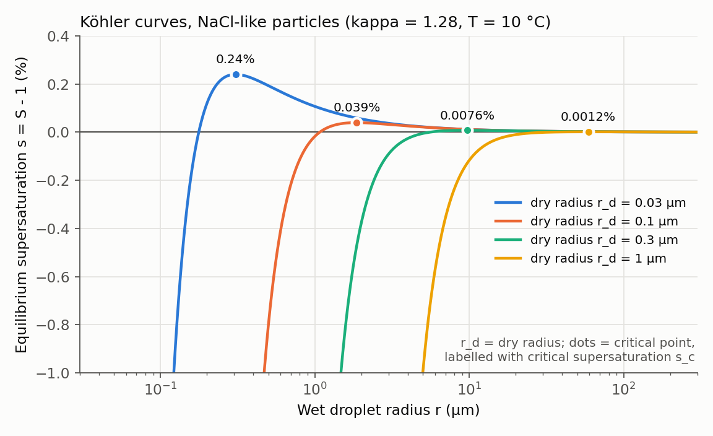
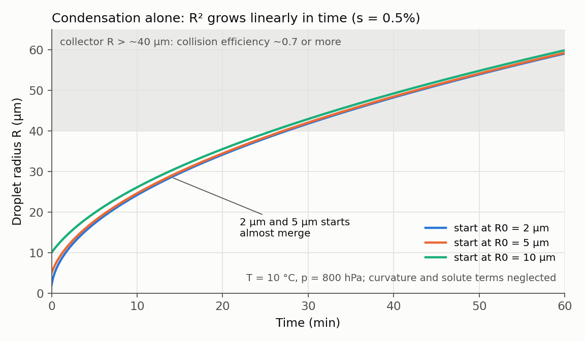

4월 랩미팅에서 연구 현황으로 Houze의 *Cloud Dynamics* 3장(Cloud Microphysics) 중 따뜻한 구름 부분(3.1절)을 읽은 노트를 보고했다. 이 글은 그 노트를 교재 원문과 다시 대조해 쓴 정리다. 식 번호는 교재 2판(2014)을 따른다 [@Houze2014CloudMicrophysics]. 질문은 이것이다. **0.1 µm 규모의 에어로졸이 어떻게 구름방울이 되고, 구름방울은 어떻게 빗방울이 되며, 흡습성 씨뿌리기는 그 사이 어디에 손을 대는가?**

::: {.review-verdict}
**핵심 정리.** 순수한 물방울은 대기에서 스스로 생기지 못하므로 구름방울은 CCN 위에서 시작한다. 응결은 작은 방울을 빠르게 키우지만 클수록 느려지고($R^2 \propto t$), 충돌·병합은 주변보다 큰 collector가 있어야 시작된다. 이 두 과정 사이의 크기 틈이 따뜻한 비의 병목이고, 흡습성 씨뿌리기는 이 틈을 건너뛸 큰 방울을 만들거나 방울 사이의 수증기 경쟁을 바꾸려는 시도다.
:::

## 먼저 표기와 크기

| 기호 | 뜻 | 주의 |
|---|---|---|
| $S = e/e_s$ | 포화비(saturation ratio). $e$는 수증기압, $e_s$는 평평한 순수 물 위 포화수증기압 | $S=1$이 포화(RH 100%) |
| $s = S-1$ | 과포화도(supersaturation) | $s=0.01$이 1%. 교재 식 (3.15)의 $\tilde S$ |
| $R$ | 물방울 반지름 | 직경은 $D=2R$ |
| $r_d$ | 건조 입자 반지름(dry radius) | 물을 흡수하기 전 에어로졸 크기 |

| 입자 | 대표 크기 | 비고 |
|---|---|---|
| CCN(건조) | 반지름 약 0.01–1 µm | 교재는 "0.1 µm 규모"로 소개. 반지름 1 µm 이상은 흔히 giant CCN |
| 구름방울 | 직경 1–100 µm | 낙하속도 1 m s⁻¹ 미만 |
| 이슬비(drizzle) | 직경 50 µm ~ 수백 µm | 가장 작은 액체 강수 |
| 빗방울 | 직경 수백 ~ 수천 µm | 반지름 약 3 mm에서 낙하속도가 거의 일정 |

: 표기와 입자 크기. 교재의 크기 분류는 직경, 식은 반지름 기준이다 {.review-data}

## 1. 순수한 물방울은 스스로 생기지 못한다: Kelvin 효과

수증기 분자들이 우연히 모여 반지름 $R$의 순수한 물방울 씨앗을 만들 때 필요한 순에너지는 다음과 같다.

$$
\Delta E = 4\pi R^2\sigma_{vl} - \tfrac{4}{3}\pi R^3 n_l\,(\mu_v-\mu_l), \qquad \mu_v-\mu_l = k_B T \ln S \tag{3.1–3.2}
$$

말로 읽으면 "씨앗을 만드는 순비용 = 표면을 새로 만드는 비용 − 분자가 액체로 들어가며 얻는 이득"이다. $\sigma_{vl}$은 단위 면적의 수증기–물 경계면을 만드는 일(표면장력), $n_l$은 물방울의 단위 부피당 분자 수, $\mu_v-\mu_l$은 분자 하나가 기체에서 액체로 옮겨갈 때의 깁스 자유에너지 차이다. $S<1$이면 두 항이 모두 비용이 되어 씨앗은 늘 증발한다. $S>1$이면 작은 $R$에서는 표면 항($R^2$)이, 큰 $R$에서는 부피 항($R^3$)이 이겨 에너지 장벽이 생긴다. 장벽의 꼭대기를 $\partial(\Delta E)/\partial R=0$으로 찾으면 Kelvin 식이 나온다.

$$
R_c = \frac{2\sigma_{vl}}{n_l k_B T \ln S}
\tag{3.3}
$$

$R_c$보다 작은 씨앗은 증발하고, 우연히 $R_c$를 넘은 씨앗만 자란다. 포화($S=1$)에서는 $\ln S=0$이라 $R_c\to\infty$이므로 반드시 과포화가 필요하다. 10 °C에서 직접 계산해 보면 차이가 분명하다.

| $S$ | $s$ | $R_c$ | 우연히 모여야 하는 분자 수 |
|---:|---:|---:|---:|
| 1.01 | 1% | 0.11 µm | 약 $2\times10^{8}$ |
| 2 | 100% | 1.6 nm | 약 560 |
| 4.5 | 350% | 0.73 nm | 약 55 |

: Kelvin 식 (3.3)으로 계산한 임계 반지름(T = 10 °C, σ = 0.072 J m⁻²) {.review-data}

교재에 따르면 균질 핵생성률은 $S$가 약 4–5에 이를 때 급격히 커진다. 즉 과포화도가 300–400%는 되어야 하는데, 대기의 과포화도는 1%를 넘는 일이 드물다. 그래서 **균질 핵생성은 자연 구름에서 역할을 하지 않는다.**

::: {.callout-warning title="S와 s를 섞지 않기"}
"과포화도 1%"는 $S=1.01$, $\ln S\approx0.01$이다. $\ln 1=0$이 되는 것은 $S=1$(포화)일 때다. 균질 핵생성에 필요한 조건도 "$S\approx4$–5", 곧 RH 400–500%, $s\approx$ 300–400%로 세 표기를 구분해 적어야 한다.
:::

## 2. 에어로졸이 출발점을 바꾼다: Raoult 효과와 Köhler 곡선

실제 구름방울은 에어로졸 표면에 물이 모이는 불균질 핵생성으로 생긴다. 물에 잘 젖는 입자 위에서는 같은 수의 분자로도 곡률 반지름이 커서 Kelvin 장벽을 넘기 쉽다. 입자가 물에 녹으면 용액의 평형 수증기압이 순수한 물보다 낮아져(Raoult 효과) 더 유리하다. 교재는 그래서 **가장 크고 가장 잘 녹는 CCN 위에 첫 구름방울이 생긴다**고 정리한다. 이 두 효과를 함께 쓰면 물방울 표면의 평형 수증기 밀도는 다음과 같다.

$$
\rho_v(R)=\rho_{vs}[T(R)]\left(1+\frac{\hat a}{R}-\frac{\hat b}{R^3}\right), \qquad \hat a=\frac{2\sigma_{vl}}{\rho_L R_v T}, \qquad \hat b=\frac{3 i_{vH} m_s M_w}{4\pi\rho_L M_s} \tag{3.18–3.20}
$$

말로 읽으면 "물방울 표면에서 평형을 이루는 수증기 = 평평한 순수 물 위 포화값 × (1 + 곡률 보정 − 용질 보정)"이다. $\hat a/R$은 작은 방울일수록 커지는 Kelvin 항, $\hat b/R^3$은 녹은 염의 질량 $m_s$와 이온 수(van't Hoff 인자 $i_{vH}$)가 클수록, 염의 분자량 $M_s$가 작을수록 커지는 Raoult 항이다. 방울이 커지면 용액이 묽어져 $R^3$로 빠르게 줄어든다.

평형 포화비 $S_{eq}(R)\approx 1+\hat a/R-\hat b/R^3$를 그린 것이 Köhler 곡선이다. 작은 $R$에서는 용질 항이 이겨 $S_{eq}<1$인 haze 방울로 존재하고, 큰 $R$에서는 곡률 항이 남아 1보다 조금 크다. $dS_{eq}/dR=0$으로 찾은 최대점은 $R_c=\sqrt{3\hat b/\hat a}$, $s_c=\sqrt{4\hat a^3/(27\hat b)}$이다. 주변 과포화도가 임계 과포화도 $s_c$를 넘으면 방울은 $R_c$를 지나 계속 자라는데, 이것을 **활성화(activation)**라고 부른다. $\kappa$-Köhler 이론에서는 묽은 용액에서 $\hat b\approx\kappa r_d^3$이므로 $s_c \propto r_d^{-3/2}\kappa^{-1/2}$가 된다. 자세한 형태는 [κ-Köhler 리뷰](../../article-review/2026-07-15-kappa-kohler/index.qmd)에 정리했다 [@Petters2007Kappa].

{fig-alt="Köhler curves for dry radii 0.03, 0.1, 0.3 and 1 micrometre with kappa 1.28; critical supersaturation falls from 0.24 percent to 0.0012 percent as dry radius increases"}

| 건조 반지름 $r_d$ | $s_c$ (κ = 0.61, 황산암모늄) | $s_c$ (κ = 1.28, NaCl) | $R_c$ (NaCl) |
|---:|---:|---:|---:|
| 0.03 µm | 0.35% | 0.24% | 0.31 µm |
| 0.1 µm | 0.057% | 0.039% | 1.9 µm |
| 0.3 µm | 0.011% | 0.0076% | 9.7 µm |
| 1 µm | 0.0018% | 0.0012% | 59 µm |

: κ-Köhler 식의 최대점을 수치로 찾은 값(T = 10 °C, σ = 0.072 J m⁻²). κ는 Petters & Kreidenweis (2007)의 CCN 기반 값 {.review-data}

건조 반지름이 10배 커지면 $s_c$는 약 30배 작아지고, κ가 두 배가 되어도 $s_c$는 약 0.7배가 될 뿐이다. 이 범위에서는 **크기가 화학보다 활성화를 더 강하게 좌우한다.** 반지름 1 µm인 giant CCN은 $s_c$가 0.001% 수준이라 사실상 어떤 구름에서도 활성화되지만, $R_c$가 수십 µm여서 "활성화되느냐"보다 "얼마나 빨리 collector 크기에 닿느냐"로 보는 편이 유용하다.

## 3. 응결 성장: 작은 방울은 빨리, 큰 방울은 느리게

활성화된 방울은 수증기 확산(Fick의 법칙)으로 자란다. 정상 상태의 구 대칭 확산과 열수지를 결합하면, 포화에 가까운 환경에서 질량 성장률은 다음과 같다.

$$
\dot m = \frac{4\pi R\, s}{F_\kappa + F_D}, \qquad F_\kappa=\frac{L^2}{\kappa_a R_v T^2}, \qquad F_D=\frac{R_v T}{D_v e_s} \tag{3.14–3.17}
$$

말로 읽으면 "질량 성장률 = $4\pi R$ × 과포화도 ÷ (열전도 저항 + 수증기 확산 저항)"이다. $s$는 성장의 구동력이다. $F_\kappa$는 응결로 나온 잠열($L$)이 방울을 데워 표면 포화수증기압을 높이므로 그 열을 공기의 열전도($\kappa_a$)로 빼내야 한다는 제약이고, $F_D$는 수증기가 공기 속을 확산($D_v$)해 와야 한다는 제약이다. 질량 대신 반지름으로 바꾸면($m=\tfrac43\pi R^3\rho_L$),

$$
R\frac{dR}{dt}=\frac{s}{\rho_L(F_\kappa+F_D)}\equiv G\,s \quad\Longrightarrow\quad R^2 = R_0^2 + 2Gs\,t .
$$

교과서에 따라 $\rho_L$을 $F$ 안에 넣어 $R\,dR/dt=(S-1)/(F_k+F_d)$로 쓰기도 한다. 핵심은 $dR/dt = Gs/R$, 즉 **방울이 클수록 반지름 성장이 느려진다**는 것이다. 작은 방울이 큰 방울을 따라잡으므로 응결은 크기 분포를 좁힌다. 아주 작은 방울에서는 곡률·용질 항을 넣은 식 (3.21)을, 떨어지는 방울에서는 통풍 인자를 곱한 식 (3.22)–(3.23)을 써야 한다.

{fig-alt="Droplet radius versus time for condensation growth from initial radii 2, 5 and 10 micrometres at 0.5 percent supersaturation; the curves converge and reach 40 micrometres only after roughly 26 to 28 minutes"}

| 반지름 성장 구간 | s = 0.2% | s = 0.5% | s = 1% |
|---|---:|---:|---:|
| 5 → 10 µm | 3분 | 1.3분 | 0.6분 |
| 10 → 20 µm | 13분 | 5분 | 2.6분 |
| 10 → 50 µm | 1.7시간 | 41분 | 21분 |
| 10 → 100 µm | 7.1시간 | 2.8시간 | 1.4시간 |

: 내가 계산한 응결 성장 시간(T = 10 °C, p = 800 hPa, $G\approx9.7\times10^{-11}$ m² s⁻¹, s 일정 가정) {.review-data}

전형적인 적운의 수명이 30분 정도라는 점 [@Bruintjes1999Review]을 생각하면, 응결만으로 직경 수백 µm의 이슬비·빗방울을 만들기는 어렵다. 실제 구름에서는 $s$가 일정하지 않으므로 이 표는 규모를 보는 용도다.

## 4. 낙하속도와 충돌·병합

구름방울(직경 100 µm 미만)은 1 m s⁻¹보다 느리게 떨어진다. 낙하속도는 반지름 500 µm까지 거의 선형으로 커지다가 그보다 큰 방울에서는 증가가 둔해지고, 반지름 약 3 mm에서 방울이 납작한 원반처럼 찌그러지며 거의 일정해진다. 크기가 다른 방울은 낙하속도가 달라 서로 따라잡는다. 큰 방울 하나가 구름방울 사이를 떨어질 때의 연속 병합 식은 다음과 같다.

$$
\dot m_{col} = A_m\,\lvert V(m)-V(m')\rvert\,\rho q_{m'}\,\Sigma_c(m,m'), \qquad A_m=\pi(R+R')^2 \tag{3.24–3.25}
$$

말로 읽으면 "병합 성장률 = 1초 동안 쓸고 지나가는 부피(단면적 × 상대 낙하속도) × 그 부피 속 구름물 질량 × 실제로 붙는 비율"이다. $A_m$은 두 반지름의 합으로 정한 유효 단면적, 절댓값은 상대 운동만 중요하다는 뜻, $\rho q_{m'}$은 구름물 함량(g m⁻³)이다. 포집효율 $\Sigma_c$는 **충돌효율 × 병합효율**이다. 충돌효율은 큰 방울 주위 기류가 작은 방울을 비켜 가게 하면 1보다 작고, 후류에 끌려 들어오면 1보다 클 수도 있다. 병합효율은 부딪힌 두 방울이 실제로 합쳐지는 비율로, 모형에서는 흔히 1로 두지만 강한 비에서는 잠시 붙었다가 떨어지기도 한다.

$R\gg R'$이면 $A_m\approx\pi R^2$이고 $m=\tfrac43\pi R^3\rho_L$이므로 $dR/dt\approx\Sigma_c\lvert\Delta V\rvert\rho q_c/(4\rho_L)$가 된다. 응결과 반대로 **방울이 클수록 낙하속도와 충돌효율이 함께 커져 성장이 빨라진다.** 문제는 시작이다. 교재 그림 3.5(Wallace & Hobbs의 충돌효율 곡선)를 눈으로 읽으면, collector 반지름이 10 µm일 때 충돌효율은 최대 0.05 안팎, 20 µm일 때 0.2 안팎이고, 40 µm 이상이 되어야 0.7–1에 가까워진다. 실제 병합은 연속 과정이 아니라 확률 과정이라, 같은 크기에서 출발해도 운 좋게 먼저 충돌한 방울이 앞서 나간다(stochastic collection, 식 3.27–3.33). 교재가 소개한 계산 예에서는 약 30분 뒤 수로는 반지름 약 10 µm 구름방울이 압도적이지만, 물 질량의 상당 부분은 반지름 약 1 mm 빗방울로 옮겨 간다.

## 5. 두 과정 사이의 틈과 씨뿌리기가 들어가는 곳

| | 응결 | 충돌·병합 |
|---|---|---|
| 반지름 성장률 | $dR/dt = Gs/R$ | $dR/dt \approx \Sigma_c\lvert\Delta V\rvert\rho q_c/(4\rho_L)$ |
| 크기가 커지면 | 느려짐 | 빨라짐 |
| 크기 분포에 주는 영향 | 좁힘 | 넓힘 |
| 효율적인 구간 | 반지름 수 µm 이하 | collector 반지름 수십 µm 이상 |

: 따뜻한 비의 두 성장 과정 비교 {.review-data}

반지름 10 µm에서 수십 µm 사이에서는 응결은 이미 느려졌고 충돌효율은 아직 작다. 이 틈을 얼마나 빨리 건너는가가 따뜻한 구름의 강수 시작 시점을 정한다. Bruintjes (1999)가 정리한 흡습성 씨뿌리기의 두 방식은 바로 이 틈을 겨냥한다.

- **Embryo 방식:** 직경 10 µm보다 큰 염 입자를 넣어 처음부터 collector 후보를 공급한다. 틈을 건너뛰는 전략이다.
- **Flare 방식:** 직경 약 0.5 µm 염 입자를 구름 밑에서 공급한다. 큰 인공 CCN이 먼저 활성화되어 수증기를 가져가면 자연 CCN이 덜 활성화되고, 적은 수의 방울이 더 크게 자란다. 수증기 경쟁을 바꾸는 전략이다.

$R^2\propto t$ 그림에서 읽을 수 있는 점도 있다. 2 µm와 5 µm에서 출발한 방울은 20분 뒤 거의 같은 크기가 된다. 그래서 출발 크기가 조금 큰 것만으로는 이득이 금방 사라지고, collector에 가까운 크기를 직접 넣거나 경쟁자 수를 줄이는 쪽이 효과적이라는 것이 식에서 읽은 내 해석이다. 반대로 작은 흡습성 입자가 자연 CCN을 대체하지 못하고 방울 수만 늘리면 강수가 늦어질 수도 있다. 이후 읽은 Ren et al. (2025)은 2차원 bin 모형의 한 대류운 사례에서 같은 질량을 넣을 때 직경 0.1–0.9 µm 입자는 강수를 억제하고, 직경 약 2 µm를 넘으면 증대로 바뀐다고 보고했다 [@Ren2025ParticleSize]. 이 질문은 [Ren (2025) 0차원 재현 실험](../../experiments/2026-09-07-ren2025-parcel-replication/index.qmd)으로 이어진다.

## 참고문헌 {.unnumbered}

::: {#refs}
:::
