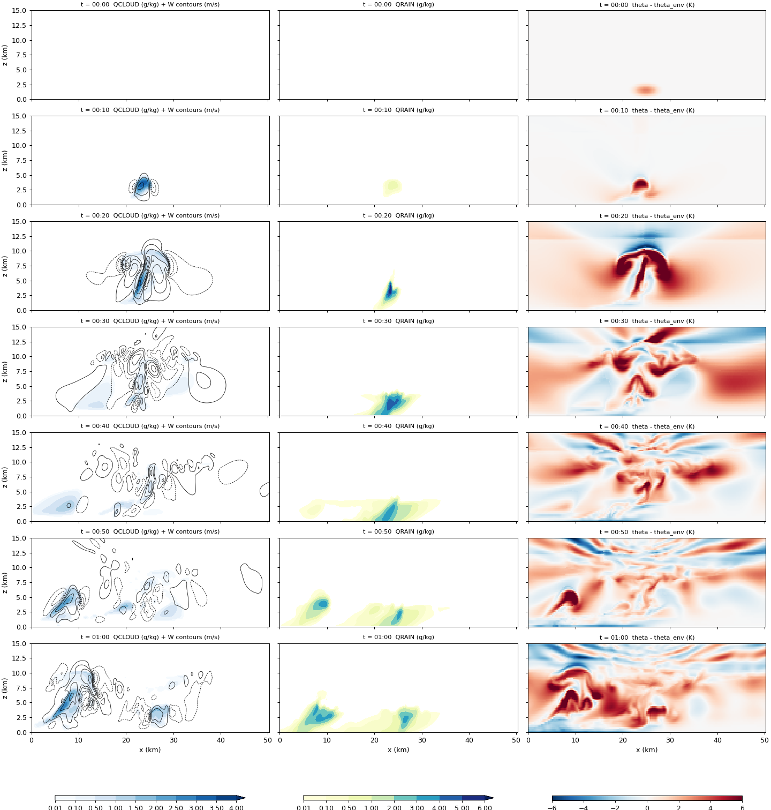
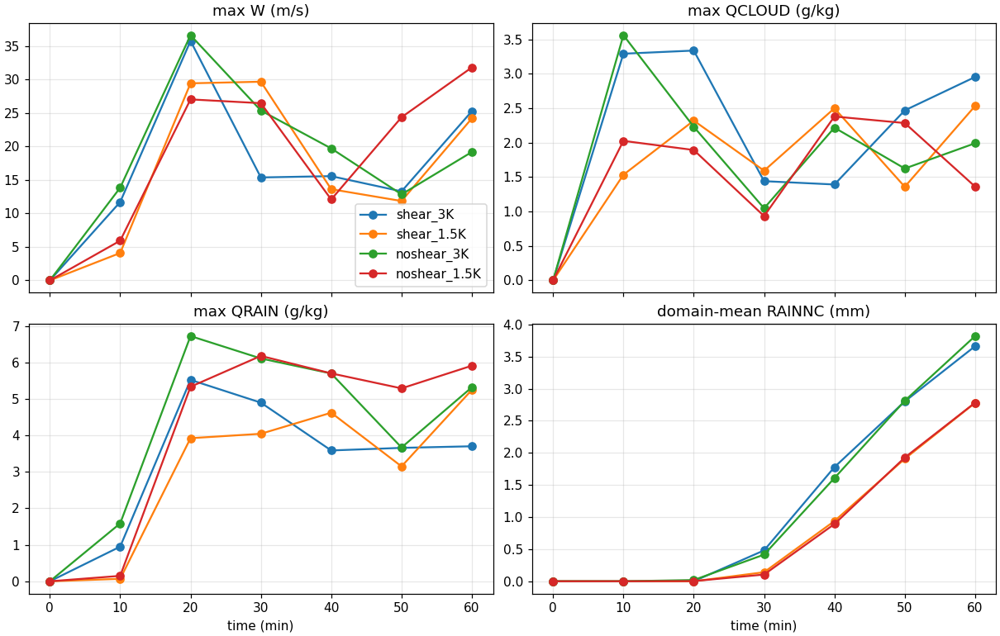
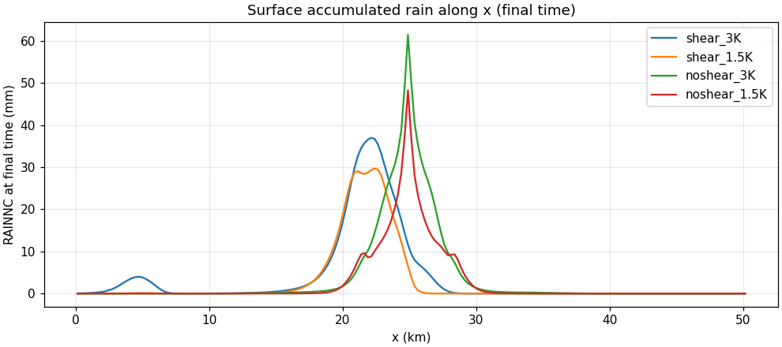
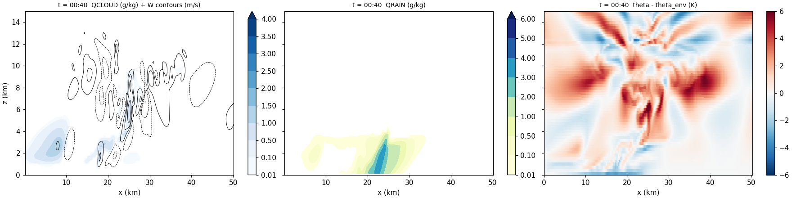
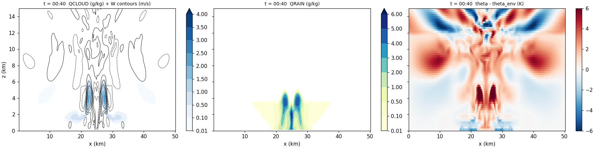
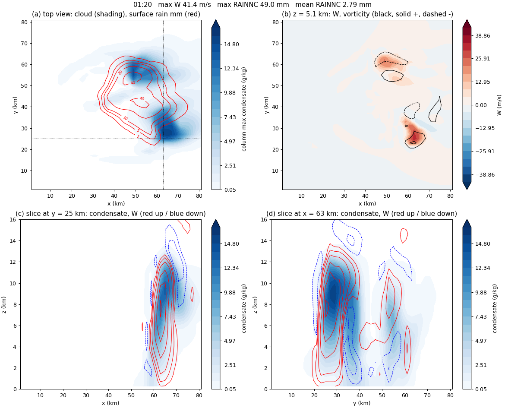
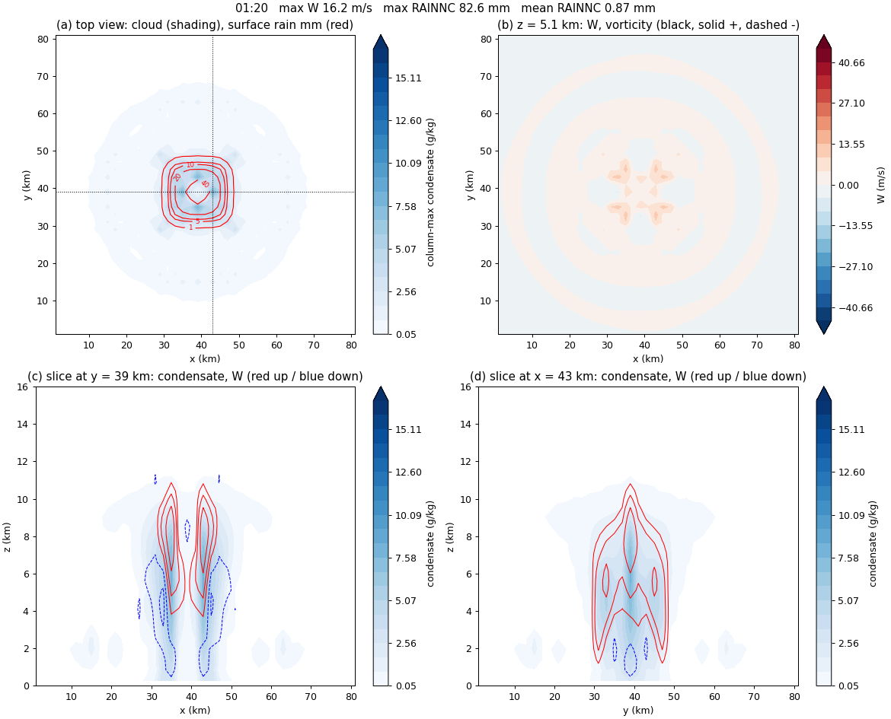

목표는 [Ren et al. (2025)](../../article-review/2026-09-10-ren2025-particle-size/index.qmd)의 2-D 흡습성 시딩 실험을 WRF로 다시 해 보는 것이다. 이 논문도 사운딩 하나와 열기포(warm bubble)로 구름을 만드는 **이상화(idealized)** 구성이라, 실제 사례용 전처리(WPS) 없이 WRF에 들어 있는 2-D 스콜선 예제 `em_squall2d_x`부터 시작했다. 이 글은 기본 예제를 연구실 서버에서 돌린 L1, 바람 시어와 열기포 세기를 바꾼 L2, 그리고 곁가지로 돌린 3-D 슈퍼셀 예제를 정리한다.

## 이상화 WRF의 실행 흐름

```
실제 사례:  재분석 자료 → WPS → real.exe → wrfinput + wrfbdy → wrf.exe → wrfout
이상화:     input_sounding + namelist.input → ideal.exe → wrfinput → wrf.exe → wrfout
```

| 파일 | 역할 |
|---|---|
| `input_sounding` | 연직 프로파일 한 개(고도별 온위, 혼합비, u, v). `ideal.exe`가 모든 격자점에 똑같이 깐다 |
| `namelist.input` | 격자, 시간, 물리 옵션. `ideal.exe`와 `wrf.exe`가 함께 읽는다 |
| `ideal.exe` | 사운딩 위에 열기포를 얹어 초기장 `wrfinput_d01`을 만든다 |
| `wrf.exe` | 시간 적분 후 `wrfout_d01_*`(NetCDF)을 쓴다 |
| `rsl.out.*`, `rsl.error.*` | MPI 프로세스마다 하나씩 생기는 로그 |
| `namelist.output` | WRF가 **실제로 적용한** 모든 설정(직접 쓰지 않은 기본값 포함) |

```bash
mpirun -np 4 ./ideal.exe
mkdir -p log_ideal; mv rsl.* log_ideal/        # ideal.exe 로그는 wrf.exe가 덮어쓰기 전에 옮겨 둔다
grep -q "SUCCESS COMPLETE IDEAL INIT" log_ideal/rsl.error.0000 || echo "ideal.exe 실패"
mpirun -np 4 ./wrf.exe
tail -1 rsl.out.0000                           # SUCCESS COMPLETE WRF 이면 성공
for f in rsl.error.*; do echo "== $f"; tail -3 $f; done   # 0번만 보지 말 것
grep -iE "mp_physics|time_step|e_sn" namelist.output       # 실제로 들어간 값
```

`rsl.error.0000`에 에러가 없어도 다른 프로세스 로그에만 에러가 찍힐 수 있다(다음 글의 fast SBM이 그랬다). 그리고 "이 옵션 기본값이 뭐였지?"는 문서보다 `namelist.output`을 grep하는 편이 빠르다.

## 2-D 예제를 그대로 돌리면 멈춘 곳

| 위치 | 예제 값 → 바꾼 값 | 이유 |
|---|---|---|
| `&domains e_sn` | 3 → **10** | MPI(dmpar) 빌드는 한 프로세스가 맡는 조각이 각 방향 10칸 이상이어야 해서 `ideal.exe`가 거부한다 |
| `&domains` 끝 | `nproc_x = 4`, `nproc_y = 1` 추가 | 지정하지 않으면 2 × 2로 나누려다 y가 다시 10칸 미만이 된다 |
| `&physics` 끝 | `ghg_input = 0` 추가 | WRF 4.6 기본값(1)은 온실가스 입력을 쓰는 복사 설정을 요구한다. 이 실험은 복사를 끈다 |
| 컴파일 | `./compile em_squall2d_x` 대신 `./compile em_quarter_ss` | 이름에 `2d`가 들어간 케이스는 dmpar 빌드에서 거부되고, 그 전에 기존 실행 파일까지 지워진다. `ideal.exe`는 실행 시 `&ideal ideal_case = 4`로 squall2d_x 초기장을 고른다 |

y는 주기 경계이고 열기포도 y로 균일해서, `e_sn`을 10으로 늘려도 결과는 2-D 그대로다. Lin 런의 y 줄끼리 강수 차이가 0인 것을 확인했다. 나머지 설정은 예제 기본값이다: dx = 250 m로 201칸(50 km), 연직 80층(꼭대기 20 km), dt = 3 s, 60분 적분, 10분 출력. 물리 과정은 미세물리(Lin, `mp_physics = 2`)만 켜고 복사·지표·경계층·적운 모수화는 끈다. 난류는 1.5차 TKE, x는 열린 경계, 위쪽 5 km는 Rayleigh 감쇠층이다. 4코어로 약 75초 걸렸다.

## 초기장: Weisman–Klemp 사운딩과 열기포

예제 사운딩의 온위·습도는 대류 모델링의 표준인 Weisman–Klemp 해석적 사운딩이다 [@Weisman1982Shear]. 첫 줄은 지면 기압 1000 hPa, 온위 300.5 K, 혼합비 14 g/kg이고, 그 아래로 250 m 간격 80줄이 이어진다.

$$\theta(z) = \theta_0 + (\theta_{tr} - \theta_0)\left(\frac{z}{z_{tr}}\right)^{5/4}, \qquad \mathrm{RH}(z) = 1 - \frac{3}{4}\left(\frac{z}{z_{tr}}\right)^{5/4} \quad (z \le z_{tr})$$

온위는 기준값 $\theta_0 = 300$ K에서 권계면 값 $\theta_{tr} = 343$ K까지 고도 $z$의 5/4제곱으로 서서히 커진다는 뜻이다. $z_{tr} = 12$ km는 권계면 고도이고, 그 위는 213 K 등온층이라 온위가 급격히 커진다(매우 안정). 맨 아래 약 350 m는 300.5 K로 일정한 혼합층이다. 상대습도는 지면 근처 거의 100 %에서 권계면 25 %까지 줄어든다. 하층 혼합비는 14 g/kg에서 잘려 1 km 남짓까지 일정하다. 정리하면 **하층은 습하고, 대류권은 조건부 불안정하고, 12 km에 뚜껑**이 있는 대기다. 파일 값으로 검산하면 375 m에서 $300 + 43 \times (375/12000)^{5/4} = 300.565$ K로 일치한다.

바람은 0–2.5 km에만 선형 시어가 있다: $u(z) = -12 + 12\,z/2500$ m/s (2.5 km 위는 0). 첫 층(125 m)의 u는 −11.4 m/s다. 절댓값보다 **고도에 따른 차이 12 m/s**가 물리적으로 중요하다.

열기포는 namelist가 아니라 `dyn_em/module_initialize_ideal.F`에 하드코딩되어 있다.

| 항목 | 값 |
|---|---|
| 세기 (중심 온위 편차) | +3 K (`delt = 3.`) |
| 중심 | 영역 가운데, 고도 1.5 km |
| 반경 | 수평 4 km, 연직 1.5 km (가장자리로 갈수록 0) |

그래서 기포 세기를 바꾸려면 소스를 고치고 `ideal.exe`를 다시 빌드해야 한다. 되돌릴 때도 예전 파일을 복사해 오면 수정 시각이 과거라 `make`가 다시 컴파일하지 않으므로, `sed`로 값을 되돌렸다.

## 실험 구성

모든 런은 Lin, dt = 3 s, 60분이며 바꾼 것은 한 번에 하나다.

| 런 | 사운딩 바람 | 열기포 | 확인하려던 것 |
|---|---|---|---|
| L1 | 예제 그대로 (시어 있음) | +3 K | 서버에서 예제가 제대로 재현되는가 |
| L2A | u = v = 0 (시어 없음) | +3 K | 시어는 비의 양을 바꾸는가, 위치를 바꾸는가 |
| L2B | 시어 있음 | +1.5 K | 방아쇠를 절반으로 줄이면 비도 줄어드는가 |
| L2B-noshear | u = v = 0 | +1.5 K | 두 효과가 겹치면 어떻게 되는가 (2 × 2 완성) |

## L1: 기본 스콜선의 한 시간

| 시각 | 최대 W (m/s) | 최대 구름물 (g/kg) | 최대 빗물 (g/kg) | 지점 최대 누적강수 (mm) |
|---|---:|---:|---:|---:|
| 10분 | 11.7 | 3.29 | 0.95 | 0.00 |
| 20분 | 35.8 | 3.34 | 5.53 | 0.04 |
| 30분 | 15.4 | 1.44 | 4.90 | 8.94 |
| 60분 | 25.3 | 2.95 | 3.70 | 37.02 |

{fig-alt="L1 em_squall2d_x with Lin microphysics: x-z sections of cloud water with vertical velocity contours, rain water, and potential temperature perturbation every 10 minutes from 0 to 60 minutes"}

0분에는 1.5 km 근처의 따뜻한 기포뿐이다. 10분에 2.5–5 km에 구름이 생기고, 20분에 상승류가 35.8 m/s로 정점을 찍으며 12 km 권계면 근처까지 솟는다. 지면 강수는 20–30분 사이에 시작한다(10분 출력 간격이라 "사이"로만 말할 수 있다). 비가 떨어진 뒤 지면 근처에 찬 공기(음의 온위 편차)가 퍼지고, 40분 이후 서쪽(x ≈ 5–10 km)에 새 구름이 자란다. 값이 예제 검증값과 같아서 서버 환경은 믿고 다음으로 넘어갔다.

## L2: 시어를 끄고, 열기포를 줄이고

| 60분, 영역 평균 / 지점 최대 | 열기포 +3 K | 열기포 +1.5 K |
|---|---|---|
| 시어 있음 | 3.66 / 37.0 mm | 2.78 / 29.7 mm |
| 시어 없음 | 3.82 / 61.5 mm | 2.78 / 48.3 mm |

표와 그림은 10월 말에 같은 비교 스크립트로 네 런을 다시 집계한 값이다. 처음 정리 때의 해석 일부(강수 시작 시각 등)를 이 재집계로 고쳤다.

{fig-alt="Time series of maximum vertical velocity, maximum cloud water, maximum rain water, and domain-mean accumulated rain for four runs: shear or no shear, with 3 K or 1.5 K warm bubble"}

{fig-alt="Surface accumulated rain along x at 60 minutes for the four L2 runs; no-shear runs peak sharply near x = 25 km while shear runs peak near x = 22 km"}

**시어는 양보다 위치와 집중도를 바꿨다.** 영역 평균은 시어 유무에 따라 −4 %(3 K), 0 %(1.5 K)로 거의 같았다. 대신 시어가 없으면 구름이 기울지 않고 기포 중심에 서 있어서, 같은 양의 비가 한곳(x ≈ 25 km)에 떨어져 지점 최대가 약 1.6배가 됐다. 시어가 있으면 구름이 기울며 비가 x ≈ 22 km 쪽으로 치우쳤다. "시어가 비를 넓게 퍼뜨린다"는 3 K에서만 맞았다(1 mm 이상 내린 폭: 3 K 14.8 vs 11.0 km, 1.5 K 9.0 vs 10.5 km).

{fig-alt="L1 with wind shear at 40 minutes: tilted updraft and rain shaft, new cloud forming on the west side"}

{fig-alt="L2A without wind shear at 40 minutes: cloud, rain, and temperature perturbation are left-right symmetric about the domain center"}

**열기포 세기는 총량을 바꿨다.** +3 K → +1.5 K에서 영역 평균은 −24 %(시어 있음), −27 %(시어 없음), 지점 최대는 약 −20 % 줄었다. 10분 상승류가 12–14 m/s에서 4–6 m/s로 느리게 출발했고, 30분 영역 평균은 1/3–1/4 수준(0.48 → 0.14, 0.42 → 0.10 mm)이었다. 다만 지면 강수 시작은 10분 출력 간격 안에서 구분되지 않았다.

::: {.callout-warning title="1.5 K 첫 실행은 바람이 빠져 있었다"}
1.5 K 실험을 처음 돌렸을 때, 시어가 있는 사운딩을 넣었다고 생각했는데 구름이 좌우 대칭으로 나왔다. `input_sounding`을 열어 보니 u가 전부 0이었다. WRF 예제 원본 파일까지 u = 0으로 바뀌어 있어서 "원본에서 다시 복사"해도 바람 없는 사운딩이 들어간 것이다. 원본 사운딩(둘째 줄 u = −11.4 m/s)을 되살려 다시 돌린 것이 위 표의 "시어 있음 + 1.5 K"이고, 최종 네 런은 다시 집계할 때 wrfout 초기장에서 열기포 세기와 바람을 확인했다. 그 뒤로 파일 이름이 아니라 **내용**을 확인한다: `sed -n 2p input_sounding`, 그리고 기준 런과 `diff namelist.input`.
:::

## 곁가지: 3-D 슈퍼셀에서 시어가 하는 일

3-D 결과를 어떻게 보는지, 2-D와 무엇이 다른지 익히려고 3-D 예제 `em_quarter_ss`(Kessler, dx = 2 km, 약 80 km 정사각 영역, 120분)를 예제 namelist·사운딩 그대로 돌리고, 사운딩의 u, v만 0으로 바꾼 런과 비교했다. 실행 파일은 이미 `em_quarter_ss`로 빌드한 것이라 다시 컴파일하지 않았다.

| 120분 | 시어 있음 (예제) | 바람 없음 (u = v = 0) |
|---|---|---|
| 최대 W | 40–100분 약 41–43 m/s 유지 | 20분 45 m/s 정점 → 40분 21 m/s |
| 5 km 최대 소용돌이도 | 20분부터 약 0.01 s⁻¹ | 약 0.002 s⁻¹ 이하 |
| 폭풍 모양 | 남북으로 분열, 동쪽으로 이동 | 제자리, 분열 없음 |
| 지면 강수 | V자 두 갈래, 지점 최대 약 80 mm | 가운데 원형 + 바깥 고리, 지점 최대 약 100 mm |
| 영역 평균 강수 | 약 9.7 mm | 약 2.2 mm |

{fig-alt="3-D quarter-circle shear supercell at 80 minutes: split storms with a V-shaped rain swath, updrafts overlapping positive and negative vertical vorticity at 5.1 km"}

{fig-alt="3-D no-wind run at 80 minutes: stationary storm with circular rain pattern at the domain center and a ring of weak cells, no significant vorticity"}

초반 20분은 오히려 바람 없는 쪽이 더 셌다. 시어가 있으면 상승류가 기울고 옆바람과 섞여 출발이 느리다. 그러나 바람이 없으면 비가 상승류 바로 위에서 떨어져 40분 안에 상승류를 끄는 단일 세포로 끝났다. 시어가 하는 일은 "처음에 세게"가 아니라 **"오래, 넓게"**였고, 영역 평균 강수가 약 4배였다. 바람 없는 런의 고리가 8각형인 것은 정사각 격자의 흔적이다. 2-D는 y로 끝없는 띠 모양이라 소용돌이도가 원리상 0이고, 2-D와 3-D의 "영역 평균"은 뜻이 달라 직접 비교하지 않는다.

::: {.review-verdict}
**결론.** 이 2-D 스콜선(Lin, 60분, 단일 런)에서 바람 시어는 비가 **어디에 얼마나 몰리는지**를, 열기포 세기는 비의 **총량**을 바꿨다. 3-D에서는 시어가 폭풍을 회전시키고 오래 유지시켜 총량까지 바꿨다.
:::

## 남은 질문

- 시어 유무에서 2-D 총강수가 거의 같은 이유는 확인하지 않았다. 런마다 한 번씩만 돌렸고, Lin 하나, 10분 출력이라 강수 시작 시각은 거칠다.
- Lin은 1-모멘트라 구름방울 수와 CCN이 없다. 시딩을 다루려면 미세물리를 바꿔야 한다 → [다음 글: 미세물리 스킴 비교와 fast SBM](../2026-09-29-microphysics-fsbm/index.qmd)

## 참고문헌 {.unnumbered}

::: {#refs}
:::
