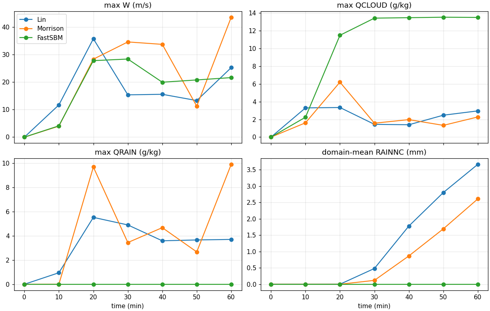
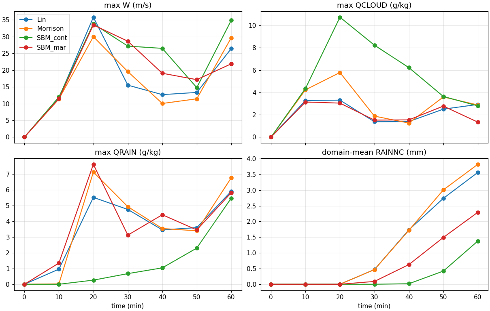
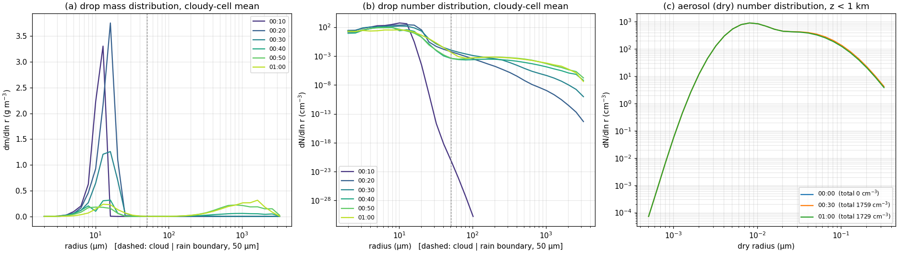
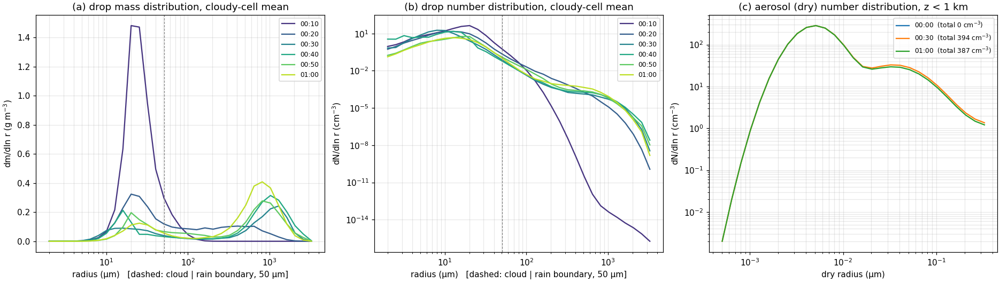

[앞 글](../2026-09-27-idealized-squall-line/index.qmd)의 Lin은 구름방울 수와 CCN을 모르는 1-모멘트 스킴이라, 흡습성 시딩처럼 "에어로졸 크기분포를 바꾸는" 실험을 표현할 수 없다. 시딩까지 가려면 에어로졸 bin을 가진 bin 미세물리가 필요해서 WRF의 fast SBM(`mp_physics = 30`)을 골랐다. 그 전에 같은 스콜선을 Lin → Morrison → fast SBM으로 바꿔 돌려 스킴마다 무엇이 다른지 보고, 마지막으로 fast SBM의 배경 에어로졸만 해양성으로 바꿨다. 가는 길에 fast SBM을 2-D로 쓸 때만 생기는 버그를 만났다.

## 세 스킴은 무엇이 다른가

| | Lin (2) | Morrison (10) | fast SBM (30) |
|---|---|---|---|
| 예측하는 것 | 수상체별 질량 (1-모멘트) | 질량 + 수농도 (2-모멘트) | 크기 bin별 분포 |
| 구름방울 수 | 없음 | 기본값 250 cm⁻³로 고정 | 에어로졸 활성화로 계산 |
| 에어로졸 | 없음 | 없음 (기본 설정) | 43 bin, 육지면 대륙성·바다면 해양성 분포 |
| 60분 적분 시간 (4코어) | 약 75초 (dt 3 s) | — | 약 25분 (dt 2 s) |

Lin과 Morrison 스킴의 원 논문은 각각 Lin et al. (1983), Morrison et al. (2009)이다 [@Lin1983BulkSnow; @Morrison2009SquallLine]. fast SBM의 물방울은 33 bin(반경 약 2 µm – 3.25 mm)으로, bin 1–14가 구름, bin 15(반경 약 50 µm)부터가 비다. 내 빌드에서는 full SBM(`mp_physics = 32`)을 쓸 수 없어 fast SBM만 썼다.

## fast SBM을 켜기 위한 준비

| 항목 | 설정 | 없으면 |
|---|---|---|
| 조견표 | `SBM_input_33/`, `scattering_tables_2layer_high_quad_1dT_1%fw_110/`를 런 폴더에 링크 | 시작하자마자 멈춤 |
| 이류 | `moist_adv_opt = 2`, `scalar_adv_opt = 2` | — |
| time step | **2 s** | 3 s에서 15분쯤 멈춤 (아래) |
| bin 출력 | `iofields_filename`으로 `ff1i01–33`, `ff8i01–43` 추가 | Registry상 보조 스트림(`h3`) 변수라 기본 wrfout에 없음 |

```bash
{ printf '+:h:0:'; for k in $(seq -w 1 33); do printf 'ff1i%s,' $k; done
  for k in $(seq -w 1 43); do printf 'ff8i%s,' $k; done; } | sed 's/,$/\n/' > sbm_iofields.txt
# &time_control 에 추가:  iofields_filename = "sbm_iofields.txt",  ignore_iofields_warning = .true.,
```

`ff1i`는 물방울 bin별 질량 혼합비(kg/kg), `ff8i`는 에어로졸 bin별 $dN/d\ln r$(#/kg)이다. 시딩 입자를 넣을 곳이 바로 `ff8i`다.

## 문제 1: dt 3 s에서 15분에 멈춤

`rsl.error.0000`은 모델 시각 00:15:33에서 그냥 멈춰 있었고, 에러는 1번 프로세스(구름이 자라던 구역) 로그 `rsl.error.0001`에만 있었다: `fatal error in ONECOND1-in (ABS(DAL1*DELMASSL1) > 3.0)`. 소스의 검사는 이런 뜻이다.

$$\Delta T = \frac{L}{c_p}\,\Delta q_l, \qquad |\Delta T| > 3\ \mathrm{K} \;\Rightarrow\; \text{정지}$$

한 번의 응결 계산에서 생긴 액체 혼합비 변화 $\Delta q_l$에 잠열 $L$을 정압비열 $c_p$로 나눈 값을 곱하면, 그 응결로 공기가 데워진 온도 $\Delta T$가 된다. 이 값이 한 스텝에 3 K를 넘으면 계산을 믿을 수 없다고 보고 스스로 멈춘다. 강한 상승류에서 time step이 길면 응결을 한 번에 몰아 계산하게 되므로, dt를 2 s로 줄여 완주했다. 이 오류가 아래 리셋 버그와 관련 있는지는 패치 뒤 3 s로 다시 확인하지 않았다.

## 문제 2: 완주했는데 비가 0 — 2-D 에어로졸 리셋 버그

dt 2 s로 끝까지 돌았지만 결과가 이상했다. 에러는 하나도 없었다.

| 증상 (패치 전) | 값 |
|---|---|
| 지면 강수, 빗물 | 60분 동안 0 |
| 최대 구름물 | 13.5 g/kg에서 평평 |
| 구름방울 수 | 약 30,000 cm⁻³ (보통 수백) |
| 물방울 크기 | 전부 반경 2–6 µm |
| 지면–1 km 에어로졸 (30 → 60분) | 1774 → 1775 cm⁻³, 소모가 없음 |

{fig-alt="Before the patch: time series where the fast SBM line shows maximum cloud water stuck near 13.5 g/kg and zero rain water and zero surface rain for 60 minutes, compared with Lin and Morrison lines from older 3-second time-step runs"}

비가 내리면 구름 밑 에어로졸은 활성화와 세정으로 줄어야 하는데 그대로였다. 누군가 매 스텝 에어로졸을 다시 채우고 있다는 뜻이다. `phys/module_mp_fast_sbm.F`(WRF 4.6.0, 약 4320행 부근)에서 원인을 찾았다.

```fortran
! itimestep > 1 이고 domain_id == 1 일 때 (내 소스에서는 MPI 빌드에서만 컴파일되는 블록)
if (i <= 5 .or. i >= IDE-5 .OR. &
    & j <= 5 .or. j >= JDE-5)THEN
   ! 에어로졸 bin(ff8i)을 초기 분포로 되돌림
```

3-D 실제 사례에서 영역 가장자리 5칸에 에어로졸을 계속 공급하는 측면 경계조건이다. 그런데 2-D 설정은 `e_sn = 10`이라 $JDE = 10$, $JDE - 5 = 5$다. y 줄 j = 1–9는 모두 "j ≤ 5 또는 j ≥ 5"를 만족하므로 **영역 전체**의 에어로졸이 매 스텝 초기값으로 돌아간다. 조건식으로 따지면 `e_sn`이 11 이하인 모든 설정이 그렇다. 에어로졸이 무한히 다시 채워지니 새 구름방울이 계속 생기고, 수만 개로 나눠 가진 물방울은 충돌·병합으로 자라지 못해 비가 되지 않았다. 시딩에는 더 치명적이다. `ff8i`에 넣은 시딩 입자가 다음 스텝에 덮어써진다.

패치는 y 조건만 끄고 x 방향 열린 경계의 에어로졸 공급은 그대로 두었다.

```bash
cp phys/module_mp_fast_sbm.F phys/module_mp_fast_sbm.F.orig
sed -i 's/& j <= 5 .or. j >= JDE-5)THEN/\& .false.)THEN   ! 2D patch: y-edge aerosol reset off (e_sn=10)/' phys/module_mp_fast_sbm.F
./compile em_quarter_ss > compile_fsbm_patch.log 2>&1
```

| | 패치 전 | 패치 후 |
|---|---|---|
| 구름방울 수 | 약 30,000 cm⁻³ | 438 / 341 / 292 cm⁻³ (10 / 20 / 30분) |
| 지면–1 km 에어로졸 (30 → 60분) | 1774 → 1775 cm⁻³ | 1759 → 1729 cm⁻³ (소모됨) |
| 60분 지점 최대 강수 | 0 mm | 10.6 mm |
| 물방울 분포 | 반경 2–6 µm에만 | 반경 약 1 mm에 빗방울 봉우리 |

::: {.callout-warning title="다른 2-D fast SBM 사용자에게"}
이 패치는 연구실 원본 WRF가 아니라 **내 작업용 사본**(WRF 4.6.0)에만 적용한 국소 수정이며, `e_sn = 10`인 이 2-D 설정에서만 확인했다. 공식 수정이 아니고 다른 버전의 소스는 보지 않았다. 증상(에러 없이 비 0, 구름방울 수만 개, 에어로졸이 줄지 않음)이 같다면 이 조건부터 확인해 볼 만하다.
:::

## 같은 dt 2 s에서 네 런 비교

Morrison도 dt에 민감해서(아래) 비교는 모두 dt 2 s로 맞췄다. 숫자는 10월 말에 모든 런을 같은 스크립트로 다시 집계한 값이고, 영역 평균은 모든 y 줄 평균이다.

| 60분, squall2d, dt 2 s | Lin | Morrison | SBM 대륙성 | SBM 해양성 |
|---|---:|---:|---:|---:|
| 영역 평균 강수 | 3.57 mm | 3.82 mm | **1.38 mm** | **2.29 mm** |
| 지점 최대 강수 (y 줄 범위) | 34.2 mm | 36.1 mm | 10.6 (9.9–10.6) mm | 24.1 (22.2–24.1) mm |
| 1 mm 이상 내린 폭 | 15.2 km | 14.0 km | 10.5 km | 11.2 km |
| 지면 강수 시작 (10분 출력) | 20–30분 | 20–30분 | 30–40분 | 20–30분 |
| 20분 최대 구름물 | 3.3 g/kg | 5.8 g/kg | 10.7 g/kg | 3.1 g/kg |

{fig-alt="Time series for Lin, Morrison, fast SBM continental, and fast SBM maritime at dt 2 s: fast SBM continental keeps high cloud water and produces the least domain-mean rain, maritime is intermediate"}

**Morrison은 time step에 민감했다.** 처음 dt 3 s 결과로 "Morrison은 Lin보다 비가 적고 초반 상승류가 약하다"고 정리했다가 철회했다.

| | 10분 최대 W | 최대 W | 60분 지점 최대 | 영역 평균 |
|---|---:|---:|---:|---:|
| Lin dt 3 → 2 s | 11.7 → 11.7 | 35.8 → 35.8 | 37.0 → 34.2 mm | 3.66 → 3.57 mm (−2 %) |
| Morrison dt 3 → 2 s | **4.0 → 11.4** | 43.6 → 30.0 | 29.0 → 36.1 mm | 2.61 → 3.82 mm (**+46 %**) |

대류가 막 시작되는 10분에 이미 차이가 크므로 혼돈 잡음이 아니라 수치적 원인으로 본다(어느 과정인지는 아직 모른다). 교훈은 두 가지다. 비교 실험은 같은 dt로 맞추고, 새 설정은 dt를 줄여 수렴을 한 번 확인한다. 그리고 시딩 효과는 이런 수치 민감도보다 확실히 커야 의미가 있다.

**Morrison의 비는 공중에서 늦게 생긴다.** 10분 최대 빗물이 Lin 약 1 g/kg, Morrison 거의 0이다(지면 강수 시작은 같은 10분 구간). 해석은 자동변환(autoconversion) 식에 있다고 본다. WRF Morrison은 Khairoutdinov–Kogan 식을 쓴다 [@Khairoutdinov2000Autoconversion].

$$P_{aut} = 1350\, q_c^{2.47}\, N_c^{-1.79}$$

구름방울끼리 뭉쳐 빗방울이 처음 생기는 속도 $P_{aut}$가 구름물 혼합비 $q_c$(kg/kg)에는 2.47제곱으로 커지고, 구름방울 수농도 $N_c$(cm⁻³)에는 −1.79제곱으로 작아진다는 뜻이다. 같은 구름물을 더 많은 방울이 나눠 가지면 방울이 작아서 비로 넘어가기 어렵다. $N_c$ = 250 cm⁻³ 고정이 첫 비를 늦춘 것으로 보이지만, 과정별로 분해해 확인하지는 않았다.

**fast SBM은 비가 적고 늦다.** 기본 배경 에어로졸이 대륙성(지면–1 km 약 1760 cm⁻³)이라 구름방울이 많고 작다. 그래서 구름물이 20분에 10.7 g/kg까지 쌓이고 비는 30–40분에야 땅에 닿았다. 이 해석이 맞다면 에어로졸만 줄였을 때 비가 빨라지고 늘어야 한다.

## L3.5: 배경 에어로졸만 해양성으로

fast SBM은 격자의 지표 종류(`XLAND`)로 에어로졸 분포를 고른다(1 = 육지 → 대륙성, 2 = 바다 → 해양성). 처음에는 `ideal.exe` 뒤에 `wrfinput_d01`의 `XLAND`를 2로 고쳤는데, 결과 표와 그림 파일이 대륙성 런과 **바이트 단위까지** 같았다. `wrf.exe`가 시작할 때 `XLAND`를 namelist의 `ideal_xland`(기본 1)로 덮어쓰기 때문이었다. `&physics`에 `ideal_xland = 2`를 넣고 `grep -i ideal_xland namelist.output`으로 적용을 확인했다. 두 실험이 완전히 같으면 "효과 없음"이 아니라 "설정이 안 들어감"을 먼저 의심해야 한다. 대류는 작은 차이도 키우기 때문이다.

| 대륙성 → 해양성 | 값 |
|---|---|
| 지면–1 km 에어로졸 (30분) | 1759 → 394 cm⁻³ |
| 구름방울 수 (10 / 20 / 30분) | 438 / 341 / 292 → 47 / 28 / 39 cm⁻³ |
| 10분 물방울 질량 봉우리 (반경) | 약 13 µm → 약 20 µm |
| 10분 최대 빗물 | 0 → 1.3 g/kg |
| 60분 영역 평균 강수 | 1.38 → 2.29 mm (+66 %) |

{fig-alt="Fast SBM continental run after the patch: drop mass and number distributions every 10 minutes with a cloud mode near 13 micrometers radius at 10 minutes and a rain mode near 1 millimeter later, and the near-surface aerosol distribution with totals 1759 and 1729 per cubic centimeter"}

{fig-alt="Fast SBM maritime run: the 10-minute cloud mode sits near 20 micrometers radius, rain-size drops grow earlier, and the near-surface aerosol total is about 390 per cubic centimeter"}

```
에어로졸 ↓ → 구름방울 수 ↓ (약 1/10) → 방울 하나가 더 큼 (13 → 20 µm)
  → 충돌·병합이 일찍 시작 → 10분부터 공중에 비 → 지면 강수가 빨라지고 늘어남
```

크기분포 그림의 00:00 에어로졸이 0 cm⁻³인 것은 초기 출력에 bin이 아직 채워지지 않아서로 보이며, 비교는 30분과 60분 값만 썼다. 해양성에서도 지면 강수는 여전히 Lin보다 적다. 공중 빗물은 많은데 지면 비가 적은 이유(구름 밑 증발인지 얼음 과정인지)는 아직 풀지 못했다.

::: {.callout-note title="덧붙임 (10월 말 확인): y 줄끼리 결과가 조금 다르다"}
2-D인데도 fast SBM 런은 y 줄마다 강수가 조금 달랐다(60분 영역 평균: 대륙성 1.34–1.42 mm, 해양성 2.21–2.40 mm). Lin·Morrison은 줄 차이가 0이다. 소스를 읽어 보니 얼음 과정 블록이 y 마지막 줄을 "영역 끝"으로 보고 바람 평균을 다르게 계산하는 부분이 원인으로 보인다. 리셋 버그와 같은 종류의 "3-D 실제 사례용 가정"이다. 패치는 제안만 했고 확인 런은 아직이다. 그래서 위 비교는 모두 y 줄 전체 평균을 쓰고 지점 최대는 줄 범위를 같이 적었다. 줄 사이 차이(약 ±3–4 %)는 대륙성 → 해양성 차이(+66 %)보다 훨씬 작다.
:::

::: {.review-verdict}
**결론.** 같은 스콜선에서 fast SBM(대륙성)은 Lin·Morrison보다 비가 약 60 % 적고 늦었고, 배경 에어로졸만 해양성으로 바꾸자 비가 약 1.7배로 늘고 빨라졌다. 이 모델은 에어로졸 변화에 반응한다. 단, 2-D에서 매 스텝 에어로졸을 리셋하던 조건을 끈 뒤에야 그렇고, 스킴 비교는 같은 dt에서만 의미가 있었다.
:::

## 다음 단계

이제 [Ren et al. (2025)](../../article-review/2026-09-10-ren2025-particle-size/index.qmd)의 설정으로 한 번에 하나씩 옮겨 갈 계획이다 [@Ren2025ParticleSize]. 논문은 Tel Aviv University의 2-D slab-symmetric bin 모델을 썼으므로 fast SBM은 근사다.

| 단계 | 바꿀 것 (논문 설정) |
|---|---|
| 사운딩 | 하이난 Sanya 관측소(WMO 59948) 2024-05-11 12:00 (BT) 라디오존데 |
| 격자·적분 | dx = dz = 300 m, 가로 30 km × 꼭대기 12 km, 40분 |
| 열기포 | +3 °C, 중심 고도 900 m (소스 수정 → `ideal.exe` 다시 빌드) |
| 시딩 | 패치한 fast SBM의 에어로졸 bin(`ff8i`)에 KCl 입자를 10분에 운저(900 m)로 주입 |

시딩 신호를 읽기 전에 dt와 작은 초기 섭동에 따른 수치 잡음 크기부터 재야 한다.

## 참고문헌 {.unnumbered}

::: {#refs}
:::
